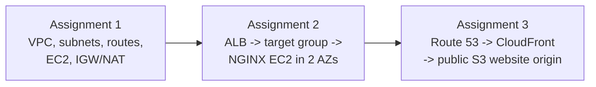

# AWS — THREADX | Three Infrastructure Assignments

Three CoderCo AWS assignments built and troubleshot in the AWS Console, using the THREADX fictional clothing storefront as the project theme. The sequence moved from **VPC networking**, to **EC2 load balancing and Auto Scaling**, to **S3/CloudFront static delivery**. The aim was not just to create AWS resources; it was to understand how a request moves, what can block it, what health checks actually measure, and how to prove a change worked.

**Region:** Europe (London), `eu-west-2`, unless noted. **Dates:** 6–8 November 2026. **Provisioning:** AWS Console, not Terraform. **Domain:** `threadx.muhyadinelmi.com` (the parent domain is managed through Cloudflare, with this subdomain delegated to Route 53).

> **Historical lab evidence, not a permanent production environment.** The NAT gateway/EIP and Application Load Balancer were deleted after testing; the Auto Scaling Group was scaled to zero; several EC2 instances were stopped. The Assignment 3 distribution and website were verified on 8 November 2026. Live availability and bills can change after that date. This repository does not claim that all three architectures are running simultaneously.

> **Evidence:** Nine cropped, real screenshots from the labs are committed below as optimised WebP images, positioned next to the explanations they support. They are historical captures, not proof that every AWS resource is still running.

## 1. Project map and evidence

| Assignment | What I built | What I verified | Detailed walkthrough |
|---|---|---|---|
| **1 — VPC and networking** | Custom VPC, public/private subnets, IGW, NAT gateway, route tables, public/private EC2, bastion access design | Resource configuration and routing, instance addressing, NAT available before cleanup | [Assignment 1](assignment-1/README.md) |
| **2 — ALB and Auto Scaling** | Two-zone NGINX EC2 app, ALB, target group, security groups, launch template / ASG, HTTPS listener | Healthy targets, alternating `curl` responses, third managed target healthy, browser HTTPS | [Assignment 2](assignment-2/README.md) |
| **3 — S3, CloudFront and Route 53** | Public S3 website, CloudFront distribution, ACM TLS certificate, Route 53 Alias, caching | Custom HTTPS site, `x-cache: Hit from cloudfront`, updated HTML, invalidation completed | [Assignment 3](assignment-3/README.md) |

**Supporting material:** [Mermaid architecture collection](architecture/README.md) · [Evidence index](evidence/README.md). Each assignment owns its screenshot plan and any relevant scripts. The overview deliberately stays concise; implementation details belong to the individual README.

## 2. Architecture evolution

**Important:** This is a learning progression, **not** a single live pipeline. Assignment 2's ALB was removed before Assignment 3's custom subdomain was repointed to CloudFront. S3 and CloudFront do not sit in the THREADX VPC or its subnets.

## 3. What each service was responsible for

| Service | Job in the lab |
|---|---|
| VPC / subnet / route table | Define the network address space, divide it into subnet ranges, and determine next-hop routes |
| Internet gateway / NAT gateway | IGW enables public routing; public NAT provided outbound IPv4 translation for the private subnet while it existed |
| Security group | Stateful traffic permission on EC2/ALB; **does not forward** requests |
| ALB / target group | ALB receives HTTP(S) traffic; target group registers backends and checks their health |
| Auto Scaling Group | Creates or removes EC2 instances to meet capacity settings; not a firewall or target group |
| NGINX / systemd | Web server on an EC2 instance; service state and boot enablement mattered for target health |
| S3 | Stores the static HTML objects outside my VPC |
| CloudFront | Global content delivery, HTTPS to viewer, caching and invalidations |
| Route 53 / ACM | DNS records for my subdomain / DNS-validated certificate for TLS |

## 4. Verification over assumptions

- **Assignment 1:** AWS displayed the VPC, subnet CIDRs, IGW and route associations; private EC2 had no public IPv4. NAT reached `Available` before deliberate deletion. **No successful full bastion SSH chain or private-instance egress test was captured**, so this README does not claim either.
- **Assignment 2:** The ALB's target group reached healthy status; repeated `curl` requests returned the App 1 and App 2 identifiers. A later resource map showed **three healthy targets**, including the additional instance. These are separate checks from merely seeing a green AWS resource-creation banner.
- **Assignment 3:** A public S3 website loaded; CloudFront `curl -I` produced `HTTP/2 200`, `x-cache: Hit from cloudfront` and a CloudFront `via` header. A `/*` invalidation completed, and the updated metallic-grey version was loaded using the custom HTTPS address.

## 5. Problems I ran into

| Problem | Diagnosis / resolution | Detailed section |
|---|---|---|
| EC2 launched into the wrong VPC | Verified the VPC ID/network fields instead of relying on the instance name | [Assignment 1](assignment-1/README.md#6-challenges-and-corrections) |
| Route tables and associations were confusing | Separated **which subnet uses this table** from **where packets go** | [Assignment 1](assignment-1/README.md#6-challenges-and-corrections) |
| NGINX target unhealthy | Missing `#!/bin/bash` in initial user data, then NGINX not enabled after restart; checked service and fixed boot behaviour | [Assignment 2](assignment-2/README.md#5-incident-notes-unhealthy-vs-healthy) |
| Public access / direct EC2 reachability confused with subnet routing | Reviewed public IPv4, SG rules, IGW route, listener and application as separate requirements | [Assignment 2](assignment-2/README.md#4-security-group-and-listener-boundaries) |
| Custom domain initially did not resolve | Compared recursive resolver with Route 53 authoritative NS and Google DNS; did **not** rebuild working infrastructure | [Assignment 3](assignment-3/README.md#6-dns-troubleshooting) |
| CloudFront could show an older file after S3 upload | Reuploaded `index.html`, invalidated `/*`, then checked the custom domain | [Assignment 3](assignment-3/README.md#7-cache-update-and-invalidation) |

## 6. Source and reproduction notes

The diagrams are architecture **records**, not infrastructure-as-code. Configuration was performed manually. The [Assignment 2 launch user-data](assignment-2/user-data/app2-bootstrap.sh) is documented because its exact contents were captured; one-off terminal recovery commands are explained separately. **No live credential, private SSH key, AWS access key or secret** is included.

The S3/CloudFront project follows the CoderCo brief's **public S3 website endpoint**. That endpoint is HTTP-only and publicly readable; HTTPS terminates at CloudFront. A more restrictive production setup would normally use a private S3 REST origin with CloudFront Origin Access Control (OAC), but that was **not** the architecture tested in this assignment.

## 7. Costs and cleanup

Stopping EC2 avoids compute runtime charges but can leave EBS and public-IP costs. Other billable items may include ALBs, NAT gateways, Route 53 hosted zones and CloudFront requests/transfer. I deleted the NAT gateway and its allocated EIP, deleted the ALB, brought the ASG to zero capacity and stopped practice EC2 instances. I kept certain stopped instances/volumes for later lab work; this is **not a claim of a zero-cost account**.

## 8. Evidence policy

The main README should not be a screenshot dump. Each assignment selects a small number of images, each with a short caption explaining **what it proves**; the [evidence index](evidence/README.md) maps screenshots and terminal transcripts to the appropriate claim. Where a screen only shows configuration, I label it *configured*, not *end-to-end tested*. Public screenshots should omit account identity, unrelated tabs and personal data.

**Out of scope:** Assignment 4 (API Gateway/Lambda/DynamoDB), a CI/CD pipeline, WAF, private S3/OAC, and claims of Terraform reproducibility.
