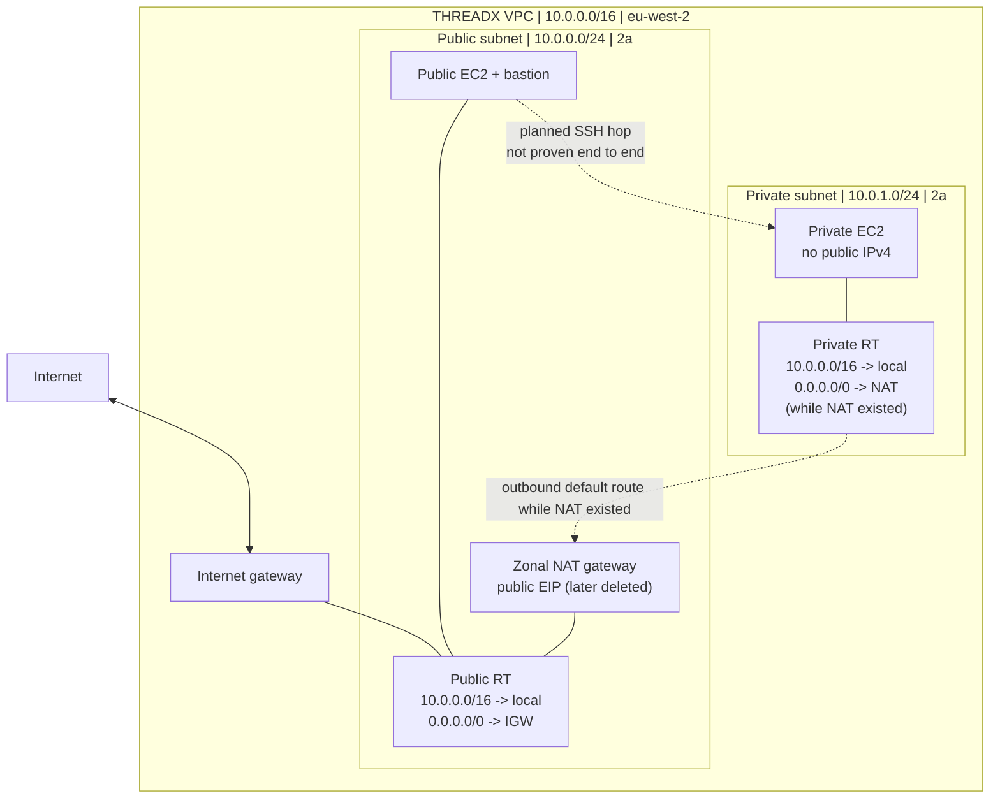
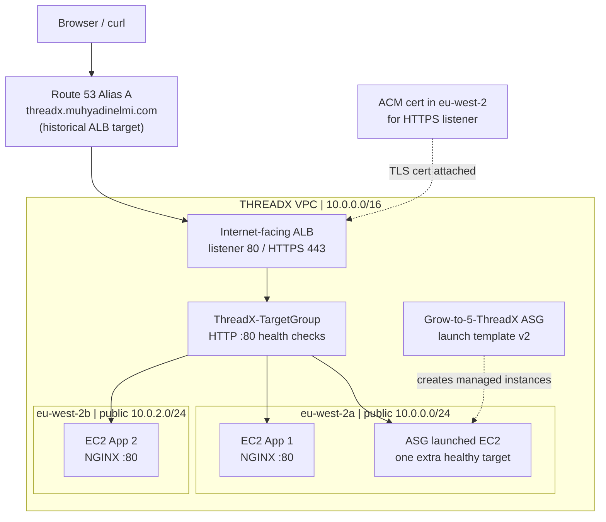
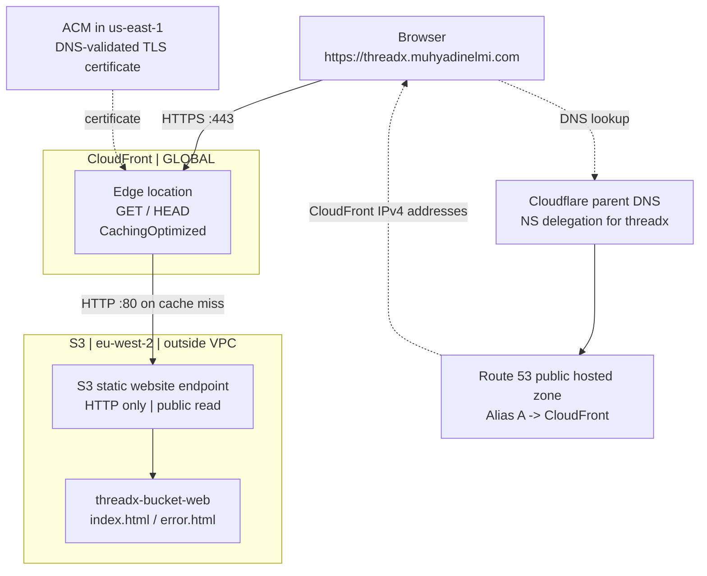

# THREADX — Architecture reference

**Read the [Assignment 1](assignment-1/README.md), [Assignment 2](assignment-2/README.md) and [Assignment 3](assignment-3/README.md) READMEs first.** They contain the build decisions, troubleshooting and screenshots. This file is just a convenient way to compare the three Mermaid diagrams.

These are **three successive historical labs**, not one permanently running architecture. The ALB was deleted before the custom DNS name was repointed to CloudFront.

## 1. Public/private VPC routing

The NAT was later removed. A configured private route or bastion security rule is not proof of a successful SSH or outbound connection.

## 2. ALB, EC2 targets and Auto Scaling

Healthy describes the ALB health-check status. It does not replace an actual application response test.

## 3. S3, CloudFront and DNS

DNS provides the address to connect to; CloudFront receives the HTTPS web request, uses its cache and can fetch public S3 website content over HTTP.

[← THREADX overview](README.md)
