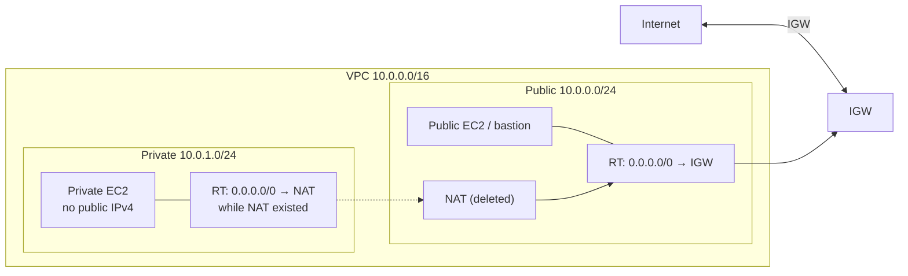
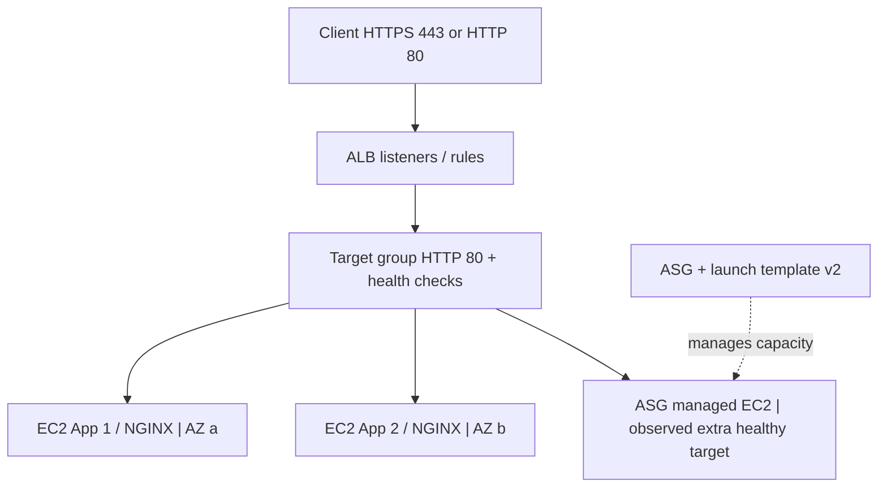
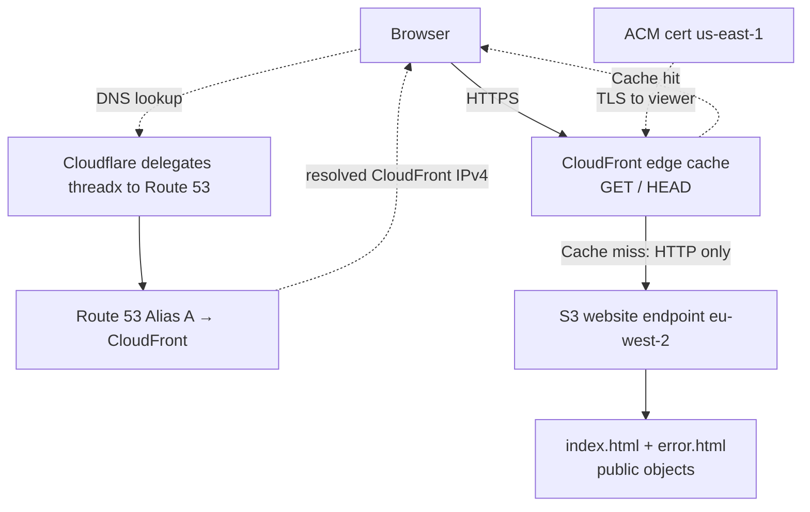

# THREADX architecture diagrams

These are **historical snapshots of three successive assignments**, not a single deployed production topology. The individual README files explain exact settings, failures and verification.

## Assignment 1 — VPC routing

**Evidence boundary:** bastion and private internet egress were configured but not confirmed end to end. NAT was later removed.

## Assignment 2 — Healthy target group

**Healthy** = the target passed the configured ALB health checks; it does not mean all application functionality was tested. NGINX boot/service corrections were required during this lab.

## Assignment 3 — CloudFront edge delivery

The AWS S3 website endpoint is **outside any user-managed VPC**. The origin is public HTTP; viewer HTTPS is supplied by CloudFront. DNS is a name-resolution step, not a proxy hop carrying the site's data.

[← AWS overview](../README.md)
