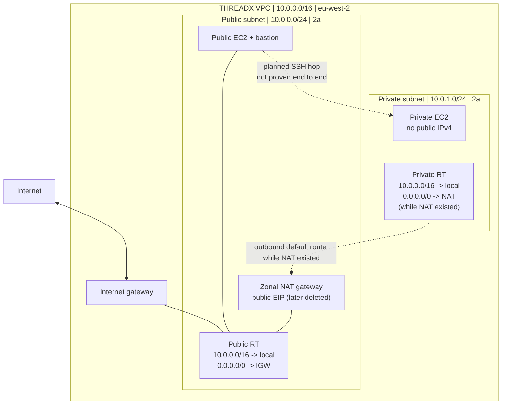

# Assignment 1 — Building a VPC from scratch

[← THREADX overview](../README.md) · [Assignment 2 →](../assignment-2/README.md)

## 1. What I was trying to build

The CoderCo task was to create the foundations of a VPC network: public and private subnets, an Internet Gateway (IGW), a NAT Gateway, route tables and EC2 instances. I built it in **London (`eu-west-2`)** using the name **THREADX**.

This is the assignment where I had to slow down. I knew the words VPC, subnet, route table and public IP, but I was still mixing up what each one actually did. I wanted to finish with a network I could explain, not just a list of AWS resources.

| Component | My configuration |
|---|---|
| VPC | `THREADX_VPC` — `10.0.0.0/16` |
| Public subnet | `pub-threadx` — `10.0.0.0/24` — `eu-west-2a` |
| Private subnet | `piv-threadX` — `10.0.1.0/24` — `eu-west-2a` |
| Internet Gateway | `ig-threadX` attached to the VPC |
| Public route table | `10.0.0.0/16 → local` and `0.0.0.0/0 → IGW` |
| Private route table | `10.0.0.0/16 → local` and `0.0.0.0/0 → NAT` while NAT existed |
| NAT Gateway | `ng-threadX`, zonal/public, with Elastic IP; later deleted |
| Instances | Public EC2, private EC2 without public IPv4, public bastion EC2 |

## 2. How I designed the network



A packet addressed to another private IP inside `10.0.0.0/16` matches the **local** route. Traffic to destinations outside the VPC needs an appropriate next hop. The public subnet's default route went to the IGW. The private subnet's default route went to the NAT Gateway **while that NAT existed**.

My biggest early mistake was thinking an EC2 is publicly accessible simply because it's in a subnet called “public”. The subnet needs an IGW route, but for direct IPv4 access the instance also needs a public address, an allowing security group, and a program actually listening on the destination port.

## 3. Building it in the AWS Console

### VPC and subnet ranges

**Console:** VPC → Your VPCs → Create VPC → **VPC only**. I chose the manual route so I could connect the resources myself. Then I went to **Subnets → Create subnet**, selected the THREADX VPC and allocated the two `/24` networks.

`10.0.0.0/16` is the parent range. `10.0.0.0/24` and `10.0.1.0/24` are two different ranges *inside* it. Each `/24` contains 256 IPv4 addresses in theory; AWS reserves five per subnet, so **251 are available** for use.

I initially made CIDR mistakes and sometimes looked at resources from the default VPC, where I saw `172.31.x.x` addresses. The practical fix was to verify the **VPC ID** and actual CIDR, not rely on the name or assume the Console was showing the right network.

### Internet Gateway and route tables

**Console:** VPC → Internet gateways → Create → **Attach to VPC**. Creating the gateway and attaching it were separate steps. Then **Route tables → Create route table → Routes → Edit routes**.

I had to get one distinction straight:

- **Routes** answer “where should traffic destined for this IP range go?”
- **Subnet associations** answer “which subnets use this route table?”

I associated the public subnet with the IGW table and the private subnet with the NAT table. I also learned that an unassociated subnet still has the VPC's main route table; it doesn't have “no routing”.

**Evidence — [open my route-table screenshot](screenshots/01-vpc-route-tables.webp).** This shows the recorded private route configuration. It proves the route existed, **not** that a private-instance internet test succeeded.

### NAT Gateway and Elastic IP

**Console:** EC2 → Elastic IPs → Allocate; then VPC → NAT Gateways → Create NAT Gateway. I selected **Zonal**, **public connectivity**, the public subnet and the EIP.

The point of the NAT Gateway was to give a private instance a route for **outbound IPv4 internet connections** without giving the instance a public IPv4 address. The gateway doesn't turn the private instance into a publicly reachable web server.

**Evidence — [open my NAT configuration screenshot](screenshots/03-nat-configuration.webp).** This image shows the choices I made during creation. The gateway later reached **Available** in the Console, but the screenshot itself is a configuration view.

I deleted the NAT Gateway and released its EIP once the exercise was finished. Leaving an old private route pointing at a deleted NAT does **not** mean private egress still works.

### EC2 instances and the bastion

**Console:** EC2 → Instances → Launch instances → Network settings. The most important part of this step for me was selecting **THREADX VPC first**, then the appropriate subnet and public-IP choice.

I created a public-facing EC2, a private EC2 without a public IPv4, and a bastion instance in the public network for the intended SSH path. The bastion idea was:

```text
My Mac --SSH/22--> bastion public address
Bastion --SSH/22--> private EC2 private address
```

A security group permitting port 22 is not itself a tunnel. The second SSH connection has to happen from the bastion to the private host. I configured the path but **did not capture a successful end-to-end SSH session** into the private EC2.

**Evidence — [open my private EC2 screenshot](screenshots/02-private-ec2-no-public-ip.webp).** It shows the EC2 address details after launch, including the absence of a public IPv4. That is what the image proves; it is not a successful SSH screenshot.

### A basic EC2 bootstrap example

For a future replay, I added a small [public EC2 NGINX user-data example](user-data/public-ec2-nginx-example.sh) using Ubuntu/`apt`. **This is a reconstructed example**, not a claim that I ran this exact script during Assignment 1. It gives me a repeatable way to put a basic test webpage on a public Ubuntu EC2:

```bash
#!/bin/bash
set -e
apt-get update -y
DEBIAN_FRONTEND=noninteractive apt-get install -y nginx
systemctl enable --now nginx
echo '<h1>THREADX public EC2 test</h1>' > /var/www/html/index.html
```

User data is a bootstrapping mechanism; it doesn't configure VPC routes, allocate a public IP or open the security group. That distinction matters. The **actual captured** App 2 user-data script is in [Assignment 2](../assignment-2/user-data/app2-bootstrap.sh).

## 4. What went wrong

**I chose the wrong VPC for an EC2.** Seeing a `172.31.x.x` address made me check which VPC I had launched it into. I needed to stop treating names as proof and check the network configuration itself.

**I was confusing address counts with ranges.** I could remember that a `/24` has 256 addresses, but I still got tripped up on counting from zero, usable addresses, and how the parent `/16` can hold multiple `/24` subnets. That's revision material, not something I want to pretend was effortless.

**I kept looking at routes and associations like they were the same setting.** They aren't. Writing the route is one operation; associating the subnet is another.

**I overestimated what a public subnet does.** A route to an IGW doesn't bypass a security group, start SSH, or assign a public IPv4 to the EC2.

## 5. How I verified it

| Check | What I actually saw | Result |
|---|---|---|
| VPC, subnets and CIDRs | Correct THREADX network ranges in the Console | Configured |
| Route tables | Public default route to IGW; private default route to NAT | Configured |
| NAT Gateway | Available before deleting it | Observed |
| Private EC2 | Private IPv4 present, public IPv4 absent | Observed |
| Bastion → private SSH | Security group rules and intended path | **Not verified end to end** |
| Private EC2 → internet | NAT path planned/configured | **Not verified end to end** |

I would rather leave those last two unchecked than write a good-looking README that claims something I cannot demonstrate.

## 6. What I learnt and what I want to improve

I finished with a much better picture of **subnet CIDR → route table association → next hop → EC2 address → security group**. The things that still need repetition are CIDR calculations, tracing routing decisions on my own, then proving both an SSH bastion hop and private outbound connectivity in a clean new lab.

**Cleanup:** NAT Gateway and EIP deleted to avoid further charges; EC2 instances stopped after the lab. Stopped EC2 can still leave billable EBS storage.

[← THREADX overview](../README.md)
