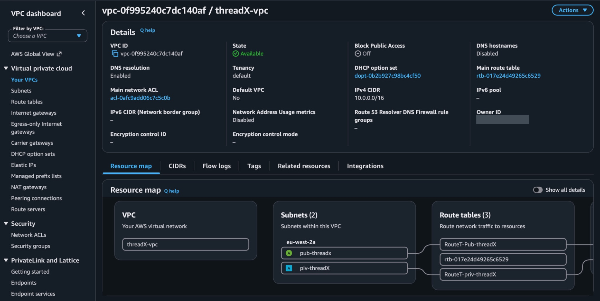
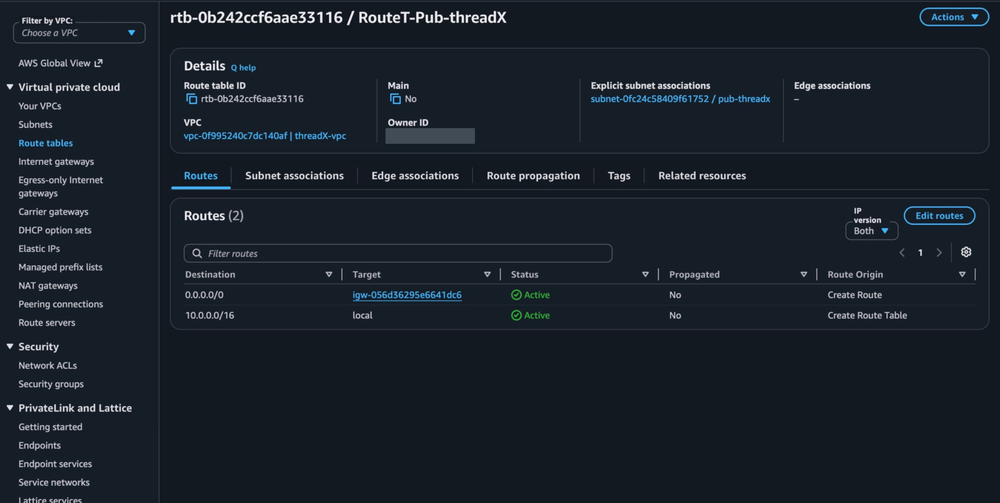
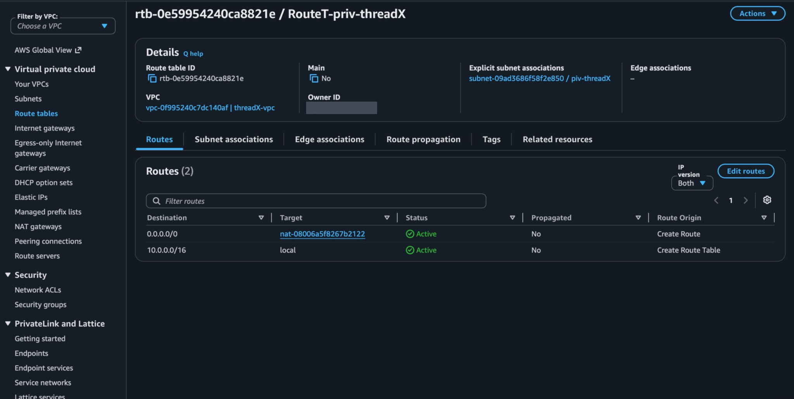
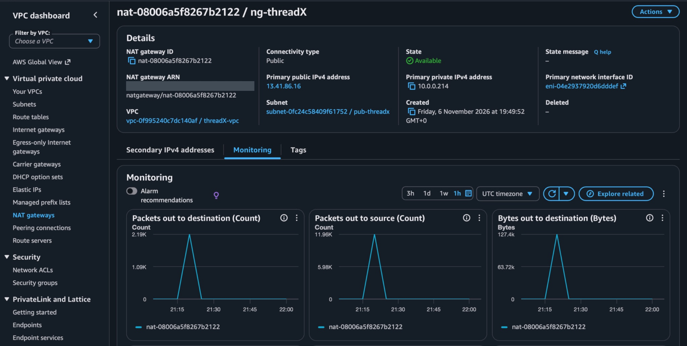
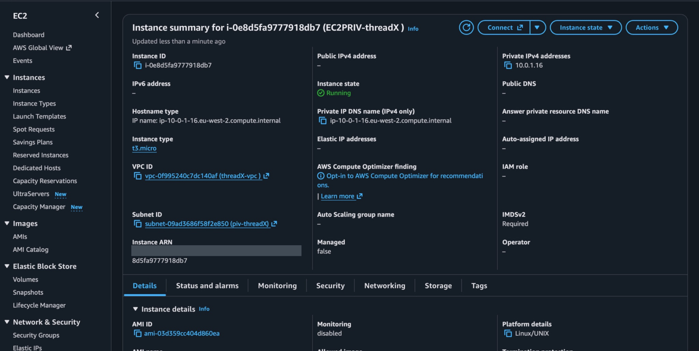
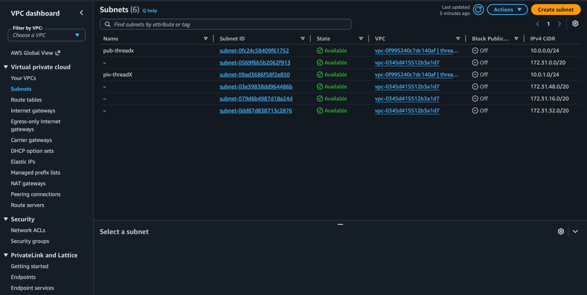
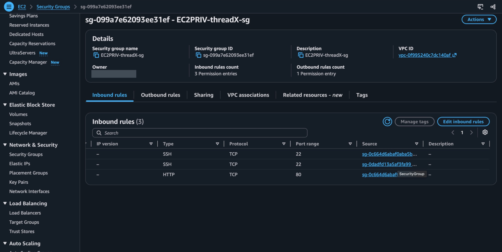

# Assignment 1 — VPC & Networking

[← AWS assignments](../README.md) · [Assignment 2 →](../assignment-2/README.md) · [Architecture](../zz-architecture.md)

## Objective

Build a custom VPC with a public and private subnet, give the public subnet an Internet Gateway route, give the private subnet a NAT route, and launch EC2 instances with the correct addressing and security groups.

## Implementation

| Task | My AWS configuration |
|---|---|
| VPC | `threadX-vpc` — `10.0.0.0/16` in `eu-west-2` |
| Subnets | Public `pub-threadx` (`10.0.0.0/24`) and private `piv-threadX` (`10.0.1.0/24`), both in `eu-west-2a` |
| Internet Gateway | `ig-threadX` attached to the VPC |
| Public route table | `RouteT-Pub-threadX`: `10.0.0.0/16 → local` and `0.0.0.0/0 → ig-threadX`, associated with the public subnet |
| NAT and private routing | Elastic IP on public NAT Gateway `ng-threadX`; private table `RouteT-priv-threadX` used `0.0.0.0/0 → ng-threadX` while the NAT existed |
| EC2 | Public instance `EC2Pub-threadX` at `10.0.0.243` with a public IPv4; private instance `EC2PRIV-threadX` at `10.0.1.16` without a public IPv4 |
| Security groups | Public EC2 SSH/HTTP limited to my lab client IP; private EC2 access limited to internal security-group sources. Optional bastion `Bastion-1` was configured for SSH access. |

The public subnet had an IGW default route; the private subnet used NAT for its configured outbound path. Neither a route nor an EC2 “Running” state alone proves a successful connection.

## Evidence from my AWS Console

*VPC resource map showing subnet and route-table relationships.*

*Public route table and subnet association with the Internet Gateway default route.*

*Private route table and subnet association with a default route to NAT.*

*NAT Gateway in Available state with an Elastic IP and monitoring activity.*

*Private EC2 running at 10.0.1.16 with no public IPv4 address.*

*Public and private /24 subnet ranges inside the custom /16 VPC.*

*Saved private-instance SSH rule includes the bastion security group as a source.*

## One issue I fixed

**Bastion access rules:** The private instance initially trusted the public EC2 security group, but the bastion used a different group. I corrected the bastion's inbound SSH rule and allowed the bastion group as an SSH source on the private instance. The saved rules show the fix; I did not capture a successful SSH session through the bastion.

**Lesson learned:** Network routing, public IP assignment, security-group rules and a working SSH session are separate checks. I should verify each layer instead of assuming one proves the others.

## Verification boundary

I captured the VPC configuration, subnet and route associations, the NAT's Available state, private-instance addressing and corrected security-group rules. I did **not** capture a successful private EC2 internet request or a complete bastion-to-private SSH session. CloudWatch Agent monitoring was not demonstrated; the optional bastion was configured but its end-to-end connection was not verified.

[Next: ALB and Auto Scaling →](../assignment-2/README.md)
