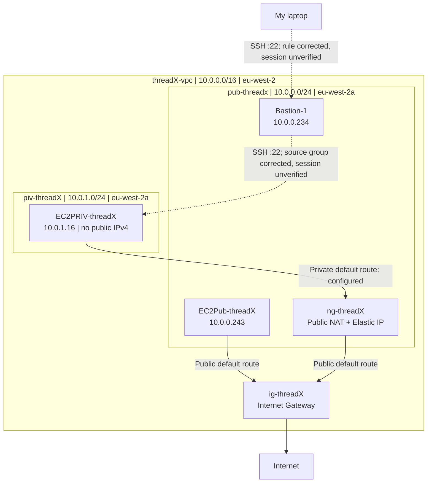
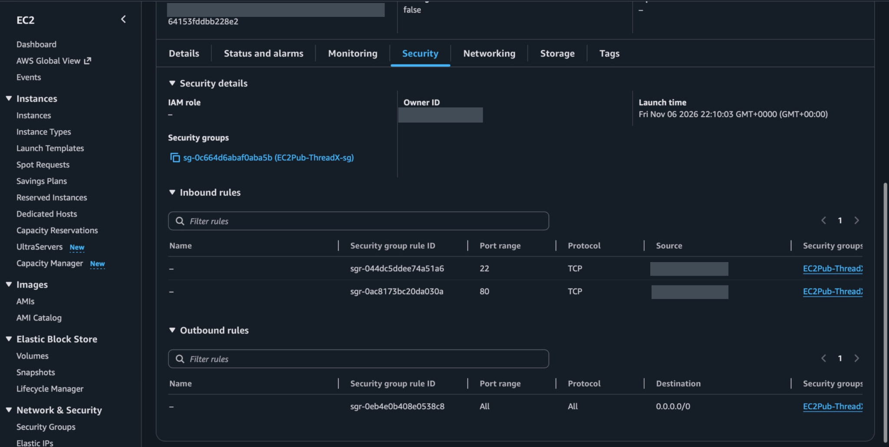
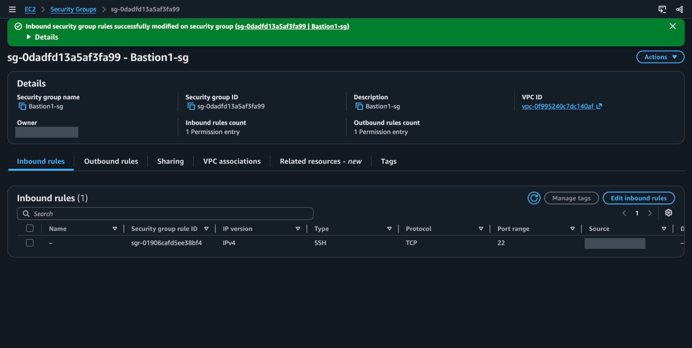

Assignment 1 — VPC and Networking
==================================

[AWS overview](../README.md) · [Next: ALB and Auto Scaling](../assignment-2/README.md)

Overview
--------

I built a custom VPC in London to understand how subnet ranges, route tables, internet access and EC2 security groups fit together. I created public and private networks, attached an Internet Gateway and configured a public NAT Gateway for private outbound traffic.

The captures show the network configuration and later corrections to the bastion security groups. I did not capture a successful SSH session through the bastion or an outbound request from the private instance, so those remain unverified.

Architecture
------------

The solid paths describe the configured routing while the NAT Gateway existed, not successful connectivity tests. The dashed SSH paths describe the corrected permissions, not a demonstrated SSH session. `Bastion-1` and `EC2Pub-threadX` were separate instances.

Configuration and decisions
---------------------------

| Component | Recorded configuration |
|---|---|
| VPC | `threadX-vpc`, `10.0.0.0/16`, `eu-west-2` |
| Public subnet | `pub-threadx`, `10.0.0.0/24`, `eu-west-2a` |
| Private subnet | `piv-threadX`, `10.0.1.0/24`, `eu-west-2a` |
| Public route table | `RouteT-Pub-threadX`: `10.0.0.0/16 → local`; `0.0.0.0/0 → ig-threadX` |
| Private route table | `RouteT-priv-threadX`: `10.0.0.0/16 → local`; `0.0.0.0/0 → ng-threadX` during the lab |
| NAT | `ng-threadX`, public connectivity, zonal placement in the public subnet, Elastic IP |
| Public EC2 | `EC2Pub-threadX`, private address `10.0.0.243`, with a public IPv4 |
| Private EC2 | `EC2PRIV-threadX`, `10.0.1.16`, no public IPv4 |
| Bastion | `Bastion-1`, private address `10.0.0.234`, with a public IPv4 |

I used two `/24` subnets inside the `/16` so that their roles were explicit. Both were in one AZ; this was a routing exercise, not a multi-AZ availability design. The public NAT provided an outbound path without assigning a public IPv4 to the private instance.

Implementation walkthrough
--------------------------

**1. Create the VPC and subnets.** I used VPC → Your VPCs → Create VPC → VPC only, then created the two subnets in that VPC. The subnet list records the CIDRs; the resource map ties the subnet and route-table names to the same VPC. The default VPC's `172.31.x.x` ranges were separate resources, not part of THREADX.

<table>
<tr>
<td width="50%">
 
The two THREADX subnet CIDRs; default VPC subnets are separate resources.
</td>
<td width="50%">
 
Custom VPC: the two subnets and their route-table relationships.
</td>
</tr>
</table>

**2. Attach the Internet Gateway and associate route tables.** Creating `ig-threadX` was not enough; I attached it to the custom VPC. I then added the public default route and explicitly associated `pub-threadx` with its table. The private table kept its local route and used the NAT as the default destination.

<table>
<tr>
<td width="50%">
 
Public subnet association and default route to ig-threadX.
</td>
<td width="50%">
 
Private subnet association and 0.0.0.0/0 to the NAT Gateway.
</td>
</tr>
</table>

I had to distinguish the route from the association: a route selects a next hop for a destination; the association determines which subnet uses that table. A subnet without an explicit association still uses the VPC's main route table.

**3. Create the NAT Gateway.** I selected public connectivity, zonal placement, `pub-threadx` and an allocated Elastic IP. The later details view shows `Available`, private address `10.0.0.214`, public address `13.41.86.16` and traffic counters.

 
NAT Available with traffic counters; no source-instance attribution.

The metrics show activity at the NAT Gateway. They do not identify which instance generated it, so I cannot use them as proof of a successful private-EC2 internet request.

**4. Launch EC2 instances and check addressing.** I selected the VPC and subnet explicitly for each instance, rather than relying on the launch wizard's defaults. The private instance had `10.0.1.16` and no public IPv4. Its running state did not establish SSH access or working egress.

 
Private EC2 running without a public address; connectivity still needs its own test.

The existing [Ubuntu NGINX user-data example](user-data/public-ec2-nginx-example.sh) is a reconstructed replay example, not the original launch script. It uses `apt`; the captured lab AMI was Amazon Linux. I would not reuse that example on Amazon Linux without changing the package manager. User data bootstraps the instance; it does not create routes, allocate its public address or open the security group.

**5. Inspect and correct the security groups.** The public rules were captured on 6 November; the bastion and private-group corrections were saved on 7 November:

| Attached group | Inbound | Outbound |
|---|---|---|
| `EC2Pub-ThreadX-sg` | TCP `22` and `80` from my lab client `/32` | All traffic to `0.0.0.0/0` |
| `EC2PRIV-threadX-sg` | TCP `22` from the public EC2 group and, after correction, `Bastion1-sg`; TCP `80` from the public EC2 group | All traffic to `0.0.0.0/0` |
| `Bastion1-sg` | After correction, TCP `22` from my lab client `/32` | TCP `22` to `EC2PRIV-threadX-sg` |

These addresses and rules are historical lab settings. In particular, the public EC2's HTTP rule was client-restricted, not open to every internet visitor.

 
Historical public EC2 rules: TCP 22 and 80 from the lab client /32; client address redacted.

<table>
<tr>
<td width="50%">
 
Saved correction: bastion ingress changed to SSH from the client /32, whose address is redacted.
</td>
<td width="50%">
 
Saved correction: private SSH now trusts Bastion1-sg; the older public-group rules remain.
</td>
</tr>
</table>

Verification
------------

| Check | Evidence | Conclusion |
|---|---|---|
| VPC, subnet CIDRs and associations | Resource map, subnet list and both route-table views | Captured configuration |
| IGW attachment | Original gateway details show `Attached`; the resource map and public route retain its relationship | Captured configuration |
| NAT state and activity | `Available`, public/private addresses and monitoring counters | Captured observation; source instance not established |
| Private EC2 addressing | Running instance with `10.0.1.16`, public IPv4 absent | Captured observation |
| Bastion → private SSH | Later saved groups show client SSH ingress and the actual bastion group as a private SSH source | Permissions corrected; session not verified |
| Private EC2 → internet | Route exists, but no successful request from that instance was captured | Not verified end to end |
| Detailed monitoring / CloudWatch Agent | EC2 summary shows Monitoring disabled; no agent or alarm evidence | No claim of detailed EC2 monitoring or agent installation |

Troubleshooting
---------------

**CIDRs and the wrong VPC.** I initially mixed up the custom network and the default VPC. Checking the VPC ID and CIDR, rather than the display name alone, stopped me from treating `172.31.x.x` addresses as THREADX addresses. I also needed to revisit subnet arithmetic: a `/24` contains 256 addresses, with five reserved by AWS and 251 usable.

**Correcting the bastion rules.** The early private group trusted the public EC2 group, but `Bastion-1` used a different group, `Bastion1-sg`. The early bastion also allowed HTTP rather than SSH ingress. On 7 November I replaced that ingress with client-restricted SSH and added `Bastion1-sg` as a private SSH source. The saved-rule captures establish those corrections. They do not establish a successful SSH hop; the private group also retained SSH from the public EC2 group, so the final permissions were broader than a bastion-only design.

**Public subnet versus public access.** An IGW route alone does not assign a public IP, open a security group or start a listening service. I needed to check those separately. Likewise, an active route to a NAT Gateway is not a record of a successful outbound request.

Lessons learned
---------------

The useful sequence for me is: destination IP → subnet route table → next hop → instance address → security-group rule → listening service. Keeping those responsibilities separate makes a failed connection easier to investigate.

This assignment also taught me to inspect the rule references, not just confirm that a group exists. My next replay needs a captured working SSH hop and a captured outbound request from the private EC2, with the gateway metrics used as supporting evidence rather than the only test.

Cleanup and references
----------------------

My lab notes record deleting the NAT Gateway, releasing its Elastic IP and stopping practice instances. A former private default route to a deleted NAT is no longer a working egress path. Stopped instances can still retain chargeable storage.

[AWS route-table documentation](https://docs.aws.amazon.com/vpc/latest/userguide/VPC_Route_Tables.html) · [AWS subnet sizing](https://docs.aws.amazon.com/vpc/latest/userguide/subnet-sizing.html)

[AWS overview](../README.md)
