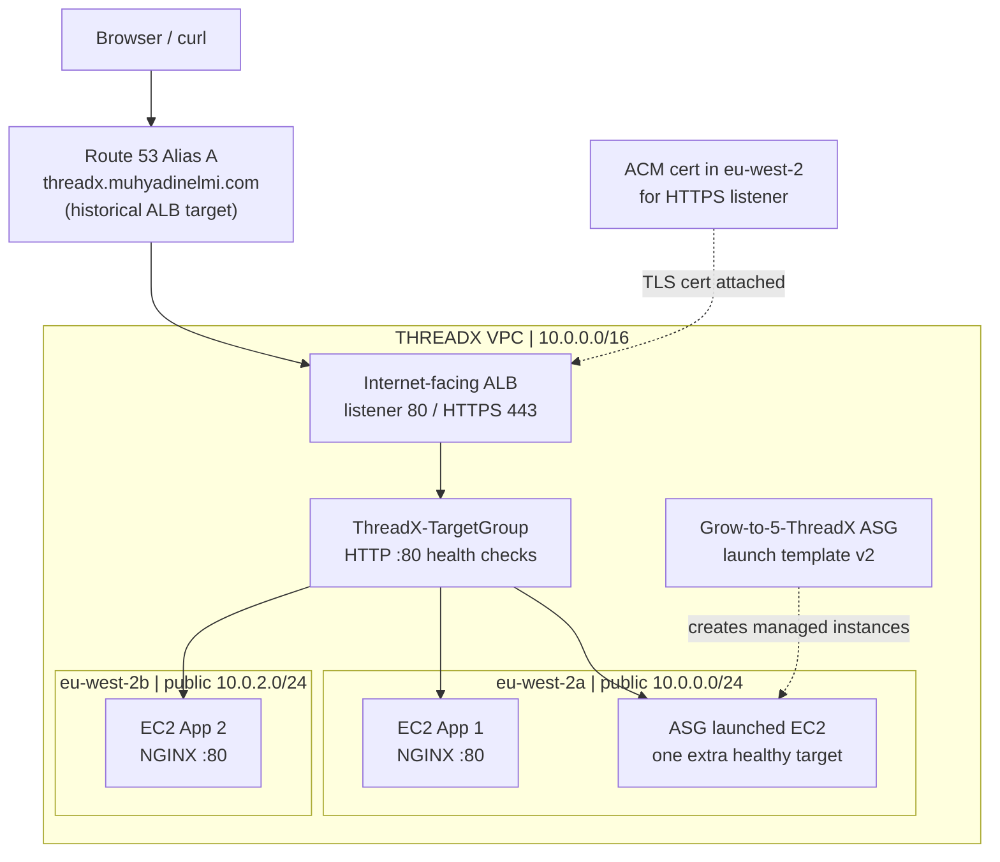

# Assignment 2 — ALB, healthy targets, Auto Scaling and HTTPS

## 1) Project overview

I used the existing THREADX VPC from Assignment 1 and built an internet-facing **Application Load Balancer (ALB)** that sent requests to **two NGINX-backed EC2 instances in two Availability Zones**. I added a launch template and Auto Scaling Group (ASG), checked a third healthy target, and extended the project with Route 53 and an ACM-backed HTTPS listener.

The important goal was to distinguish **Security Group vs Target Group vs Auto Scaling Group** and to test the actual response, not just the resource-creation screen.

## 2) Architecture



The diagram shows the **tested period**, before ALB deletion. A target group is not a service that launches servers; it registers them and checks health. The ASG launches/removes managed servers; the ALB forwards requests through its listener and target group.


*Evidence 1 — Three registered targets healthy at that time; this shows HTTP health-check success, not complete application functionality.*

## 3) Network and application configuration

| Component | Configuration / observation |
|---|---|
| VPC | THREADX, `10.0.0.0/16` |
| Public subnet A | `pub-threadx`, `10.0.0.0/24`, `eu-west-2a` |
| Public subnet B | `pub2-threadX`, `10.0.2.0/24`, `eu-west-2b` |
| ALB | `threadX-ALB`, internet-facing, IPv4 |
| Target group | `ThreadX-TargetGroup`, EC2 instance targets on HTTP 80 |
| Primary instances | App 1 `10.0.0.186` / App 2 `10.0.2.36` (private addresses) |
| ALB listener | HTTP 80 → target group; HTTPS 443 → same HTTP target group |
| ACM | Certificate in London (`eu-west-2`) for ALB listener |
| ASG | `Grow-to-5-ThreadX` with `ThreadX-ASG-Template`, default version **2** |
| Scaling | Observed a third healthy target; later ASG capacity set to zero and its managed instance terminated |

**Do not confuse:** The ASG name includes “5”, but that does **not** prove five instances were running. The screenshot shows **three** healthy registered targets at the relevant point.

## 4) Security group and listener boundaries

My ALB security group allowed web clients to reach HTTP/HTTPS listeners (80/443) and allowed outbound HTTP to the application security group. The application security group allowed inbound **HTTP 80 from the ALB security group**, rather than making the backend web port available from arbitrary public addresses. An additional restricted SSH rule/SG was used for App 1 troubleshooting.

**Request path:** visitor → ALB security group → ALB listener → target group → healthy EC2 `:80` → NGINX. The ALB terminates TLS at its HTTPS listener and forwards HTTP internally. Permissions in a security group are **not** instructions to forward traffic; the ALB's listener/target group perform forwarding.

**Public IP correction:** a public subnet route and an EC2 public IPv4 are separate properties. An ALB can receive internet traffic while its app targets are privately addressed, provided its VPC route, security groups and target health are correctly configured. Direct browser access to an EC2 is a separate test; public IPv4 matters there.

## 5) Incident notes: unhealthy vs healthy

### 5.1) What did "healthy" actually mean?

- **Registered:** EC2 was added to `ThreadX-TargetGroup`.
- **Health check:** The ALB periodically sent an HTTP request to the configured target/port and judged it against the health-check criteria.
- **Healthy:** The target passed enough consecutive checks and became eligible to receive normal forwarded requests.
- **Unhealthy:** The target failed checks; the ALB generally avoids forwarding to unhealthy targets when healthy ones are available. This does **not** automatically reveal whether the root cause is security group, NGINX, boot script or port.

A green EC2 **running** status is not proof that NGINX is listening. A green target health check is useful, but it proves only the health-check endpoint responded according to the configured criteria; it is **not** a full functional test of the entire application.

### 5.2) Bootstrap failure and recovery

**First issue — missing shebang.** The original App 1 EC2 user-data did not begin with `#!/bin/bash`, so NGINX installation did not run as intended. I investigated the instance instead of assuming a running EC2 meant the site was ready.

**Second issue — service did not survive restart.** After manual installation/start, the instance later restarted and NGINX was not enabled at boot, so the target became unhealthy again. The corrective command was:

```bash
sudo systemctl enable --now nginx
sudo systemctl status nginx
```

`systemctl enable` configures boot-time start; `--now` starts the service immediately. `status` is how I check the current service state. I also used target-group health status and browser/`curl` responses to verify the result outside the instance.


*Evidence 2 — The terminal showed nginx inactive/disabled. I ran `sudo systemctl enable --now nginx`; target health and responses were checked separately.*

### 5.3) Corrected second-instance user data

The complete second EC2 bootstrap, retained as [app2-bootstrap.sh](user-data/app2-bootstrap.sh), begins with the shell interpreter line and installs/starts NGINX. It writes an identifying page for App 2 so I can tell which instance answered.

This is a record of the App 2 bootstrap actually used, **not** a claim that all EC2s were provisioned from one identical script. The App 1 first-attempt user data was incomplete; I haven't invented a clean historical App 1 script.

### 5.4) Recovery sequence I can defend

1. Verify **Instances → instance state / VPC / IP**.
2. Verify **Target groups → Targets → health status** and reason.
3. Check security groups: ALB ingress, ALB-to-EC2 HTTP, and EC2 HTTP ingress from ALB SG.
4. Connect to the affected instance using the restricted administration path and check `sudo systemctl status nginx`.
5. Install/start/enable NGINX as needed, then retest from the ALB address with `curl`.
6. Confirm the target returns healthy and the expected HTML page.

This sequence reflects the issues encountered; it is not a claim that I inspected every possible health-check setting or system log.

## 6) Testing and evidence

The lab terminal repeatedly queried the ALB's AWS DNS name:

```bash
curl http://threadX-ALB-1786616983.eu-west-2.elb.amazonaws.com
```

Responses alternated between **“Welcome to THREADX Online Clothing Store - EC2 Application 1”** and **“... EC2 Application 2”**. This provided real application-level evidence of forwarding to more than one backend. The resource map later showed **three healthy** registered targets, consistent with an extra managed instance being present at that time.

After creating the Route 53 subdomain and validating the London ACM certificate, I added the HTTPS 443 listener and opened **`https://threadx.muhyadinelmi.com`** successfully through the ALB. That custom name was subsequently repointed to CloudFront for Assignment 3, so it **no longer represents this ALB**.

**Curated visual proof:** [screenshot plan](screenshots/README.md). Evidence is historical: the ALB was subsequently deleted.

## 7) The three groups — my mental model

| AWS term | Its job | What it does **not** do |
|---|---|---|
| **Security group** | Stateful firewall rule set permitting inbound/outbound traffic on supported resources | Does not send a web request to another EC2 |
| **Target group** | Registered backend targets + health-check rules used by an ALB listener | Does not launch or resize EC2 |
| **Auto Scaling Group** | Maintains configured EC2 capacity using a launch template and scaling settings | Does not act as an ALB listener or firewall |

**Launch template versions:** Creating version 2 did not create a differently named template; `ThreadX-ASG-Template` kept the same identity and the ASG used its **Default** version, which was updated to version 2. “Default” means which version the ASG is configured to reference, not “version 1.”


*Evidence 3 — ASG settings after scale-down show the Default template version selection. The ASG name does not mean five instances were running.*

## 8) What I learnt and what I'd test again

- Corrected unhealthy targets by checking NGINX state and startup, rather than assuming the ALB or security group was at fault.
- Learnt that **listener**, **target group**, **security group** and **ASG** have different responsibilities.
- Used two subnets in different AZs behind the ALB; they could use the *same* public route table if routes were identical.
- Verified actual response diversity with `curl`, not just a console screenshot.
- Need more practice building the full design again without hints, specifying health-check paths/thresholds from memory and validating scaling policies under controlled load.

## 9) Cleanup and scope

The ALB was deleted after evidence was captured, and the ASG desired/min/max capacity was reduced to zero to prevent replacement instances. The ASG-managed instance terminated; stopped practice EC2 instances and their EBS root volumes were not automatically deleted. The London ACM certificate did not replace the separate Virginia certificate required later by CloudFront.

No claim of stress-testing a five-instance production fleet, scaling on latency, or running this environment continuously is made.

[← AWS overview](../README.md)
