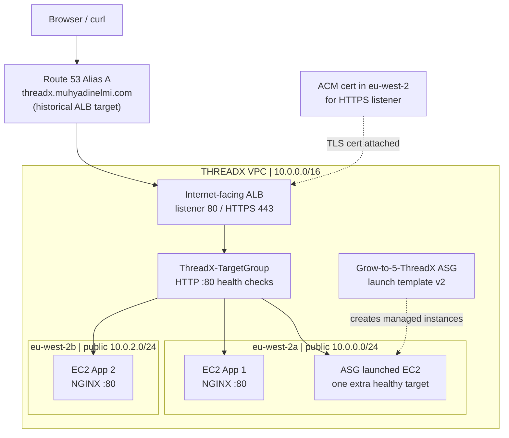

# Assignment 2 — ALB, Auto Scaling and fixing unhealthy targets

[← THREADX overview](../README.md) · [← Assignment 1](../assignment-1/README.md) · [Assignment 3 →](../assignment-3/README.md)

## 1. What I built

I wanted to take the VPC from Assignment 1 and see an actual web request distributed between **two EC2 applications in different Availability Zones**. I built an internet-facing Application Load Balancer (ALB), its target group, NGINX on two EC2 instances, the security groups, a launch template and an Auto Scaling Group (ASG). I later added HTTPS using ACM and Route 53.

I got things working, but not in a straight line. One instance was **running**, yet the target group still said **unhealthy**. That forced me to separate “the VM exists” from “my web server is alive”.

## 2. Architecture and request path



The actual HTTP request path was:

```text
Browser or curl
    -> ALB security group + listener (HTTP 80 / HTTPS 443)
    -> ThreadX-TargetGroup (HTTP 80)
    -> healthy EC2 target
    -> NGINX response
```

The target group is not another server and doesn't create EC2 instances. It contains the registered targets and the ALB's health-check configuration. The ASG is a separate resource responsible for launching or replacing instances according to capacity settings.

## 3. What I configured

| Resource | Recorded setup |
|---|---|
| Region/VPC | London `eu-west-2`; THREADX `10.0.0.0/16` |
| Public subnet A | `10.0.0.0/24` in `eu-west-2a` |
| Public subnet B | `10.0.2.0/24` in `eu-west-2b` |
| ALB | `threadX-ALB`, internet-facing |
| Target group | `ThreadX-TargetGroup`, instance targets, HTTP port 80 |
| App 1 | EC2 with NGINX; private IPv4 `10.0.0.186` |
| App 2 | EC2 with NGINX; private IPv4 `10.0.2.36` |
| ASG | `Grow-to-5-ThreadX` using `ThreadX-ASG-Template`, default version 2 |
| HTTPS | ALB listener 443 using ACM certificate in London; forwards to HTTP targets |

### Why two public subnets?

An internet-facing ALB needs subnet placement in at least two Availability Zones. The two public subnets could share one public route table because they used the same next hop, but the EC2s themselves lived in different subnet/AZ combinations.

### Why these security group rules?

The ALB security group allowed inbound web traffic on its listeners. The application security group allowed **HTTP 80 from the ALB security group**, rather than from arbitrary clients. I also used a separate, restricted SSH route for troubleshooting App 1.

I had to stop using “security group”, “target group” and “Auto Scaling Group” as if they all did some kind of routing:

- **Security Group:** permits or denies supported traffic on the associated AWS resource.
- **Target Group:** identifies ALB backends and tests their health.
- **Auto Scaling Group:** maintains a chosen number of EC2 instances from a launch template.

## 4. Healthy versus unhealthy — where the real troubleshooting happened

**Console:** EC2 → Target Groups → `ThreadX-TargetGroup` → **Targets**.

**Healthy** means the target passed enough checks against the configured health-check endpoint/port. **Unhealthy** means the checks failed. Neither state is a claim that every part of an application works. Equally, EC2 **Running** only means the VM is powered on, not that NGINX is serving port 80.

**Evidence — [open the ALB target-health screenshot](screenshots/01-alb-three-healthy-targets.webp).** It shows **three healthy registered targets** at one stage of the lab. The ASG name contains “5”, but I am not claiming five EC2s were running.

### Problem 1 — my first bootstrap did not run correctly

My initial App 1 user data was missing `#!/bin/bash`. NGINX did not get installed as expected during launch. I had to connect to the EC2 and investigate rather than keep changing the load balancer.

### Problem 2 — NGINX was not enabled at startup

I manually started NGINX, but after an EC2 stop/start it was no longer running. That explained why a previously healthy target became unhealthy again. The useful commands were:

```bash
sudo systemctl status nginx
sudo systemctl enable --now nginx
sudo systemctl status nginx
```

`status` checks the systemd service. `enable` configures it to start at boot, and `--now` starts it in the same command. I then checked the target group and re-ran the browser/`curl` test.

**Evidence — [open the NGINX service-recovery screenshot](screenshots/02-nginx-unhealthy-service-recovery.webp).** This is the actual `inactive (dead)` / disabled finding and the `enable --now` action. It's more valuable to me than an extra screenshot of a green resource-creation banner.

### The corrected App 2 user-data script

When launching the replacement App 2 instance, I used the following complete user data. I kept it in [`user-data/app2-bootstrap.sh`](user-data/app2-bootstrap.sh) as well:

```bash
#!/bin/bash
set -e
dnf install -y nginx
systemctl enable --now nginx
echo "<h1>Welcome to THREADX Online Clothing Store - EC2 Application 2</h1>" > /usr/share/nginx/html/index.html
```

This is the **actual App 2 user data** from the lab, on a `dnf`-based image. I am not presenting it as the exact script for App 1: that first launch had the missing-shebang mistake.

## 5. Proving the load balancer worked

I repeatedly queried the ALB DNS name from my Mac:

```bash
curl http://threadX-ALB-1786616983.eu-west-2.elb.amazonaws.com
```

The responses included:

```text
Welcome to THREADX Online Clothing Store - EC2 Application 1
Welcome to THREADX Online Clothing Store - EC2 Application 2
```

That is stronger evidence of forwarding to both instances than seeing “2/2 healthy” alone. It shows actual HTTP responses with different app identifiers. It doesn't prove perfectly equal distribution; just that both backends served requests.

When I added HTTPS, I configured an ACM certificate in **`eu-west-2`** and the ALB's 443 listener, with TLS terminating at the ALB and HTTP continuing to NGINX internally. That ALB was deleted after testing, and its former custom DNS name was repointed to CloudFront for Assignment 3.

## 6. Auto Scaling Group and launch template

The launch template was named `ThreadX-ASG-Template`. I made a **version 2** and configured the ASG to use its **Default** template version. The default pointer can change; it doesn't always mean version 1.

I observed a third target become healthy, alongside my two original app instances. Afterwards I scaled the ASG down to zero rather than leave it creating replacement instances and running up charges.

**Evidence — [open the ASG settings screenshot](screenshots/03-asg-template-version-2.webp).** It shows template version/capacity configuration. It is not proof that five instances ran or that I tested CPU-triggered scaling under load.

## 7. Where I struggled and what I learnt

**My initial instinct was to look at the load balancer whenever a target was unhealthy.** But the fault was on the instance: the script hadn't bootstrapped NGINX correctly, then the service wasn't enabled across restarts. This taught me to check from the bottom up: instance state → NGINX service → port/security rules → target health → real HTTP response.

**I mixed up the groups.** I now have a practical anchor: SG = permissions, TG = registered destinations and health checks, ASG = EC2 capacity.

**I was tempted to call the job finished when the Console turned green.** Running `curl` multiple times gave me much better evidence. There is still a difference between passing a health check and demonstrating how the application behaves.

For a future independent replay, I want to build the ALB/ASG from a blank VPC, choose health-check settings without guidance, then verify scaling with deliberate load rather than assume its name or desired capacity proves scaling worked.

**Cleanup:** ALB deleted; ASG scaled to zero; the ASG-managed instance terminated. Some stopped lab EC2s and EBS volumes remained.

[← THREADX overview](../README.md)
