Assignment 2 — ALB, NGINX and Auto Scaling
==========================================

[AWS overview](../README.md) · [Previous: VPC](../assignment-1/README.md) · [Next: S3 and CloudFront](../assignment-3/README.md)

Overview
--------

I extended the THREADX network with two NGINX applications in different Availability Zones, an internet-facing Application Load Balancer, a target group, a launch template and an Auto Scaling Group. I then connected the custom hostname and configured HTTPS.

Repeated requests returned both application identifiers. The build also exposed a bootstrap problem and an NGINX service that was not enabled at boot. Those failures helped me distinguish an EC2 running state from a healthy application.

Architecture
------------

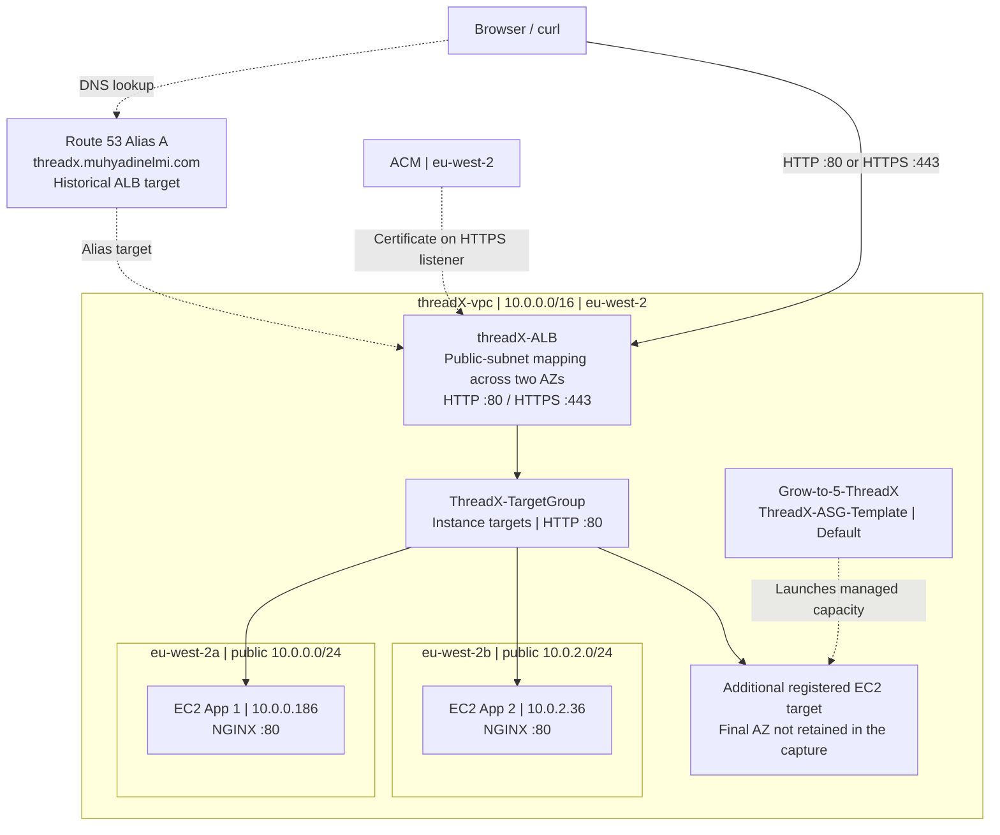

The solid arrows describe web requests. DNS and certificate attachment are separate relationships. The target group represents registered backends and health-check settings, not another server. The two named application instances were in public subnets; this is not a claim that I built the private-backend design used in some reference projects.

Configuration and decisions
---------------------------

| Component | Recorded setup |
|---|---|
| VPC | `threadX-vpc`, `10.0.0.0/16`, London `eu-west-2` |
| Public subnet A | `10.0.0.0/24`, `eu-west-2a`; App 1 at `10.0.0.186` |
| Public subnet B | `10.0.2.0/24`, `eu-west-2b`; App 2 at `10.0.2.36` |
| ALB | `threadX-ALB`, internet-facing; HTTP `80`, later HTTPS `443` |
| Target group | `ThreadX-TargetGroup`, instance targets, HTTP `80` |
| Launch template | `ThreadX-ASG-Template`; Amazon Linux 2023, `t3.micro`, 8 GiB gp3 in the captured creation view |
| ASG | `Grow-to-5-ThreadX`; template selector `Default`; cleanup capture shows desired `0`, limits `0–2` |
| TLS and DNS | ACM certificate in `eu-west-2`; Route 53 Alias A for `threadx.muhyadinelmi.com` |

I added pub2-threadX (`10.0.2.0/24`) in eu-west-2b and explicitly associated it with the existing public route table; both public subnets used the same IGW default route. The ALB needed mapping across two AZs. Its HTTPS listener terminated viewer TLS and forwarded HTTP to NGINX on port `80`.

The App 2 security view shows HTTP `80` sourced from `ALB-threadX-sg` (`sg-0e695b28211321595`) and outbound traffic to `0.0.0.0/0`. I added separate administrative SSH access during troubleshooting. This is captured configuration, not a direct-access rejection test.

<p>
<a href="screenshots/04-backend-security-rules.jpg">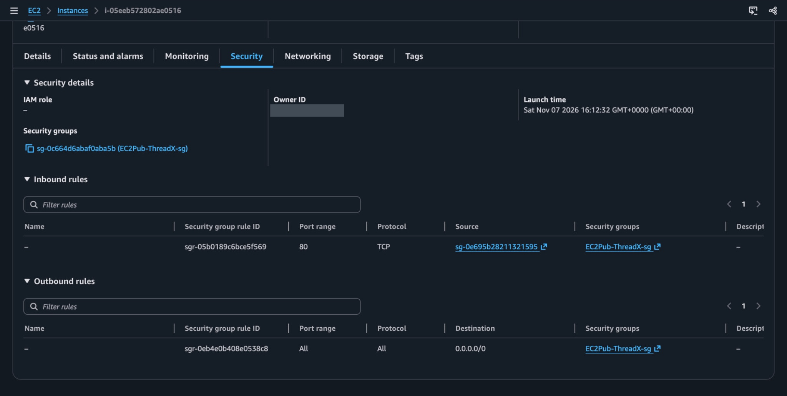</a><br>
<sub>App 2: HTTP 80 from the ALB group; outbound all traffic.</sub>
</p>

Implementation walkthrough
--------------------------

**1. Prepare the EC2 applications.** I used different page identifiers so that a response would show which instance handled it. The recorded [App 2 bootstrap script](user-data/app2-bootstrap.sh) was:

```bash
#!/bin/bash
set -e
dnf install -y nginx
systemctl enable --now nginx
echo "<h1>Welcome to THREADX Online Clothing Store - EC2 Application 2</h1>" > /usr/share/nginx/html/index.html
```

This is an Amazon Linux script using `dnf`. It is not the original App 1 script, which my notes identify as missing its shell shebang.

**2. Configure the ALB and target group.** I registered the application instances as HTTP targets on port `80` and used the ALB listener to forward requests to the group. The final resource map showed three healthy registered targets on port `80`. Earlier unhealthy states are retained below only where they explain the NGINX recovery.

<p>
<a href="screenshots/01-alb-three-healthy-targets.jpg">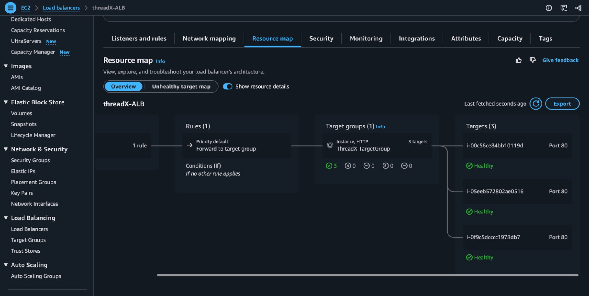</a><br>
<sub>Three healthy registered targets behind the HTTP listener.</sub>
</p>

Registration, health-check success and a completed HTTP request are different stages. That view does not prove an AZ failure test or an equal split of requests.

**3. Add a launch template and ASG.** I selected the Amazon Linux image, instance type, security group and storage in the template, then used it for managed capacity. The saved template view confirms version `2` became the default. The ASG selected `Default`, so its launches followed that pointer. Its capacity view records desired `0` and limits `0–2`; that is a point-in-time configuration, not proof that no managed instances ever ran.

<p>
<a href="screenshots/11-template-nginx-bootstrap.jpg">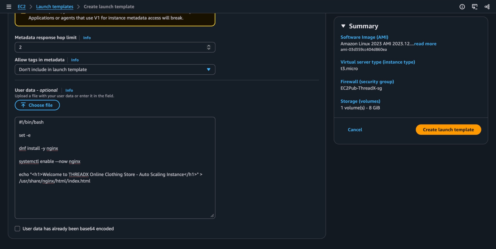</a><br>
<sub>Template user data: correct nginx package, shell shebang and enable --now.</sub>
</p>

<table>
<tr>
<td width="50%">
<a href="screenshots/06-launch-template-default-v2.jpg">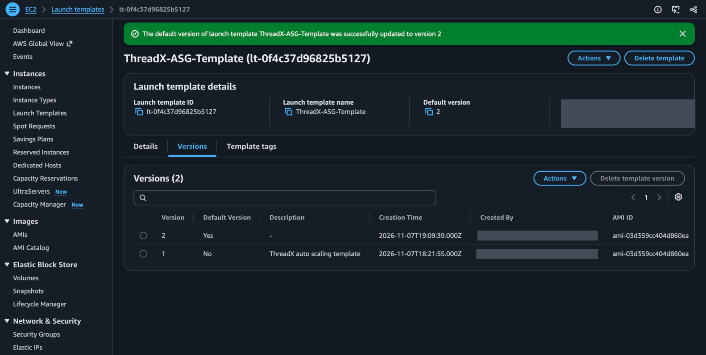</a><br>
<sub>Saved template version 2 is the default; owner fields redacted.</sub>
</td>
<td width="50%">
<a href="screenshots/03-asg-capacity-and-template.jpg">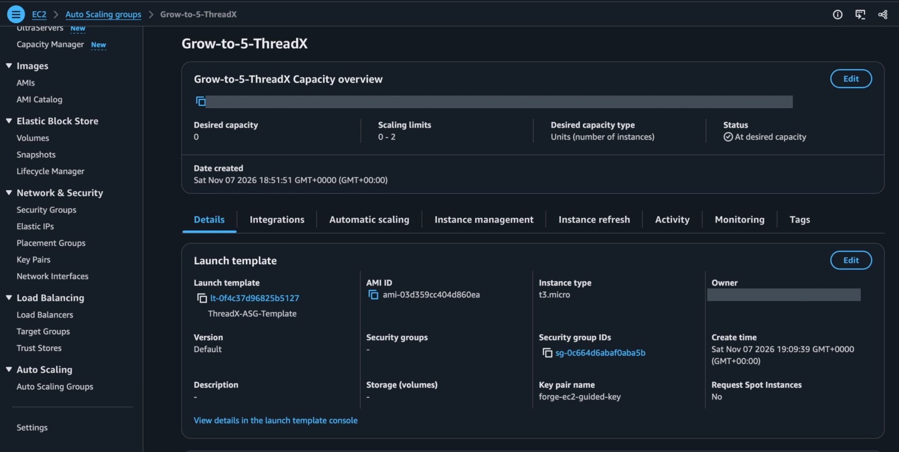</a><br>
<sub>ASG uses Default; captured desired capacity 0, limits 0–2.</sub>
</td>
</tr>
</table>

An early form had optional ELB checks unselected. The later creation review explicitly shows `EC2, ELB` and a `300`-second grace period, with the target group attached. I use that later review to document the intended health configuration; it does not prove replacement behaviour. I did not capture a load-driven scaling test or an application-failure replacement test.

<p>
<a href="screenshots/07-asg-health-check-review.jpg">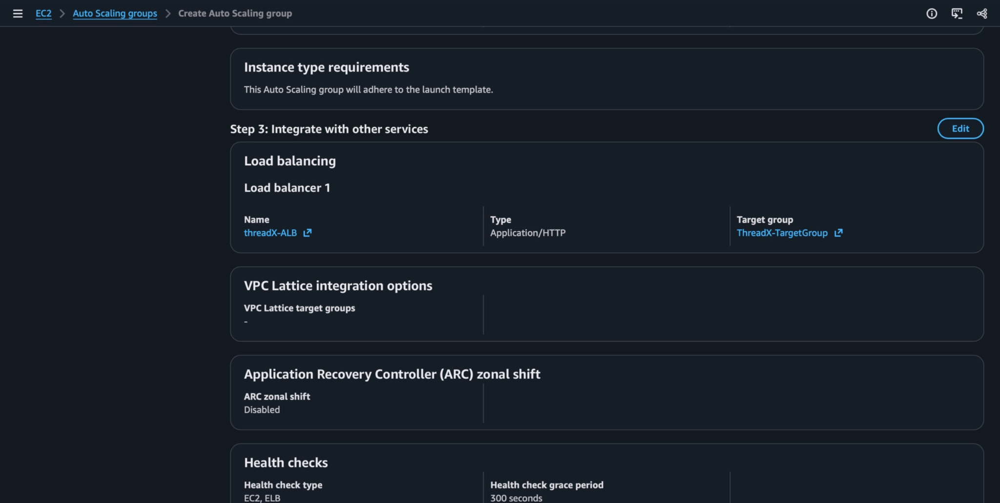</a><br>
<sub>Later review: target group attached; EC2 and ELB checks; 300-second grace period.</sub>
</p>

The ASG name contained “5”, but the saved cleanup capacity was desired `0`, minimum `0`, maximum `2`. I observed additional registered capacity during the lab; I did not demonstrate five running instances or CPU-triggered scale-out.

**4. Configure the custom domain and HTTPS.** I requested a DNS-validated ACM certificate in London, validated the hostname and attached a certificate to the ALB's HTTPS listener. The original certificate captures show Pending validation followed by Issued. The saved listener view below is stronger evidence of the resulting setup: HTTP `80` and HTTPS `443` both forward to `ThreadX-TargetGroup`, with the custom-domain certificate on the HTTPS listener. HTTP was still forwarded, not redirected to HTTPS in this ALB stage.

<p>
<a href="screenshots/08-http-https-listeners.jpg">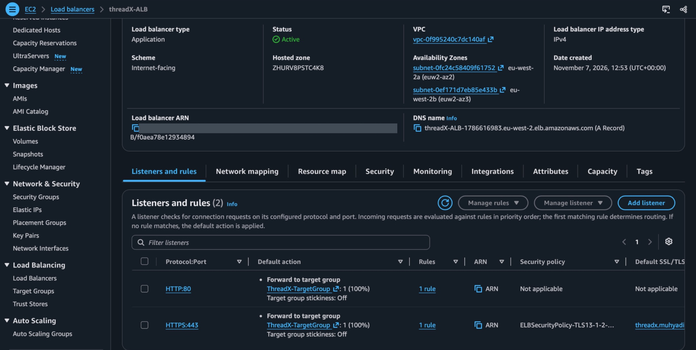</a><br>
<sub>Saved listeners: HTTP 80 and HTTPS 443 forward to the target group; HTTPS has a certificate.</sub>
</p>

The later browser capture below is the end-to-end check of the custom HTTPS address. This hostname was subsequently repointed to CloudFront for Assignment 3.

Verification
------------

I repeatedly ran the following request from my Mac:

```bash
curl http://threadX-ALB-1786616983.eu-west-2.elb.amazonaws.com
```

The captured responses included:

```html
<h1>Welcome to THREADX Online Clothing Store - EC2 Application 2</h1>
<h1>Welcome to THREADX Online Clothing Store - EC2 Application 1</h1>
```

The same terminal capture includes the historical DNS check:

```bash
dig +short threadx.muhyadinelmi.com
```

It returned `18.169.198.150` and `18.169.245.242` during the ALB stage. These are recorded answers, not addresses to hard-code or assume remain assigned to this project.

<table>
<tr>
<td width="50%">
<a href="screenshots/09-curl-backend-responses.jpg">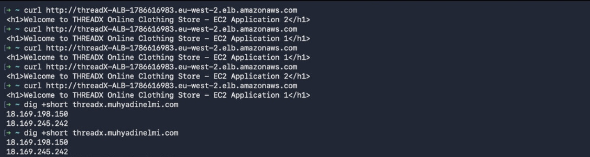</a><br>
<sub>Actual backend responses and historical DNS answers; cropped to the ALB test output.</sub>
</td>
<td width="50%">
<a href="screenshots/10-custom-domain-https.jpg">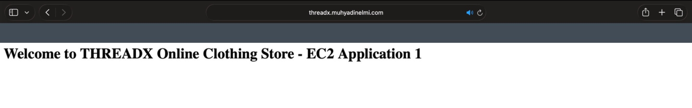</a><br>
<sub>HTTPS custom-domain request returns App 1, before the hostname moves to CloudFront.</sub>
</td>
</tr>
</table>

| Check | Evidence | Conclusion |
|---|---|---|
| Requests reach both applications | Repeated ALB `curl` responses with App 1 and App 2 identifiers | Captured end-to-end HTTP test |
| Target health | Resource map with three healthy HTTP targets | Captured health-check result at that point |
| Custom-domain HTTPS | Browser page at `https://threadx.muhyadinelmi.com`, displaying App 1 | Captured browser test; no separate TLS-cipher audit |
| ASG configuration and cleanup | Template selector and desired `0`, limits `0–2` | Captured configuration, not a scaling-under-load test |
| Extra capacity | Third healthy target; an earlier managed instance is associated with Grow-to-5-ThreadX in the archive | Registration captured; earlier instance details show ASG ownership, but the final target is not traced to a specific launch event |
| AZ outage, load-triggered scale-out and NGINX-driven instance replacement | No test evidence retained | Not verified |

Troubleshooting
---------------

<p>
<a href="screenshots/05-unhealthy-app1.jpg">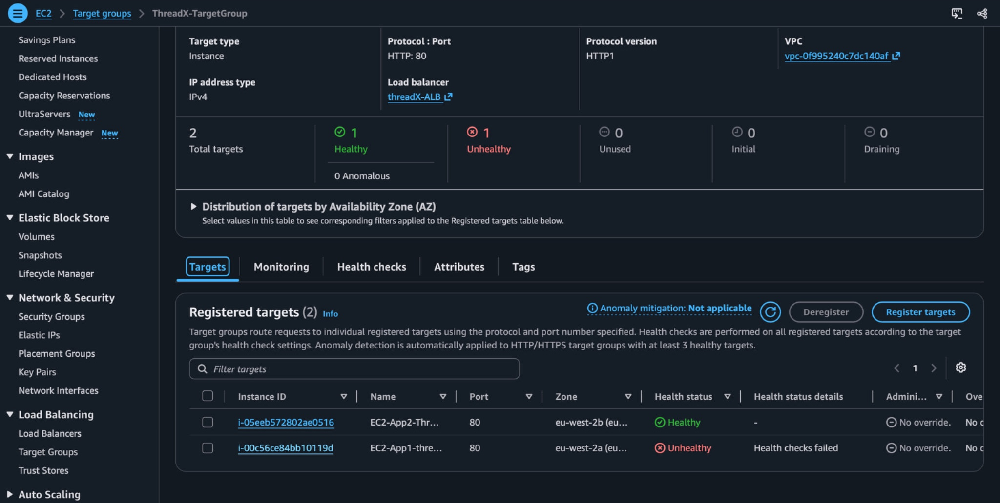</a><br>
<sub>Before recovery: App 1 health checks fail while App 2 is healthy.</sub>
</p>

**Bootstrap and service startup.** My notes record a missing `#!/bin/bash` in the initial App 1 user data. The retained terminal capture establishes a second, specific problem: NGINX was installed but `disabled` and `inactive (dead)` on App 1. I ran:

```bash
sudo systemctl status nginx
sudo systemctl enable --now nginx
sudo systemctl status nginx
```

The capture shows the first status and the `enable --now` command creating the systemd link; it does not show the final status command. The healthy-target view and actual responses provide separate evidence that the application subsequently served requests.

<p>
<a href="screenshots/02-nginx-service-recovery.jpg">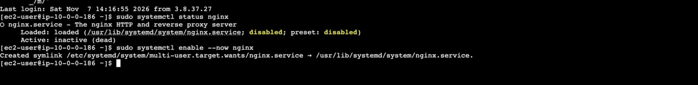</a><br>
<sub>App 1 service diagnosis and enable --now command; later healthy targets and responses verify service recovery.</sub>
</p>

I had initially treated an unhealthy target as a load-balancer problem. The useful order was to inspect the instance, the NGINX service, network permissions, target health and then the real response. Changing the ALB would not have started a stopped service.

**Certificate validation.** Pending validation was an intermediate certificate state, not evidence of a broken web server. I needed DNS validation to complete before using the certificate on the listener; the issued certificate and successful HTTPS browser request are different checks.

Lessons learned
---------------

Security groups control permitted traffic, target groups identify backends and test their health, and an ASG manages EC2 capacity. I needed to stop using those names as if they described the same responsibility.

The strongest result was the pair of backend identifiers in real HTTP responses. The next exercise should deliberately stop an application, observe ALB routing, inspect which health checks the ASG actually uses and then test replacement and scaling. That would establish behaviour this lab did not prove.

Cleanup and references
----------------------

My notes record deleting the ALB, setting the ASG to zero and terminating its managed instance. The saved ASG view confirms zero desired capacity. Some practice instances were stopped rather than terminated, so storage needed checking separately. The old ALB hostname is historical.

[AWS ALB target health](https://docs.aws.amazon.com/elasticloadbalancing/latest/application/target-group-health-checks.html) · [AWS Auto Scaling health checks](https://docs.aws.amazon.com/autoscaling/ec2/userguide/ec2-auto-scaling-health-checks.html)

[AWS overview](../README.md)
