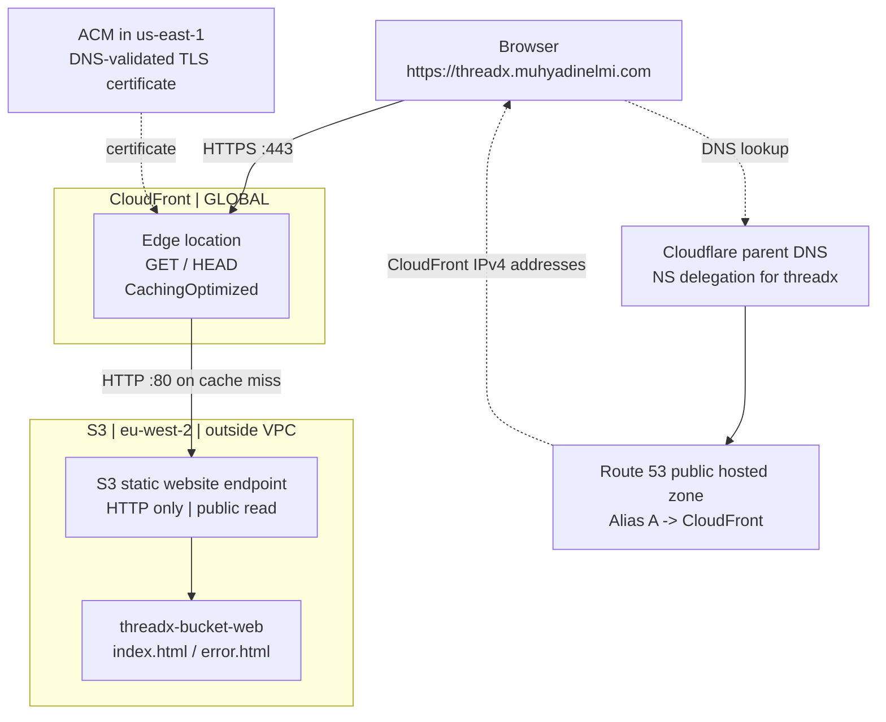
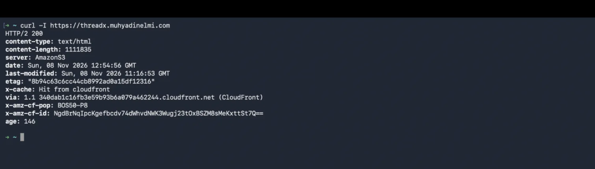
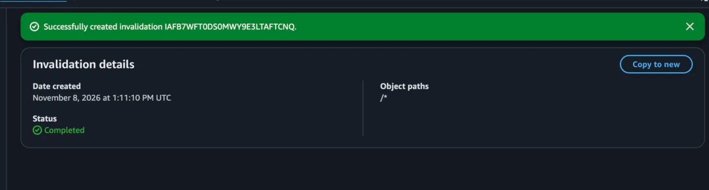
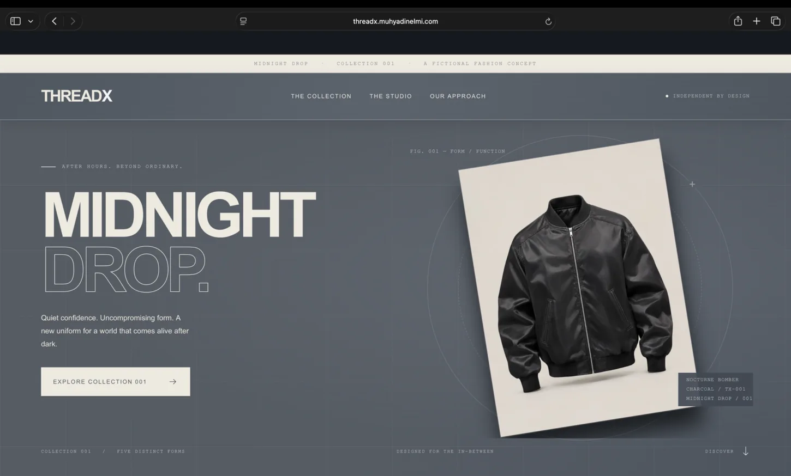

# Assignment 3 — S3 static website, CloudFront CDN and Route 53

## 1) Project overview

CoderCo required a public S3 static website containing `index.html` and `error.html`, distributed through CloudFront with HTTPS, compression, the managed `CachingOptimized` cache policy and GET/HEAD methods; a Route 53 Alias A record; then an update + cache invalidation test.

I reused the THREADX clothing-store theme. The storefront was generated outside this AWS repository, uploaded to S3 and then updated to a metallic-grey version. **This project documents the AWS hosting and delivery work, not authorship of the site's application design or HTML.**

## 2) Architecture



This is **not** a private S3 origin or a service in the VPC. DNS returns the IP addresses necessary for the browser to reach CloudFront; DNS does not deliver the HTML. CloudFront may serve the cached content directly without contacting S3 for every request.

## 3) S3 website setup

**Console:** S3 → Buckets → Create bucket → General purpose → `threadx-bucket-web` → London (`eu-west-2`). I kept object ownership as **Bucket owner enforced** (ACLs disabled), disabled public access blocking for this deliberately public-website assignment and used an explicit bucket policy to allow object reads.

The public-read permission's important fields were:

```json
{
  "Version": "2012-10-17",
  "Statement": [
    {
      "Sid": "PublicReadWebsite",
      "Effect": "Allow",
      "Principal": "*",
      "Action": "s3:GetObject",
      "Resource": "arn:aws:s3:::threadx-bucket-web/*"
    }
  ]
}
```

`s3:GetObject` allows reading objects, **not** public upload, list, delete or editing the bucket. The `/*` matches objects inside the bucket, not the bucket itself. The bucket policy uses JSON; `Statement` is an array containing a rule object.

**Console:** Bucket → Properties → Static website hosting → Enable → Host a static website → index document `index.html`; error document `error.html`. Both objects were uploaded directly to the **bucket root**, and the website endpoint was tested in the browser over HTTP.

**Website endpoint:** `threadx-bucket-web.s3-website.eu-west-2.amazonaws.com`. This is an AWS-managed HTTP hostname, not a newly registered domain or a second copy of the website.

## 4) CloudFront configuration

**Console:** CloudFront → Distributions → Create distribution. CloudFront is global; unlike EC2 and S3, I don't select one Region for its distribution.

| Setting | THREADX choice | Why |
|---|---|---|
| Origin | `threadx-bucket-web.s3-website.eu-west-2.amazonaws.com` | The CoderCo brief explicitly asks for the **S3 website endpoint**, not the bucket REST endpoint |
| Origin protocol | **HTTP only**, port 80 | S3 website endpoints do not support HTTPS |
| Viewer protocol | Redirect HTTP to HTTPS | Visitors connect securely to CloudFront |
| Allowed methods | GET, HEAD | Visitors fetch files / headers from a static site |
| Cache policy | Managed **CachingOptimized** | CDN caching, with Gzip/Brotli support |
| Origin path | Blank | `index.html` lives at the bucket root |
| WAF | Disabled | Not part of core Assignment 3; avoid unnecessary charge |
| Default root object | `index.html` | CloudFront serves the homepage when a viewer asks for `/` |
| Alternate domain name | `threadx.muhyadinelmi.com` | CloudFront must recognise requests using the custom hostname |
| Certificate | ACM `us-east-1` issued certificate for that name | CloudFront uses this for TLS to visitors |

**Critical distinction:** the ACM certificate terminates the **browser → CloudFront** HTTPS connection. CloudFront still fetches from the **public S3 website origin over HTTP**. This is what the assignment specifies, but it isn't end-to-end encrypted to the origin. A production setup requiring private origin access would use the S3 REST endpoint + OAC instead.

## 5) Domain configuration: Cloudflare, Route 53 and ACM

The parent `muhyadinelmi.com` is managed in Cloudflare. I delegated only the `threadx` subdomain to a Route 53 **public hosted zone** using four NS records in Cloudflare. The hosted zone contains an A record configured as an **Alias**. Yesterday that Alias pointed to the ALB; after the ALB was deleted I edited the **same record** to point to my CloudFront distribution.

**Why Alias = Yes:** Rather than entering hard-coded IPv4 addresses in an ordinary A record, I select the AWS distribution. Route 53 returns suitable CloudFront IPv4 addresses and follows the AWS-managed destination mapping. **CloudFront is not a DNS record**; it is the AWS resource selected as the Alias target.

**Why another certificate:** The old ALB certificate was in London, but CloudFront uses an ACM certificate from `us-east-1`. DNS validation succeeded via a CNAME record. The certificate being **Issued / In use** is not, by itself, proof the website DNS record works.

## 6) DNS troubleshooting

When I first opened `https://threadx.muhyadinelmi.com`, Safari reported it could not find the server. The normal A query initially returned no addresses, but the four NS records resolved:

```bash
dig +short NS threadx.muhyadinelmi.com
dig +short A threadx.muhyadinelmi.com
dig @ns-495.awsdns-61.com threadx.muhyadinelmi.com A +short
dig @8.8.8.8 +short threadx.muhyadinelmi.com A
nslookup threadx.muhyadinelmi.com
```

The **authoritative Route 53 server** returned four IPv4 addresses even while the default recursive resolver returned none. Google DNS later returned four addresses, and the website loaded. That strongly suggested a temporary resolver/cache delay, **not a proven defect in the Alias or certificate**. I avoided rebuilding infrastructure on the basis of one empty `dig`.

**Diagnostic distinction:** `@ns-495...` selects one specific authoritative nameserver. `@8.8.8.8` asks a public recursive resolver. `nslookup`'s “non-authoritative answer” is expected when the response comes from a recursive resolver.

## 7) Cache update and invalidation

With the CloudFront-backed domain working, I ran:

```bash
curl -I https://threadx.muhyadinelmi.com
```

The output included **`HTTP/2 200`**, **`content-type: text/html`**, **`x-cache: Hit from cloudfront`**, a `via` header identifying CloudFront, and **`server: AmazonS3`**. The `age` header showed cached content was being reused. `curl -I` requests headers only, whereas `curl -i` includes headers and response body.



*Evidence 1 — `HTTP/2 200` and `x-cache: Hit from cloudfront` in the HTTPS response headers.*

Next I replaced the **same** S3 `index.html` object with a visibly updated metallic-grey version. S3 already had the new object, but CloudFront could still serve an earlier cached copy. I went to **CloudFront → Distribution → Invalidations → Create invalidation** and used `/*` to invalidate cached paths, including `/` and `/index.html`.

The console showed **Completed**.



*Evidence 2 — The `/*` invalidation reached Completed. That alone does not prove a visible page change.* I then opened the updated storefront using **`threadx.muhyadinelmi.com`**, not just the direct S3 endpoint. That confirmed the changed content was reachable through the custom-domain CloudFront path.



*Evidence 3 — The metallic-grey storefront displayed at `threadx.muhyadinelmi.com`, not just the direct S3 HTTP endpoint.*

**Curated screenshot evidence (three images):** [evidence plan](screenshots/README.md).

## 8) What I learnt / boundaries

- **S3 bucket** = object storage; **S3 website endpoint** = AWS HTTP address exposing configured files; **CloudFront domain** = AWS address for the CDN; **alternate domain name** = an additional custom hostname for the **same** distribution; **Route 53 Alias** = DNS answer directed to the distribution.
- **S3 outside my VPC:** I did not create a VPC endpoint or subnet for the bucket.
- **HTTPS does not change the HTTP method:** GET and HEAD are valid HTTP methods used over an HTTPS connection. The viewer protocol policy and allowed methods are different decisions.
- **Caching vs object versioning:** Uploading a new S3 object with the same key updates what S3 serves (version history depends on S3 versioning configuration); CloudFront cache copies may still be older until expiry/invalidation.
- **Security limitation:** Public S3 website objects remain directly accessible over HTTP; CloudFront WAF/TLS does not restrict that direct public endpoint. This is not a private-bucket production security claim.
- **Not implemented:** GitHub Actions auto-deploy, CloudFront Functions security headers, Lambda@Edge, WAF, and custom error-page behaviours beyond the configured `error.html` document.

## 9) Reproduction and cleanup

This was manually configured through AWS Console. It is not an automated deployment. Check continuing costs for the S3 bucket, CloudFront distribution, data transfer and Route 53 hosted zone. Removing yesterday's ALB did not remove its former DNS records automatically; I deliberately changed the Route 53 Alias to CloudFront.

[← AWS overview](../README.md)
