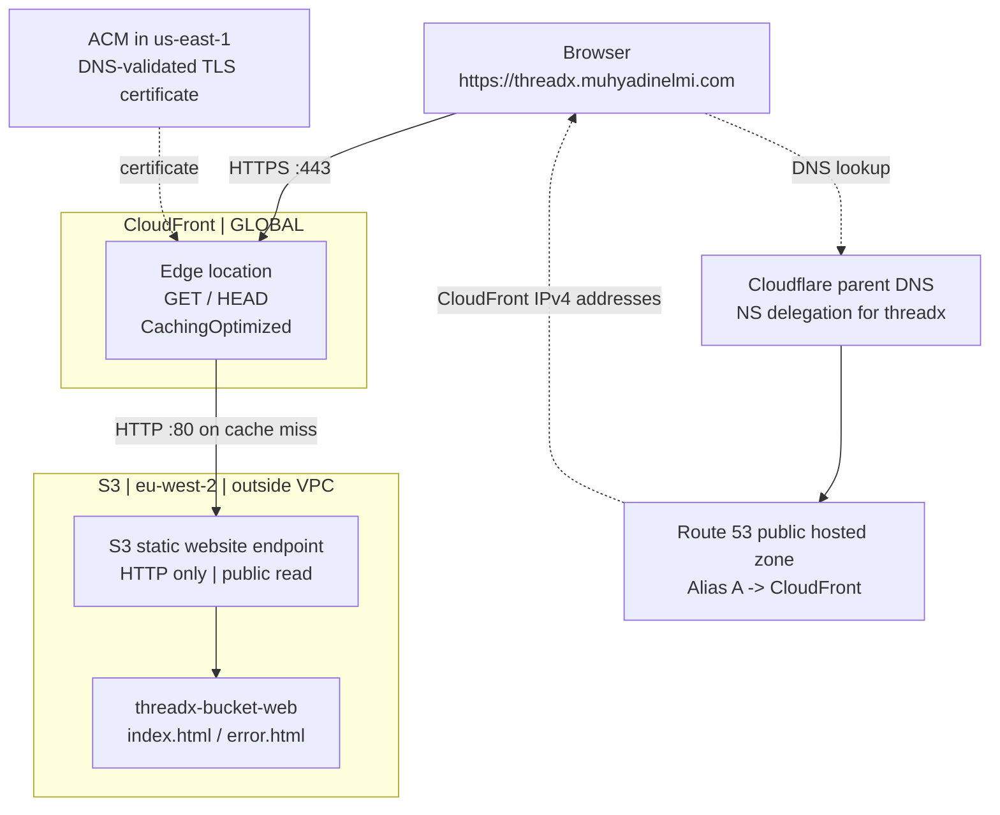

# Assignment 3 — S3, CloudFront, HTTPS and DNS

[← THREADX overview](../README.md) · [← Assignment 2](../assignment-2/README.md)

## 1. What I built

For the third CoderCo assignment I hosted a **static THREADX clothing storefront** as objects in an S3 bucket, put CloudFront in front of it, connected my own subdomain through Route 53 and added HTTPS with ACM. I then replaced `index.html` and proved I could invalidate CloudFront's old cached response.

This one challenged me more conceptually than I expected. I understood that an S3 bucket stores objects, but I kept mixing up the bucket name, its website endpoint, CloudFront's address, my custom subdomain and the DNS Alias. The build helped me finally separate those jobs.

The HTML storefront was generated separately with Codex; this README documents **my AWS hosting, configuration and troubleshooting**, not that I personally coded the HTML.

## 2. The architecture I finished with



The order matters:

1. The browser resolves **`threadx.muhyadinelmi.com`** through the Cloudflare delegation and Route 53 Alias.
2. The browser establishes **HTTPS with CloudFront**. The certificate lives in ACM `us-east-1`.
3. CloudFront serves a cached object if it has a reusable copy.
4. On a cache miss, CloudFront requests the content from the **S3 static website endpoint using HTTP**.

S3 and CloudFront are **not inside my VPC**. DNS finds CloudFront; it does not carry the web page back to the browser.

## 3. S3 bucket and static hosting

**Console:** S3 → Buckets → Create bucket → General purpose → `threadx-bucket-web`, Region `eu-west-2`. I used **Bucket owner enforced** for Object Ownership (ACLs disabled). For this assignment's public website endpoint, I turned off the bucket's public-access block and added a bucket policy that allowed public object reads:

```json
{
  "Version": "2012-10-17",
  "Statement": [
    {
      "Sid": "PublicReadWebsite",
      "Effect": "Allow",
      "Principal": "*",
      "Action": "s3:GetObject",
      "Resource": "arn:aws:s3:::threadx-bucket-web/*"
    }
  ]
}
```

I spent time on this because I knew JavaScript but wasn't used to reading IAM-style JSON policies. In this object, `Statement` is an array of rule objects; `Effect` is Allow, `Principal: "*"` means any principal, `Action` allows reading objects, and `Resource` specifies which object ARNs that action applies to. This policy **does not** grant public write or delete.

**Console:** Bucket → Properties → Static website hosting → Enable → Host a static website. I set `index.html` as the home document and `error.html` as the error document, then uploaded both at the bucket root.

I checked the S3 website endpoint:

```text
http://threadx-bucket-web.s3-website.eu-west-2.amazonaws.com
```

That address is an **HTTP website endpoint provided by AWS**, not another domain I registered. It proved that S3 could serve the files before I added CloudFront.

## 4. CloudFront configuration

**Console:** CloudFront → Distributions → Create distribution. I selected the **S3 website endpoint**, not the bucket's REST endpoint.

| Setting | Choice | Why |
|---|---|---|
| Origin | S3 website endpoint in London | Required for this public static-hosting lab |
| CloudFront → origin protocol | HTTP only, port 80 | The S3 website endpoint does not support HTTPS |
| Browser → CloudFront | Redirect HTTP to HTTPS | Visitors use a TLS-protected connection to CloudFront |
| Allowed HTTP methods | GET, HEAD | Read website files and request headers |
| Cache policy | Managed `CachingOptimized` | Cache repeat reads; Gzip/Brotli available |
| Origin path | Blank | The HTML files are at the root of the bucket |
| Default root object | `index.html` | Serve the homepage for `/` |
| WAF | Not enabled | Outside the assignment scope, potential cost |
| Alternate domain name | `threadx.muhyadinelmi.com` | Tell CloudFront to serve requests for my custom hostname |
| Viewer TLS certificate | Issued in ACM `us-east-1` | CloudFront requires that Region |

The most important thing I had to understand here: **HTTPS from the browser to CloudFront does not mean HTTPS from CloudFront to this S3 website endpoint.** The origin connection for this design is HTTP. In a different production design I would use a **private S3 REST origin + Origin Access Control**, but I didn't build that here.

## 5. Route 53, Cloudflare and the Alias

My parent domain `muhyadinelmi.com` is managed at Cloudflare. I delegated **only `threadx.muhyadinelmi.com`** to four Route 53 nameservers, rather than moving the whole domain.

I had previously configured the Route 53 Alias A record to point at my Assignment 2 ALB. For this assignment I edited **that same Alias A record** so that its AWS target became the CloudFront distribution.

This clicked when I stopped thinking of “Alias” as just a nickname: the Route 53 record gives the browser CloudFront IPv4 answers without me manually hard-coding addresses that AWS can change. The CloudFront distribution itself is **not** a DNS record; the Alias A record refers to it.

I requested a **new ACM certificate in `us-east-1`**, validated the hostname through the DNS CNAME record and attached it to CloudFront. The earlier ALB certificate was issued in London, so it was not the certificate to select here.

## 6. The DNS issue I troubleshot

When I first opened the new HTTPS address, Safari said it couldn't find the server. Initially:

```bash
dig +short NS threadx.muhyadinelmi.com
dig +short A threadx.muhyadinelmi.com
```

The NS lookup returned the expected Route 53 nameservers, but the A lookup returned nothing through my usual resolver. I then asked one AWS authoritative nameserver **directly**:

```bash
dig @ns-495.awsdns-61.com threadx.muhyadinelmi.com A +short
```

That returned four IPv4 addresses. Later I queried Google DNS:

```bash
dig @8.8.8.8 +short threadx.muhyadinelmi.com A
nslookup threadx.muhyadinelmi.com
```

Google returned valid A answers and the custom website opened. My best explanation is **temporary recursive DNS caching/resolution delay**, not a proven bad record. I didn't need to delete and rebuild any working AWS resources.

This was useful independent practice: an empty result from one resolver is not the same thing as a missing record on the authoritative nameserver.

## 7. CloudFront caching and invalidation

I ran a header-only request:

```bash
curl -I https://threadx.muhyadinelmi.com
```

The response contained `HTTP/2 200`, `content-type: text/html`, `x-cache: Hit from cloudfront`, a CloudFront `via` header and `server: AmazonS3`. The cache hit and `age` value showed CloudFront was serving previously cached content.

**Evidence — [open the curl / CloudFront cache-hit screenshot](screenshots/01-cloudfront-cache-hit.webp).** This is a real response from the custom HTTPS URL, not a diagram of what should happen.

I then uploaded a **new version of the same `index.html` key** to S3, changing the storefront from the earlier dark design to a metallic-grey version. Uploading a replacement object changes S3, but a cached CloudFront copy may remain old.

**Console:** CloudFront → Distribution → Invalidations → Create invalidation → `/*`. The wildcard covers both the homepage `/` and `/index.html` for this small lab. I waited for the invalidation status to show **Completed**.

**Evidence — [open the completed invalidation screenshot](screenshots/02-invalidation-completed.webp).** “Completed” tells me the cache invalidation finished; it doesn't itself prove the HTML changed.

Finally, I opened the updated website at **`threadx.muhyadinelmi.com`**, not just the direct S3 website endpoint.

**Evidence — [open the final metallic-grey storefront screenshot](screenshots/03-updated-https-storefront.webp).** This ties the final visual check to the **custom domain** and the CloudFront delivery path.

## 8. What I learned and what I still want to practise

- **S3 object vs website:** Replacing `index.html` in S3 doesn't edit my local file; I must upload the changed object. Version history would depend on whether bucket versioning was enabled.
- **S3 vs CloudFront:** S3 holds the current content; CloudFront can cache earlier responses and serve them again until expiry or invalidation.
- **Alias A vs domain:** The subdomain is a hostname; the Alias A is the DNS record configuration that maps that hostname to an AWS resource.
- **HTTPS vs methods:** GET and HEAD are still HTTP methods when the connection uses HTTPS. Viewer protocol policy is a separate setting from allowed methods.
- **Cost/security caveat:** The S3 website endpoint is publicly readable over HTTP by design in this assignment. CloudFront adds HTTPS **for its viewers**, not private origin access.

I got the site working, but the DNS terminology took repeated conversations. I want to keep revisiting the whole path until I can draw it from memory: Cloudflare NS delegation → Route 53 Alias → CloudFront viewer TLS/cache → S3 website origin.

**Cleanup:** The earlier ALB was deleted. S3, CloudFront and Route 53 should be checked for continuing storage, requests, traffic and hosted-zone charges.

[← THREADX overview](../README.md)
