Assignment 3 — S3, CloudFront, HTTPS and DNS
============================================

[AWS overview](../README.md) · [Previous: ALB and Auto Scaling](../assignment-2/README.md)

Overview
--------

I hosted the fictional THREADX storefront in S3, added CloudFront, connected `threadx.muhyadinelmi.com` through Route 53 and configured HTTPS with ACM. I then changed the website from black to metallic grey and used a CloudFront invalidation to check that the updated content reached the custom domain.

The HTML and imagery were generated with Codex. This assignment documents my AWS configuration, request checks and DNS/cache troubleshooting. It is a static educational storefront, with no checkout, payment service or application backend.

Architecture
------------

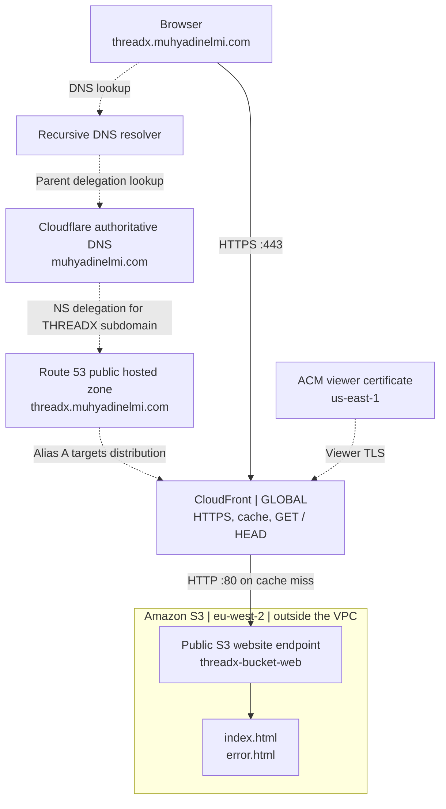

Solid arrows show the content request; dashed arrows show DNS and certificate relationships. DNS locates CloudFront rather than carrying the HTML response. S3 and CloudFront are not resources inside my VPC.

Configuration and decisions
---------------------------

| Setting | Recorded choice | Reason or boundary |
|---|---|---|
| S3 bucket | `threadx-bucket-web`, `eu-west-2` | Object storage in London |
| Website documents | `index.html`, `error.html`, at bucket root | Homepage and configured error document |
| Ownership and permissions | Bucket owner enforced; ACLs disabled; public-read bucket policy | Website objects readable through the public website endpoint |
| CloudFront origin | `threadx-bucket-web.s3-website.eu-west-2.amazonaws.com` | Website endpoint, not the S3 REST endpoint |
| Origin connection | HTTP only, port `80`; blank origin path | S3 website endpoints do not support HTTPS |
| Viewer protocol | Redirect HTTP to HTTPS | TLS on the visitor-to-CloudFront connection |
| Methods and cache | `GET`, `HEAD`; managed `CachingOptimized` | Read-only static content and caching |
| Default root object | `index.html` | Homepage for `/` |
| Custom hostname | `threadx.muhyadinelmi.com` | CloudFront alternate domain name and Route 53 Alias A |
| Viewer certificate | DNS-validated ACM certificate in `us-east-1` | Required Region for CloudFront viewer certificates |
| Edge additions | No WAF or response-headers policy selected in the creation review | No claim of WAF, security-header function or Lambda@Edge deployment |

The origin choice is a deliberate limitation of this lab: the S3 website is public and CloudFront fetches it over HTTP. Viewer HTTPS does not establish private-origin access or end-to-end TLS. A private S3 REST origin with Origin Access Control would be a different design; I did not implement it here.

Implementation walkthrough
--------------------------

**1. Configure S3 hosting and object access.** I created the bucket in London, disabled the relevant bucket-level public-access block for this public website lab and added the object-read policy below. In Properties → Static website hosting, I selected `index.html` and `error.html`, then uploaded the files to the root.

```json
{
  "Version": "2012-10-17",
  "Statement": [
    {
      "Sid": "PublicReadWebsite",
      "Effect": "Allow",
      "Principal": "*",
      "Action": "s3:GetObject",
      "Resource": "arn:aws:s3:::threadx-bucket-web/*"
    }
  ]
}
```

`Principal: "*"` allows public reads of the bucket's objects. The policy does not grant public upload or delete permissions. I needed to learn the structure of the policy rather than treat the JSON as an unexplained block to paste: Statement is an array of rules, Effect selects Allow, Action defines the operation and Resource limits the affected object ARNs.

<table>
<tr>
<td width="50%">
<a href="screenshots/01-s3-public-read-policy.jpg">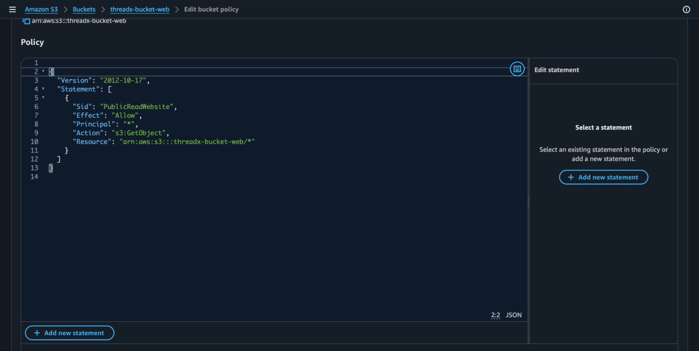</a><br>
<sub>Policy configuration: public s3:GetObject for this bucket; no public write grant.</sub>
</td>
<td width="50%">
<a href="screenshots/02-s3-website-documents.jpg">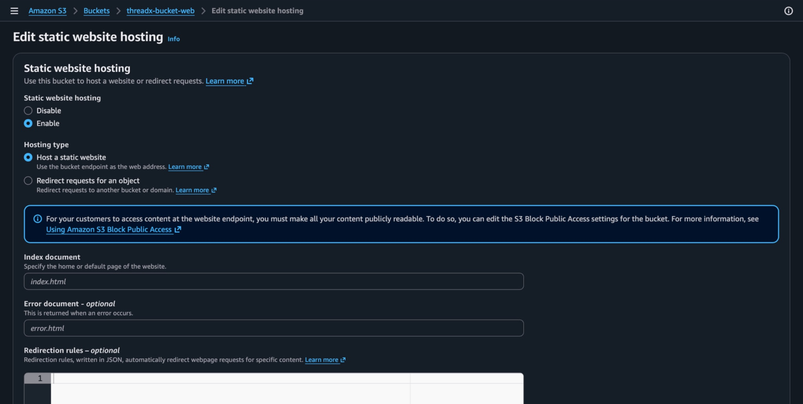</a><br>
<sub>Website hosting selections: index.html and error.html at the bucket root.</sub>
</td>
</tr>
</table>

The later object list shows `index.html` at 1.1 MB, replaced at 13:08:42 UTC, and `error.html` at bucket root. An earlier upload-success capture records both HTML files uploaded successfully; the original files were smaller. My initial browser check used the website endpoint:

```text
http://threadx-bucket-web.s3-website.eu-west-2.amazonaws.com
```

The archive includes a browser view of the original product collection at that S3 endpoint. It is separate from the later custom-domain HTTPS check through CloudFront.

<p>
<a href="screenshots/08-s3-updated-object.jpg">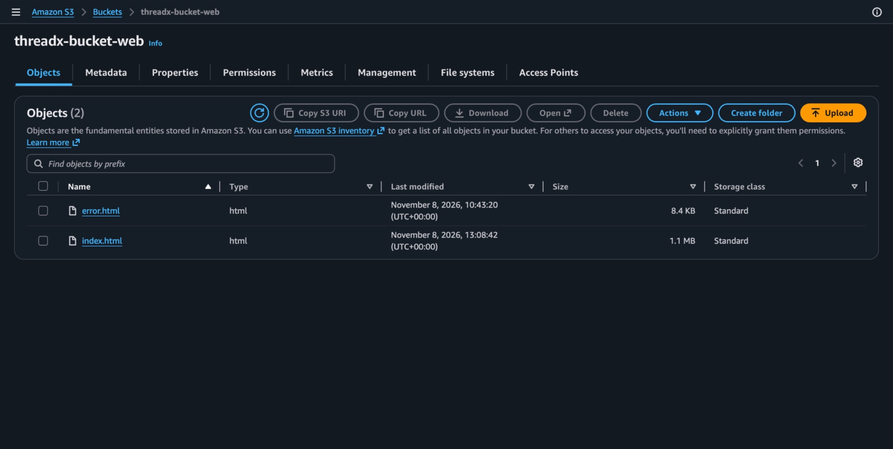</a><br>
<sub>Later upload: index.html replaced at 13:08:42 UTC; both HTML files at root.</sub>
</p>

**2. Create the CloudFront distribution.** I entered the website endpoint as the origin, left the origin path blank, chose `GET`/`HEAD`, the `CachingOptimized` policy and HTTP-to-HTTPS redirection, then set `index.html` as the default root object.

<p>
<a href="screenshots/03-cloudfront-creation-review.jpg">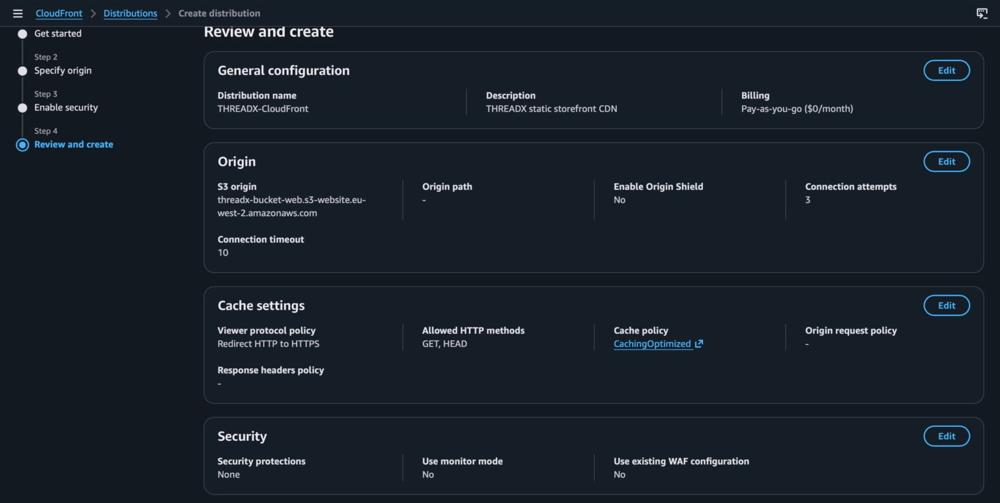</a><br>
<sub>Creation review: website origin, GET/HEAD, CachingOptimized, HTTP-to-HTTPS redirect and no WAF.</sub>
</p>

This is the creation review, so it records selected settings rather than proving deployment by itself. The later `curl` headers establish that the custom-domain request was served by CloudFront. The retained response does not show `content-encoding`; I have not claimed a successful gzip or Brotli compression test.

**3. Connect DNS and the certificate.** Cloudflare hosted the parent zone, `muhyadinelmi.com`. I delegated the THREADX subdomain to four Route 53 nameservers and changed its existing Alias A target from the earlier ALB to CloudFront. The edit view preserves the old ALB target in the record list while the CloudFront target is being selected.

<p>
<a href="screenshots/05-route53-cloudfront-alias.jpg">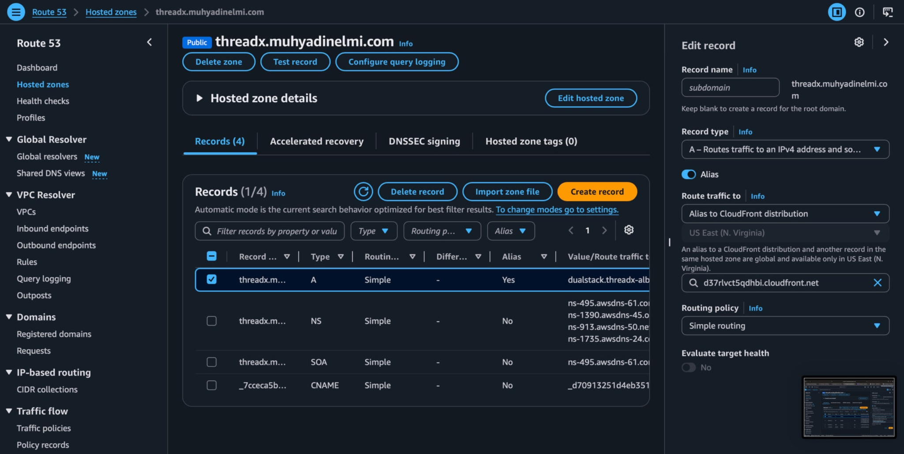</a><br>
<sub>Alias change: old ALB target remains visible while CloudFront is selected.</sub>
</p>

I requested a new ACM viewer certificate in `us-east-1`, validated the hostname through its DNS CNAME and attached it to CloudFront. The earlier ALB certificate was in `eu-west-2` and could not serve that CloudFront viewer role. The certificate capture shows `Issued`, successful domain validation and `In use: Yes`. The original capture is in N. Virginia (`us-east-1`); the selected crop removes account chrome.

<p>
<a href="screenshots/04-acm-virginia-issued-in-use.jpg">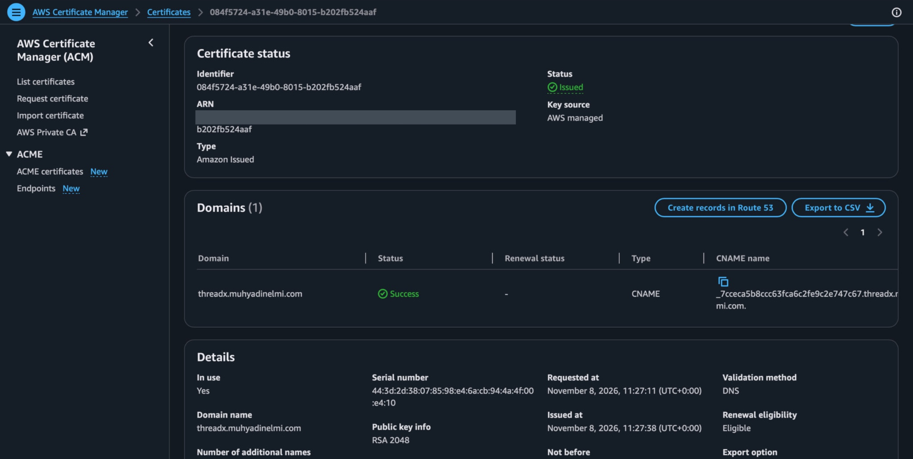</a><br>
<sub>CloudFront viewer certificate: Issued, domain validation Success and In use Yes; account ARN redacted.</sub>
</p>

Verification
------------

**CloudFront response.** I ran:

```bash
curl -I https://threadx.muhyadinelmi.com
```

The captured response included:

```text
HTTP/2 200
content-type: text/html
content-length: 1111835
server: AmazonS3
x-cache: Hit from cloudfront
age: 146
```

<p>
<a href="screenshots/07-cloudfront-cache-hit.jpg">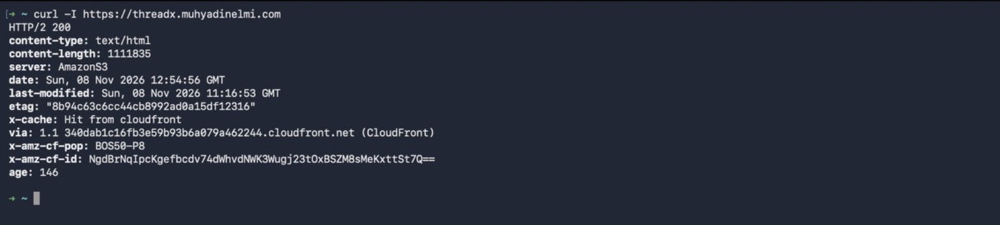</a><br>
<sub>Captured HTTPS HEAD response: cache hit, CloudFront via header and age 146.</sub>
</p>

`x-cache: Hit from cloudfront`, `age: 146` and the CloudFront `via` header identify a cached response. `server: AmazonS3` alone would not prove CDN caching. This was a `HEAD` request: it checked response headers, not the complete page body.

**Replace the object and invalidate the cache.** I kept the same S3 key, `index.html`, and uploaded the metallic-grey replacement. I then created an invalidation for `/*` in the distribution and waited for `Completed`. The wildcard covered this small site's cached paths, including `/` and `/index.html`.

<table>
<tr>
<td width="50%">
<a href="screenshots/09-invalidation-completed.jpg">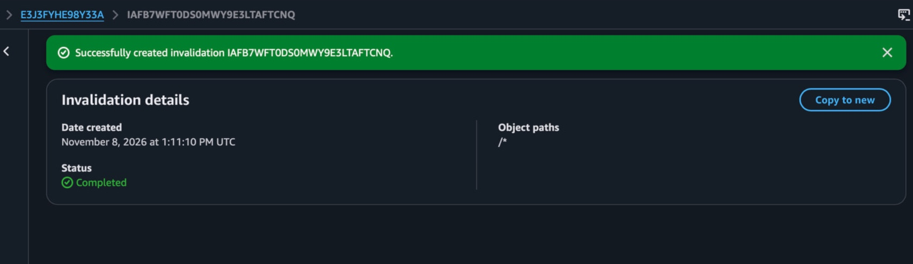</a><br>
<sub>Invalidation /* completed after the updated object upload.</sub>
</td>
<td width="50%">
<a href="screenshots/10-updated-custom-domain.jpg">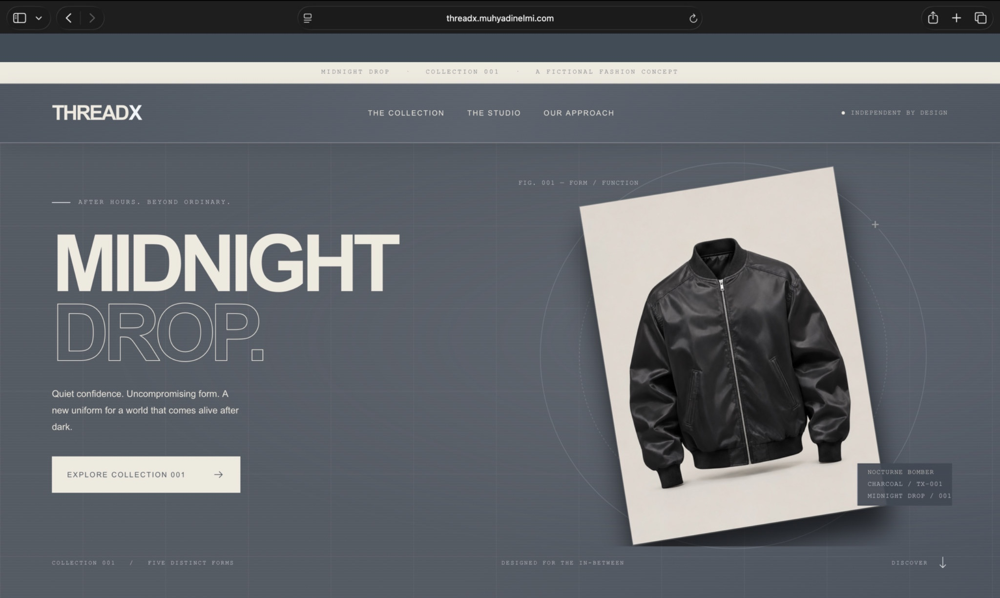</a><br>
<sub>Updated grey storefront at threadx.muhyadinelmi.com; personal browser tab text redacted.</sub>
</td>
</tr>
</table>

The invalidation capture and the updated page at the custom domain are complementary checks. `Completed` establishes the invalidation state; the visible grey storefront establishes the browser result. A direct S3 page would not be sufficient evidence of that CloudFront check. I did not capture a post-invalidation `Miss` header or a test from every edge location.

| Check | Evidence | Conclusion |
|---|---|---|
| Bucket policy and root objects | S3 policy and object-list captures | Captured configuration; object versions changed during the exercise |
| Origin, methods, cache policy and redirect | CloudFront creation review | Captured setup choices; review screen is not a final settings audit |
| Custom-domain HTTPS and caching | `curl -I`, HTTP `200`, CloudFront cache-hit and `via` headers | Captured HTTPS response and cache hit |
| Invalidation | `/*`, status `Completed` | Captured invalidation result |
| Updated content through custom hostname | Grey storefront with `threadx.muhyadinelmi.com` in the browser | Captured visual test |
| DNS comparison | Terminal shows no A answer from the default resolver, four answers from Route 53, then four from Google DNS | Captured resolver comparison |
| Custom error response, compression and HTTP redirect | Configured or selected; no dedicated response capture | Not independently verified |

Troubleshooting
---------------

**A resolver returned no A answer.** Safari initially could not find the server. My first checks were:

```bash
dig +short NS threadx.muhyadinelmi.com
dig +short A threadx.muhyadinelmi.com
```

The NS lookup returned the Route 53 nameservers, but the usual resolver returned no A answer. I compared it with a direct authoritative query:

```bash
dig @ns-495.awsdns-61.com threadx.muhyadinelmi.com A +short
```

That returned four IPv4 addresses. I later checked another recursive resolver and the local lookup:

```bash
dig @8.8.8.8 +short threadx.muhyadinelmi.com A
nslookup threadx.muhyadinelmi.com
```

<p>
<a href="screenshots/06-dns-resolver-comparison.jpg">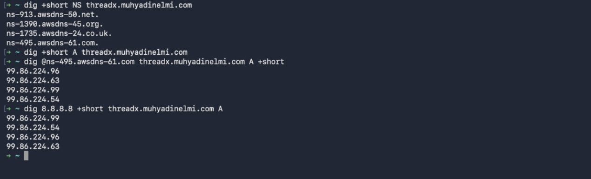</a><br>
<sub>Default resolver: no A answer. Route 53 authority and Google DNS: four CloudFront IPv4 answers.</sub>
</p>

The terminal capture shows valid answers through Google DNS, followed by the working site and cache-hit captures. The `nslookup` check is retained in my notes, without a corresponding terminal capture. Temporary recursive caching or resolution delay is the likely explanation, not a proven root cause. I did not capture TTLs or resolver cache contents, so I would not describe this as a confirmed DNS propagation diagnosis.

**An S3 update did not guarantee an updated cached response.** I had to separate the local file, the uploaded S3 object and the copy CloudFront could reuse. Changing the object updated the origin. Invalidation and the browser check addressed delivery through the CDN.

Lessons learned
---------------

I initially mixed up a bucket name, website endpoint, distribution hostname and Alias record. The useful distinction is now: S3 stores the files; DNS locates CloudFront; the viewer establishes TLS with CloudFront; CloudFront serves a cached response or fetches the website origin over HTTP.

Comparing an authoritative DNS answer with recursive answers also gave me a better troubleshooting method. An empty answer from one resolver is a reason to investigate, not a reason to rebuild a working service. GET and HEAD are still HTTP methods over HTTPS; allowed methods and viewer protocol are separate settings. Replacing the local HTML also does not update S3 until I upload it, and object version history depends on bucket versioning.

Lifecycle and references
------------------------

The earlier ALB was deleted and the subdomain was reused for this static deployment. The captures are a record of the lab, not a guarantee that the endpoint remains live. S3 storage, CloudFront traffic and Route 53 hosted-zone charges need checking separately.

[AWS S3 website endpoints](https://docs.aws.amazon.com/AmazonS3/latest/userguide/WebsiteEndpoints.html) · [CloudFront certificate requirements](https://docs.aws.amazon.com/AmazonCloudFront/latest/DeveloperGuide/cnames-and-https-requirements.html) · [CloudFront invalidations](https://docs.aws.amazon.com/AmazonCloudFront/latest/DeveloperGuide/Invalidation.html)

[AWS overview](../README.md)
