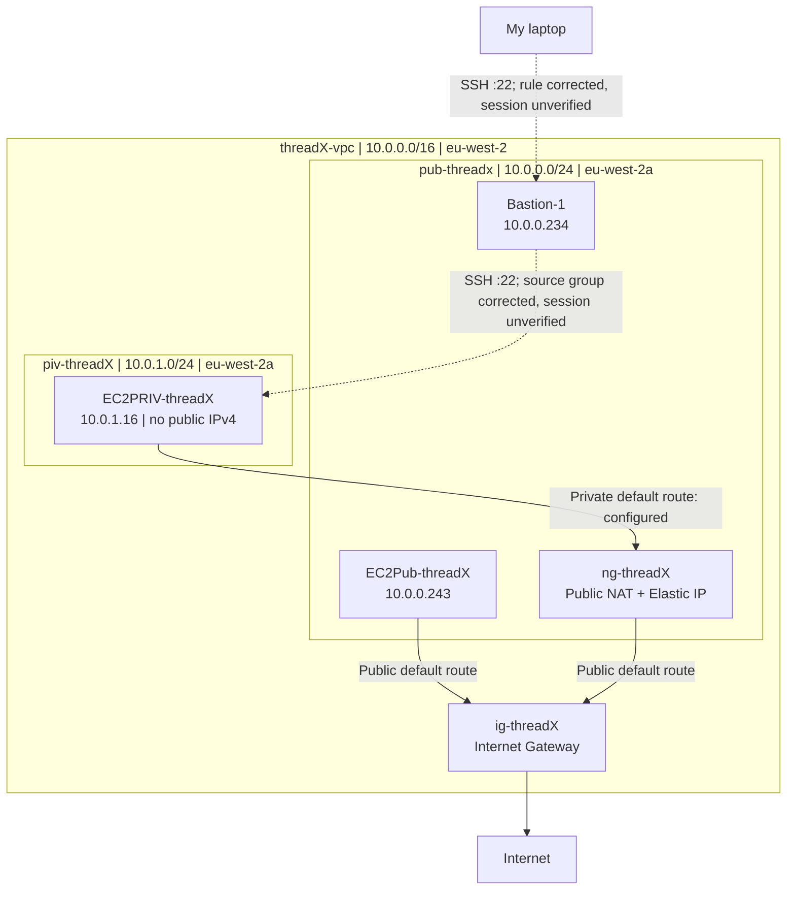
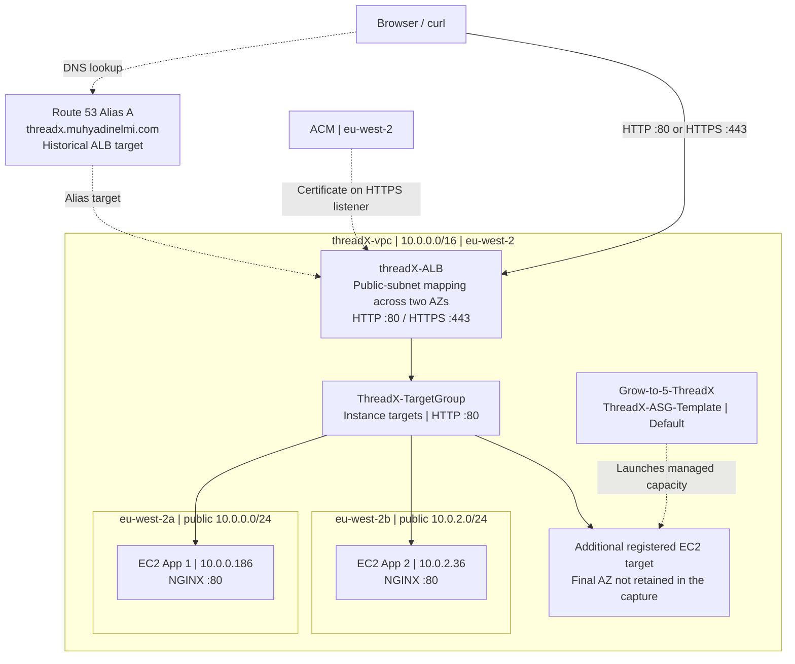
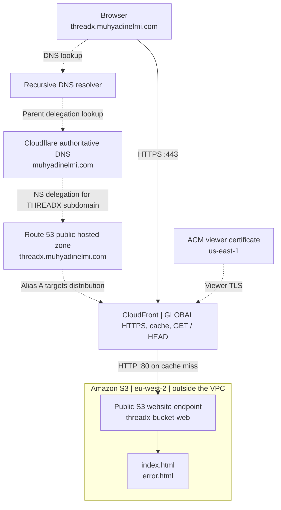

THREADX — Architecture Reference
=================================

Read the [VPC](assignment-1/README.md), [ALB](assignment-2/README.md) and [S3/CloudFront](assignment-3/README.md) walkthroughs for the implementation evidence. This optional reference compares their diagrams without repeating the screenshots.

These are historical lab stages. The ALB was deleted and the custom hostname was later repointed to CloudFront. The diagrams do not claim that all resources remain deployed.

VPC routing and corrected bastion rules
---------------------------------------

Solid paths record configured routing while NAT existed; dashed SSH paths show corrected permissions, without a captured session. NAT metrics did not establish the source instance.

ALB, EC2 and managed capacity
-----------------------------

The named app instances were in public subnets. Three healthy targets were captured, but the additional target's final AZ was not retained. DNS and certificate relationships are separate from web traffic.

S3 website delivery through CloudFront
--------------------------------------

The browser uses HTTPS to CloudFront; the public website origin uses HTTP. DNS delegation and the Alias are lookup/configuration relationships, not content proxies.

[AWS overview](README.md)
