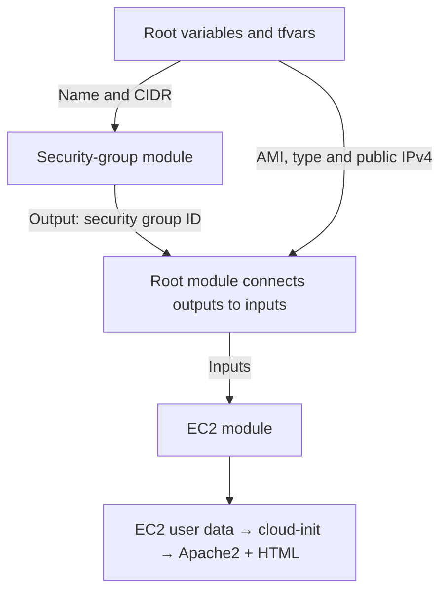

# Terraform Assignment 2 — Deploying Apache on EC2 with Cloud-init

[← DevOps Learning](../../README.md) · [Assignment 1 — WordPress](../project-1/) · [Screenshot archive](screenshots/)

## Project overview

The objective of this assignment was to provision an AWS EC2 instance with Terraform and use cloud-init to install and configure a web server automatically. I chose Apache2 and created a small custom HTML page to make the result easy to verify.

I wanted the instance to do more than simply enter the **Running** state in AWS. When Terraform finished provisioning it, the server needed to install Apache, place my page in the correct Linux directory, start the service and respond to an HTTP request. I also wanted to practise separating Terraform resources into modules and passing information between them, instead of putting everything into one `main.tf` file.

The final deployment worked: Terraform created the EC2 instance and its security-group resources, the custom page loaded through the instance's public IPv4 address, and an HTTP request returned `200 OK`. I subsequently destroyed the four Terraform-managed resources. The public IP shown in the evidence is therefore a record of the test, **not a live website**.

| Component | What I used |
|---|---|
| Infrastructure | Terraform with the AWS provider, version constraint `~> 6.0` |
| Cloud | AWS EC2 and VPC security groups in `eu-west-2` (London) |
| Instance | Ubuntu AMI supplied through a variable; `t3.micro` |
| Configuration | Cloud-init YAML passed through EC2 `user_data` |
| Web server | Apache2 serving a custom `index.html` |
| Terraform state | S3 backend configuration with a separate key for this project |

## How the architecture works

There are two different flows in this project: **Terraform provisioning the infrastructure**, and **a browser requesting the page after the server starts**.



At provisioning time, Terraform uses the root module to connect the two child modules. The security-group module creates the network rules and exposes the group ID. The root passes that ID to the EC2 module so AWS knows which security group to attach to the instance. The EC2 module also passes the cloud-init configuration as user data.

After the instance boots, the web request follows a simpler path:

```text
Browser → EC2 public IPv4:80 → AWS security group → Ubuntu EC2 → Apache2 → index.html
```

The security group decides whether inbound HTTP traffic is permitted. Apache is the software that actually serves the page. Terraform provisions these pieces, but Terraform itself is not in the HTTP request path.

I used AWS's default VPC behaviour rather than building a separate VPC, subnet, route table or Internet Gateway in this assignment. The Terraform code does not explicitly declare any of those networking resources. This kept the scope focused on EC2, security groups and cloud-init.

## Project structure

```text
Terraform/project-2/
├── README.md
├── apache.remote_storage.tf
├── main.tf
├── output.tf
├── provider.tf
├── terraform.tfvars
├── variable.tf
├── screenshots/
└── modules/
    ├── ec2/
    │   ├── cloud_init.yml
    │   ├── index.html
    │   ├── main.tf
    │   ├── output.tf
    │   └── variable.tf
    └── security_groups/
        ├── main.tf
        ├── output.tf
        └── variable.tf
```

The files in the project root act as the entry point. The `modules/ec2` folder owns the instance and its boot configuration; `modules/security_groups` owns the network access rules. Each child module has its own `main.tf`, `variable.tf` and `output.tf`, because each module needs to define what it creates, what information it accepts and what information it exposes.

I kept the screenshots separate from the configuration. The source files can be read directly on GitHub, and [the screenshot archive](screenshots/) records what I ran and observed during the deployment.

## 1. Configuring the provider and remote state

I started with the AWS provider in [`provider.tf`](provider.tf):

```hcl
terraform {
  required_providers {
    aws = {
      source  = "hashicorp/aws"
      version = "~> 6.0"
    }
  }
}

provider "aws" {
  region = "eu-west-2"
}
```

`required_providers` tells Terraform which provider plugin it needs and its compatible version range. The separate `provider "aws"` block configures where that provider should manage resources. I selected London because that is the AWS Region I was using for the assignment.

I also configured an S3 backend in [`apache.remote_storage.tf`](apache.remote_storage.tf):

```hcl
terraform {
  backend "s3" {
    bucket = "terra.1-bucket"
    key    = "project.2/apache"
    region = "eu-west-2"
  }
}
```

The backend is where Terraform stores its **state**, which records the infrastructure Terraform is managing. It is different from the `.tf` files: the configuration describes what I want, while state records what Terraform knows about the deployed resources. The `key` is the path of the state object inside the bucket, allowing another project to use a different key without mixing its state with this deployment.

I used `terraform init` to prepare the working directory, configure the backend and install the provider dependencies. The `.terraform.lock.hcl` file records provider selections; `.terraform/` holds local working data and is excluded from Git. The remote S3 bucket is a backend dependency, **not** one of the four EC2/security-group resources created in the final plan.

Evidence: [provider configuration](screenshots/source-provider.webp) · [backend configuration](screenshots/source-remote-backend.webp).

## 2. Declaring variables and supplying their values

I kept the configuration reusable by declaring inputs in the root [`variable.tf`](variable.tf) and assigning values in [`terraform.tfvars`](terraform.tfvars).

For example, the root declares the instance type and public-IP setting:

```hcl
variable "instance_type" {
  type = string
}

variable "public_ipv4" {
  type = bool
}
```

The values used for the final lab were:

```hcl
instance_type = "t3.micro"
name          = "apache.sg"
cidr_ipv4     = "0.0.0.0/0"
public_ipv4   = true
```

The AMI ID is also provided through `terraform.tfvars`. Keeping those values separate lets me change the instance size or network range without rewriting the resource arguments. Terraform automatically loads a file named `terraform.tfvars` in the root working directory.

One distinction I had to get clear is that a root variable does **not** automatically appear inside a child module. The root has to pass it into the module block, and the child module has to declare the corresponding input. For the public IPv4 setting, the flow is:

```text
terraform.tfvars: public_ipv4 = true
        ↓
root variable "public_ipv4"
        ↓
root main.tf: public_ipv4 = var.public_ipv4
        ↓
modules/ec2/variable.tf: variable "public_ipv4"
        ↓
EC2 resource: associate_public_ip_address = var.public_ipv4
```

The left-hand name in a module call is an **input argument expected by that child module**; `var.public_ipv4` on the right reads the variable available in the root. That separation matters when Terraform reports a missing required argument.

Evidence: [root variable declarations](screenshots/source-root-variables.webp) · [assignment values](screenshots/source-tfvars.webp) · [EC2 module inputs](screenshots/source-ec2-variables.webp).

## 3. Creating the security group module

Before launching EC2, I defined the security group that would control traffic to the web server. The [`modules/security_groups/main.tf`](modules/security_groups/main.tf) file creates three Terraform resources:

1. `aws_security_group.apache_sg` — the security group itself.
2. `aws_vpc_security_group_ingress_rule.inbound_http` — allows inbound TCP port `80`.
3. `aws_vpc_security_group_egress_rule.outbound_` — allows outbound traffic.

The important part of the HTTP rule is:

```hcl
resource "aws_vpc_security_group_ingress_rule" "inbound_http" {
  security_group_id = aws_security_group.apache_sg.id
  cidr_ipv4         = var.cidr_ipv4
  from_port         = 80
  to_port           = 80
  ip_protocol       = "tcp"
}
```

`aws_security_group.apache_sg.id` reads the ID of the group created by the first resource. AWS needs that ID so it can attach this rule to the correct group. The `cidr_ipv4` value of `0.0.0.0/0` allowed HTTP requests from any IPv4 address for the lab. The egress rule uses `ip_protocol = "-1"`, which means all protocols.

For a portfolio demonstration this made the page publicly reachable, but I would not treat it as a complete production security design. The configuration does not create an SSH rule and does not add a load balancer, HTTPS listener or private application subnet.

Evidence: [security-group resource code](screenshots/source-sg-main.webp) · [live AWS ingress and egress rules](screenshots/aws-security-group-rules.webp).

## 4. Connecting the security group to EC2 through modules

The connection between modules was one of the most important things I learned from this assignment.

The EC2 instance needs the **security group ID**, but the resource that creates the security group lives inside a different child module. I cannot reference `aws_security_group.apache_sg.id` directly from the EC2 module because that resource is not declared in the EC2 module's scope.

I exposed the value from [`modules/security_groups/output.tf`](modules/security_groups/output.tf):

```hcl
output "security_group_id" {
  value = aws_security_group.apache_sg.id
}
```

Then the root [`main.tf`](main.tf) connects the output to the EC2 module's input:

```hcl
module "ec2" {
  source            = "./modules/ec2"
  ami               = var.ami
  instance_type     = var.instance_type
  security_group_id = module.security_group_apache.security_group_id
  public_ipv4       = var.public_ipv4
}
```

Finally, the EC2 resource reads its own input:

```hcl
vpc_security_group_ids = [var.security_group_id]
```

The square brackets are important: `vpc_security_group_ids` expects a collection of security-group IDs, even though I only attached **one** group. The root passes one ID as a string; the EC2 resource wraps that string in a one-item list.

The complete relationship is:

```text
Security-group resource attribute (.id)
    → security-group module output
    → root module reference (module.security_group_apache.security_group_id)
    → EC2 module input (security_group_id)
    → EC2 resource argument (vpc_security_group_ids)
```

This is why Terraform has both **inputs** and **outputs**. Inputs let me give a module information; outputs let me retrieve information that a module produces. Terraform can also use the reference to understand that EC2 depends on the security-group resource.

Evidence: [security-group output](screenshots/source-sg-output.webp) · [root module wiring](screenshots/source-root-main.webp) · [EC2 resource](screenshots/source-ec2-main.webp).

## 5. Bootstrapping Apache with cloud-init

Provisioning EC2 was only half the assignment. I also needed the operating system to configure the web server without me logging in and installing packages manually.

The EC2 resource in [`modules/ec2/main.tf`](modules/ec2/main.tf) passes user data using:

```hcl
user_data = templatefile("${path.module}/cloud_init.yml", {
  html_content = filebase64("${path.module}/index.html")
})
```

There are two separate jobs here:

- `filebase64()` reads the local HTML file and encodes its contents as base64 so it can be included safely in the YAML template.
- `templatefile()` reads `cloud_init.yml` and replaces `${html_content}` with that encoded HTML content. `path.module` makes both paths relative to the EC2 module folder rather than whichever directory I ran the Terraform command from.

Terraform supplies the resulting text as EC2 user data. On first boot, the instance's cloud-init tooling processes the YAML. The relevant parts of [`cloud_init.yml`](modules/ec2/cloud_init.yml) are:

```yaml
#cloud-config
package_update: true

packages:
  - apache2

write_files:
  - path: /var/www/html/index.html
    encoding: b64
    content: ${html_content}

runcmd:
  - systemctl start apache2
  - systemctl enable apache2
```

`packages` asks cloud-init to install Apache2. `write_files` puts my decoded HTML at `/var/www/html/index.html`, the document root Apache serves for this configuration. `runcmd` supplies service commands to start Apache and enable it on future boots. The package and command stages are carried out by cloud-init during instance initialisation; I did not have to run the YAML as a standalone terminal script.

The custom [`index.html`](modules/ec2/index.html) displays a small Terraform Project 2 page explaining the technology used. It is deliberately simple enough for a `t3.micro`. Seeing that page in the browser rather than Apache's default page gave me evidence that my own HTML reached the server through user data and cloud-init.

Evidence: [cloud-init YAML](screenshots/source-cloud-init.webp) · [HTML source](screenshots/source-index-html.webp) · [deployed website](screenshots/apache-site-landing.webp) · [additional page section](screenshots/apache-site-project-files.webp).

## 6. Validating, planning and applying the infrastructure

My workflow was to check the configuration, review what Terraform intended to do, and only then deploy:

```bash
terraform init
terraform validate
terraform plan
terraform apply
```

`init` prepares the provider and backend. `validate` checks whether the configuration is internally valid. `plan` compares the configuration with Terraform's current state and any provider-reported reality to show the proposed actions. `apply` performs the proposed infrastructure changes after approval.

I initially ran into module-reference and missing-input errors. After correcting those, the terminal returned:

```text
Success! The configuration is valid.
```

See [validation evidence](screenshots/validate-and-plan.webp) and the later [required-input correction and successful validation](screenshots/troubleshoot-missing-variable.webp).

The deployment plan showed:

```text
Plan: 4 to add, 0 to change, 0 to destroy.
```

Those four resources were the EC2 instance, the security group, its HTTP ingress rule and its outbound rule. The modules themselves are organisational units; they are not additional AWS resources. The planned resource changes are captured in the [plan screenshot](screenshots/plan-four-create.webp), with [another plan review](screenshots/plan-second-review.webp) retained in the archive.

After approving the apply, Terraform reported:

```text
Apply complete! Resources: 4 added, 0 changed, 0 destroyed.

Outputs:
display_public_ip = "3.9.176.73"
```

This was the public IP at the time of the successful deployment. The value comes from the child module's `aws_instance.apache_1.public_ip` attribute, which the root exposes through `module.ec2.display_public_ip`. That follows the same output rule as the security-group ID: a child module exposes the attribute before the root can use or display it.

Evidence: [apply approval and creation progress](screenshots/apply-confirmation.webp) · [completed apply and public IP output](screenshots/apply-four-created.webp) · [child output](screenshots/source-ec2-output.webp) · [root output](screenshots/source-root-output.webp).

## 7. Verifying the deployment beyond Terraform

A successful `terraform apply` proves that Terraform completed its requested provider operations. It does not, on its own, prove that Apache started or that the browser can reach the website. I checked the deployment at separate layers:

| Check | What it confirmed | Evidence |
|---|---|---|
| EC2 console | AWS showed the new instance in **Running** state with a public IPv4 address | [EC2 instance](screenshots/aws-ec2-running.webp) |
| Security settings | The attached `apache.sg` had inbound HTTP TCP `80` and outbound access | [Security-group rules](screenshots/aws-security-group-rules.webp) |
| Browser | The public IP served my custom HTML page, rather than a default error or landing page | [Live website](screenshots/apache-site-landing.webp) |
| Terminal HTTP check | The server returned `HTTP/1.1 200 OK` | [HTTP response](screenshots/apache-http-200.webp) |

The distinction matters for troubleshooting. If EC2 is not running, I would investigate provisioning or instance state. If EC2 is running but the page is unreachable, I would check security-group rules and network reachability. If port 80 is reachable but the page is wrong, I would investigate Apache, `/var/www/html/index.html` and the cloud-init configuration.

These checks gave me stronger evidence than the apply message alone because they covered both the AWS infrastructure and the application running inside the instance.

## 8. Problems I ran into

### Undeclared security-group resource in the EC2 module

While separating the resources into modules, I initially referenced the security group as though it had been declared inside the EC2 module. Terraform returned:

```text
Error: Reference to undeclared resource
A managed resource "aws_security_group" "apache_sg"
has not been declared in module.ec2.
```

The problem was **module scope**, not an AWS security-group failure. The EC2 module could not directly read a resource that belonged to the security-group module. I exposed the ID through the security-group module's `output.tf`, referenced that output in the root module, and passed it as the EC2 module's `security_group_id` input. After making the connection correctly, validation succeeded and the plan could be generated.

Evidence: [original undeclared-resource error](screenshots/troubleshoot-unresolved-module.webp) · [successful validation](screenshots/validate-and-plan.webp).

### Missing `public_ipv4` module argument

I declared `variable "public_ipv4"` inside the EC2 module but initially did not supply it in the root `module "ec2"` call. Terraform returned:

```text
Error: Missing required argument
The argument "public_ipv4" is required, but no definition was found.
```

That was a useful reminder that creating a variable in a child module does not automatically provide it with a value. I passed `public_ipv4 = var.public_ipv4` from the root into the EC2 module. The terminal then displayed `Success! The configuration is valid.`

Evidence: [missing argument and successful revalidation](screenshots/troubleshoot-missing-variable.webp).

### A later plan proposed replacing the EC2 instance

When I reviewed Terraform again, a plan showed that the EC2 instance would have to be **replaced**, with `associate_public_ip_address` changing from `false` to `true`. Terraform marked the argument as forcing replacement. This matters because a `-/+` action means **destroy and create a replacement**, not update the same instance in place.

I treated that as something to understand before approving any further changes. The current `terraform.tfvars` records `public_ipv4 = true`, while the earlier successful apply screenshot records the instance that was actually deployed at that stage. The [replacement-plan screenshot](screenshots/plan-public-ip-replacement.webp) proves Terraform proposed replacement; it does **not** show that I performed a second apply with the newer setting. The final captured cleanup was a separate `terraform destroy`.

### Backend configuration and state

During the earlier setup I also had to correct a mismatch between the S3 bucket location and the backend Region. The final backend file points to `eu-west-2`. This reinforced that the S3 backend is not just another Terraform resource block: Terraform must initialise access to the correct state location before it can reliably compare and manage the infrastructure. The backend file documents the final configuration; I have not labelled a screenshot as proof of a backend migration that it does not show.

The common lesson across these issues was to read the actual Terraform error or plan first, identify whether the problem was a **module reference**, a **missing input**, an **AWS configuration change** or **backend/state setup**, and fix that specific layer.

## 9. Destroying the lab resources

Once I had the working website, EC2, security-group and HTTP-response evidence, I ran:

```bash
terraform destroy
```

Terraform showed a destroy plan for the four managed resources. After I confirmed it, the output finished with:

```text
Destroy complete! Resources: 4 destroyed.
```

[View the completed destroy output](screenshots/destroy-four-complete.webp). This screenshot includes the confirmation and completed destruction, not just the initial plan.

Destroying the Terraform-managed resources is important for a temporary cloud lab because leaving EC2 running can incur charges. It also means the old public IP should not be used as a working demo link. The S3 backend bucket is separate from the four resources shown in the plan; I would check any separately retained AWS resources and state-storage costs independently.

## Key learning points

- **Root and child modules have different responsibilities.** The root connects the modules. Each child module owns its resources, inputs and outputs. A resource inside one child is not automatically visible inside another.
- **Variables and outputs are not interchangeable.** Variables accept values; outputs expose values. To connect a security group to EC2, I needed the group ID as an output from one module and as an input to the other.
- **The provider's argument types matter.** `vpc_security_group_ids` accepts a collection, even when I only need one security group. That is why the resource uses `[var.security_group_id]`.
- **Cloud-init joins infrastructure to operating-system configuration.** Terraform created the instance; cloud-init configured Apache and delivered the HTML page during boot. Each part has a separate responsibility.
- **Validation, planning and application testing answer different questions.** `validate` checked configuration, `plan` showed intended changes, `apply` provisioned resources, and the AWS/browser/HTTP checks showed whether the system actually worked.
- **Changes can require replacement.** Reading `-/+` and *forces replacement* in a plan prevents me from mistaking an instance replacement for a harmless update.
- **Destroy is part of the workflow.** I captured the working result and then removed the four resources rather than leaving the assignment running indefinitely.

## Source and evidence archive

The screenshots are grouped by what they prove, with the important ones linked in the explanations above. I kept the individual source-file captures as well, so the configuration and the terminal results can be reviewed separately.

| Source file | Screenshot of the file |
|---|---|
| [`main.tf`](main.tf) | [Root module connections](screenshots/source-root-main.webp) |
| [`variable.tf`](variable.tf) | [Root variable declarations](screenshots/source-root-variables.webp) |
| [`terraform.tfvars`](terraform.tfvars) | [Root variable values](screenshots/source-tfvars.webp) |
| [`output.tf`](output.tf) | [Root public IP output](screenshots/source-root-output.webp) |
| [`provider.tf`](provider.tf) | [AWS provider configuration](screenshots/source-provider.webp) |
| [`apache.remote_storage.tf`](apache.remote_storage.tf) | [S3 backend](screenshots/source-remote-backend.webp) |
| [`modules/ec2/main.tf`](modules/ec2/main.tf) | [EC2 resource](screenshots/source-ec2-main.webp) |
| [`modules/ec2/variable.tf`](modules/ec2/variable.tf) | [EC2 input variables](screenshots/source-ec2-variables.webp) |
| [`modules/ec2/output.tf`](modules/ec2/output.tf) | [EC2 output](screenshots/source-ec2-output.webp) |
| [`modules/ec2/cloud_init.yml`](modules/ec2/cloud_init.yml) | [Cloud-init YAML](screenshots/source-cloud-init.webp) |
| [`modules/ec2/index.html`](modules/ec2/index.html) | [HTML source](screenshots/source-index-html.webp) |
| [`modules/security_groups/main.tf`](modules/security_groups/main.tf) | [Security-group resources](screenshots/source-sg-main.webp) |
| [`modules/security_groups/variable.tf`](modules/security_groups/variable.tf) | [Security-group inputs](screenshots/source-sg-variables.webp) |
| [`modules/security_groups/output.tf`](modules/security_groups/output.tf) | [Security-group output](screenshots/source-sg-output.webp) |

Other [screenshots in the archive](screenshots/) show the Terraform plan, apply confirmation, AWS instance views, security rules, the custom page, the HTTP response, troubleshooting and cleanup. They remain available as supporting evidence without taking over the README itself.

## Conclusion

I used Terraform to provision an EC2 server and its HTTP security group, passed the security-group ID between child modules, and supplied a cloud-init template that installed Apache and served my custom HTML file. The deployment succeeded, the HTTP response was verified, and the four Terraform-managed resources were destroyed after testing.

The most useful part was understanding **where information belongs**: configuration values enter through variables, resource attributes leave modules through outputs, and the root connects the pieces. I also learned to treat `terraform apply` as infrastructure evidence, then verify the operating system and web application separately. That is the approach I would carry into a larger Terraform project.
