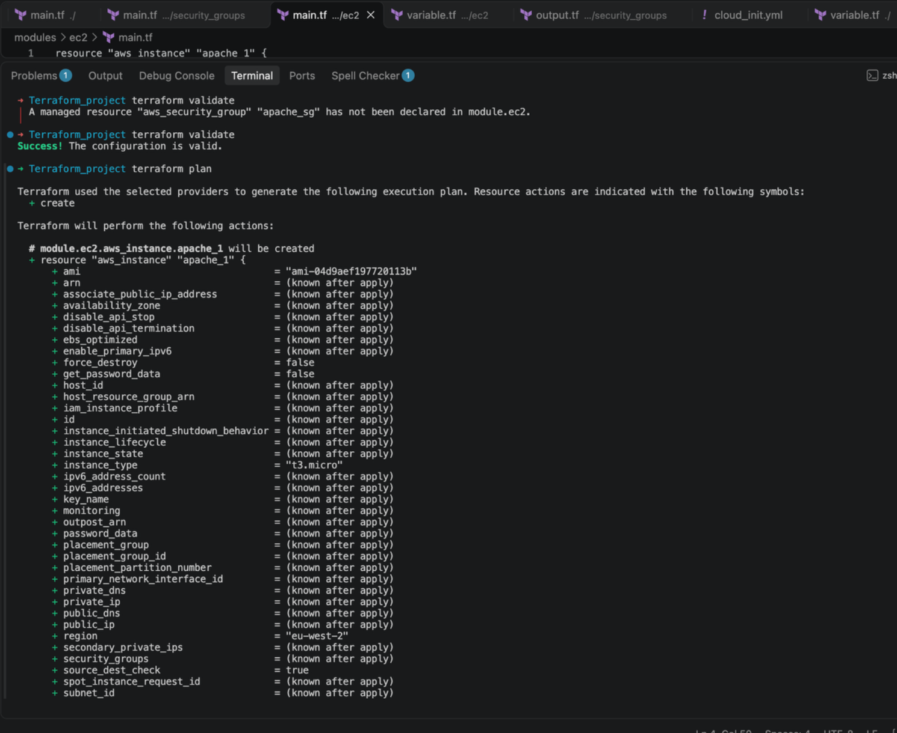
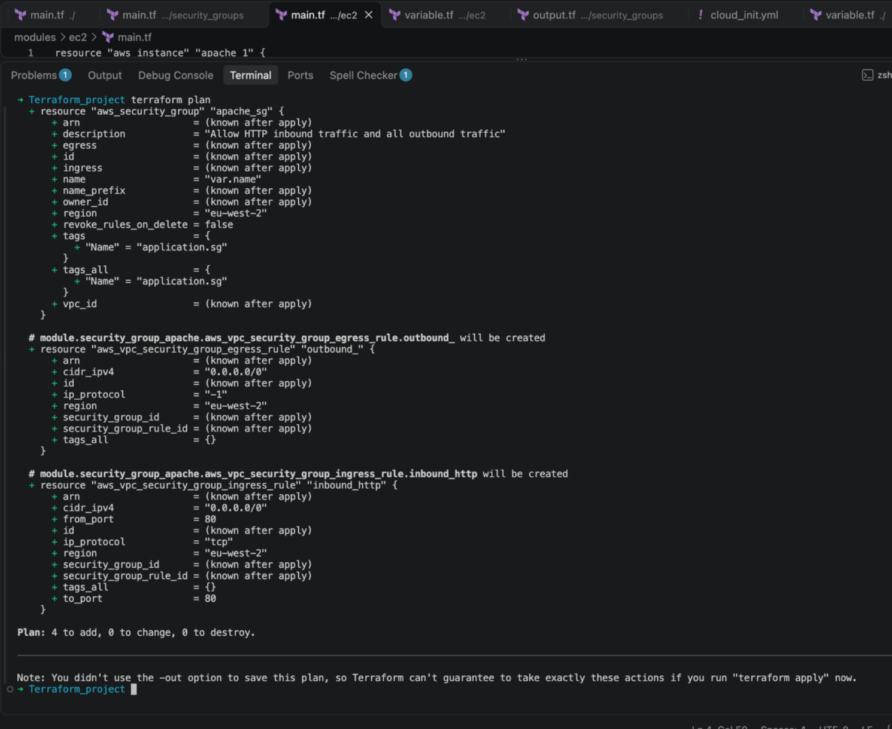
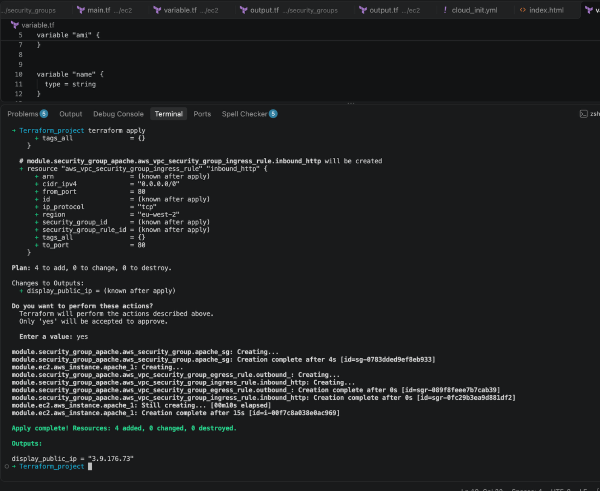
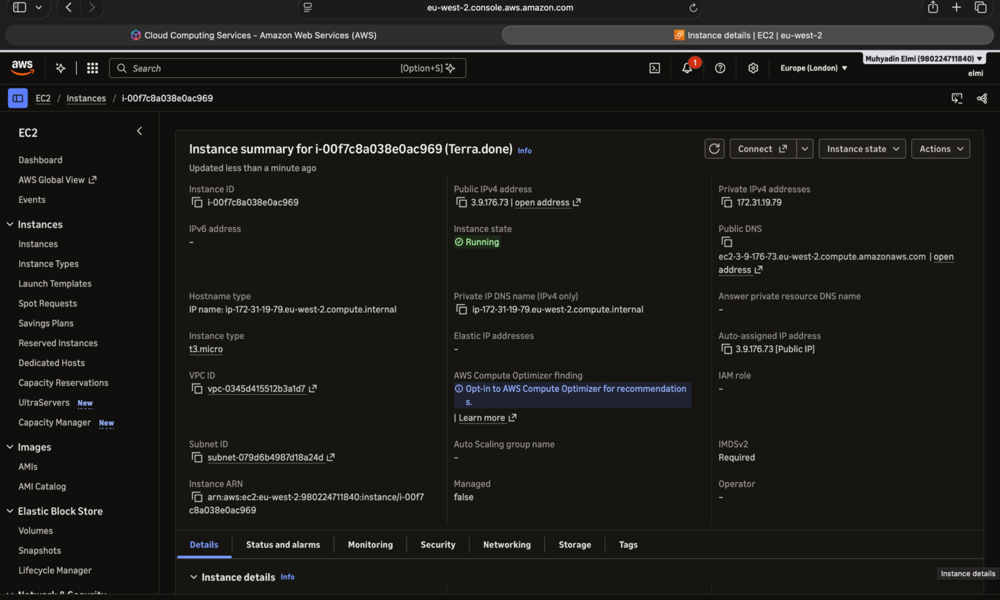
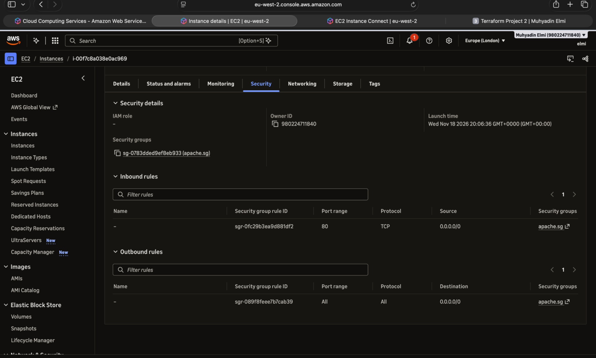
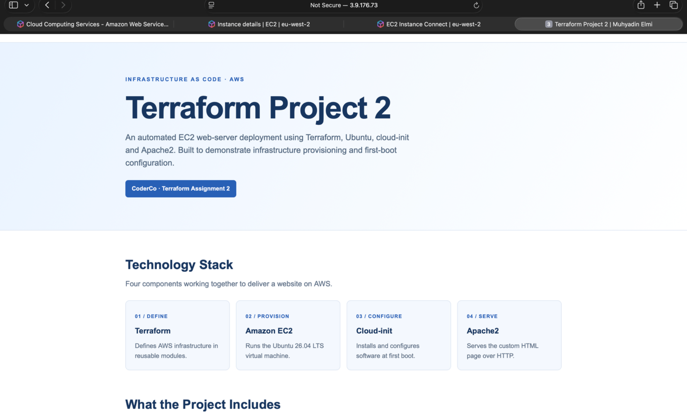
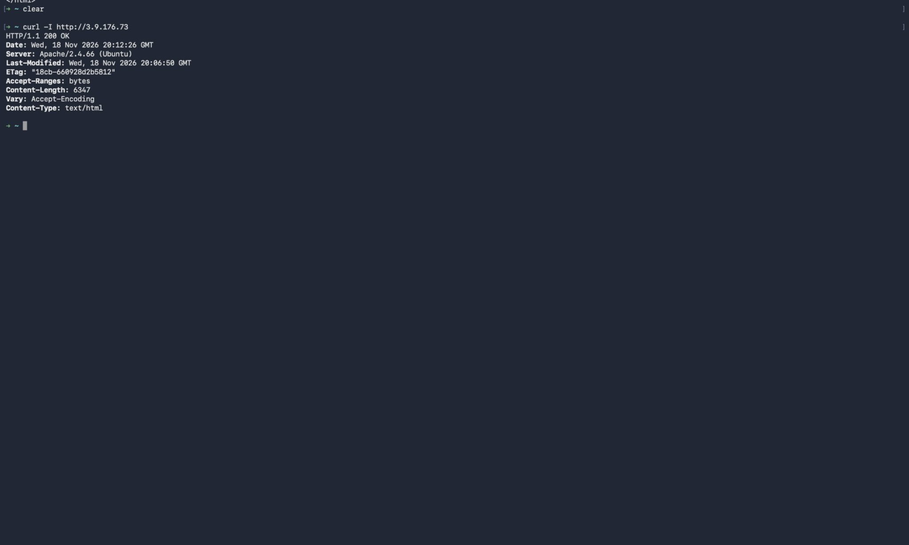
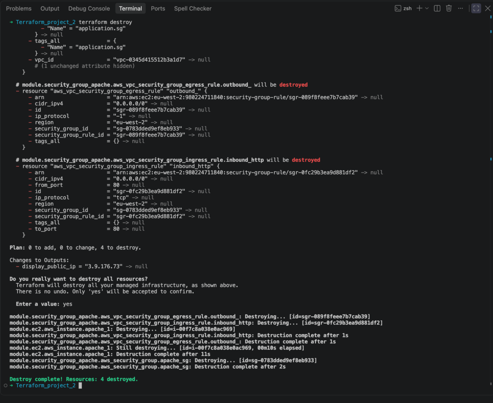

# Assignment 2 — Deploy Apache on EC2 with Terraform and Cloud-Init

[← DevOps Learning](../../README.md) · [Assignment 1 — WordPress](../project-1/) · [Browse all screenshots](screenshots/)

## Objective

Provision an EC2 instance using Terraform, bootstrap Apache automatically with a cloud-init YAML file, and serve my own HTML page over the instance's public IPv4 address. I separated the EC2 and security-group configuration into reusable modules, then verified the running infrastructure, HTTP response and cleanup.

## Implementation

| Task | My configuration |
|---|---|
| Region | AWS `eu-west-2` (London) |
| EC2 | `aws_instance.apache_1` in the `ec2` child module; Ubuntu AMI supplied as an input and a `t3.micro` instance |
| Security group | Separate `security_groups` module; inbound TCP `80` from `0.0.0.0/0` and outbound traffic allowed |
| Module connection | The security-group module exposes its ID; the root module passes that output into the EC2 module's `security_group_id` input |
| Public access | `associate_public_ip_address` is configured through the `public_ipv4` variable; the public IP is exposed as a root output |
| First-boot configuration | `cloud_init.yml` updates packages, installs Apache2, writes the custom page to `/var/www/html/index.html`, and starts/enables the Apache service |
| Page content | `index.html` is read by Terraform, base64-encoded and passed to cloud-init using `templatefile()` and `filebase64()` |
| State | S3 backend configuration in `apache.remote_storage.tf` using a project-specific state key |
| Inputs | Root `variable.tf` declares inputs; `terraform.tfvars` supplies the assignment values |

The web port was deliberately public for this lab. In a production setup I would limit the source range or put the application behind an appropriate load balancer, and would not assume that a running EC2 instance means the web service is healthy.

## Project files

```text
project-2/
├── apache.remote_storage.tf
├── main.tf
├── output.tf
├── provider.tf
├── terraform.tfvars
├── variable.tf
└── modules/
    ├── ec2/
    │   ├── cloud_init.yml
    │   ├── index.html
    │   ├── main.tf
    │   ├── output.tf
    │   └── variable.tf
    └── security_groups/
        ├── main.tf
        ├── output.tf
        └── variable.tf
```

The key connection is **security-group output → root module → EC2 input**. The EC2 module does not reach into the other module to read its resources directly. The main EC2 resource also passes the HTML content into the cloud-init template:

```hcl
vpc_security_group_ids = [var.security_group_id]

user_data = templatefile("${path.module}/cloud_init.yml", {
  html_content = filebase64("${path.module}/index.html")
})

associate_public_ip_address = var.public_ipv4
```

## Evidence — validation, deployment and live application

The screenshots below show the actual Terraform and AWS workflow, not just the finished code. Click each image for its full-size evidence.

### 1. Validation and the execution plan

<a href="screenshots/validate-and-plan.webp"></a>

*After correcting a cross-module resource reference, `terraform validate` returned **Success! The configuration is valid.** The plan then described the resources Terraform would create.*

<a href="screenshots/plan-four-create.webp"></a>

*The reviewed plan showed **4 to add, 0 to change, 0 to destroy**. The security-group resource, its HTTP ingress and egress rules, and EC2 instance made up those four resources.*

### 2. Terraform apply

<a href="screenshots/apply-four-created.webp"></a>

*`terraform apply` completed: **4 added, 0 changed, 0 destroyed**. The output exposed the instance's public IPv4 address for testing.*

### 3. AWS EC2 and security group

<a href="screenshots/aws-ec2-running.webp"></a>

*The AWS console confirmed the EC2 instance was **Running**, with its public IPv4 address recorded at the time of the deployment.*

<a href="screenshots/aws-security-group-rules.webp"></a>

*The attached `apache.sg` security group showed inbound TCP port `80` from `0.0.0.0/0` and an outbound allow rule.*

### 4. The deployed website and HTTP response

<a href="screenshots/apache-site-landing.webp"></a>

*The instance served the custom **Terraform Project 2** page, rather than Apache's default landing page.*

<a href="screenshots/apache-http-200.webp"></a>

*A terminal HTTP request returned **HTTP/1.1 200 OK**, showing that the deployed server was responding to requests.*

### 5. Destroy and cleanup

<a href="screenshots/destroy-four-complete.webp"></a>

*The final `terraform destroy` was confirmed and finished with **Destroy complete! Resources: 4 destroyed.** This is a completed cleanup, not merely a destroy preview.*

## Troubleshooting I worked through

**Cross-module reference:** Initially, the EC2 module tried to refer directly to a security-group resource declared outside that module. Terraform reported `Reference to undeclared resource` ([error screenshot](screenshots/troubleshoot-unresolved-module.webp)). The correct design was to export the group ID from the security-group module, pass it through the root `module` block, and consume it as `var.security_group_id` inside EC2. A subsequent [validation screenshot](screenshots/validate-and-plan.webp) shows the error resolved.

**Required input missing:** When the EC2 module declared `public_ipv4` as a required variable but the root call did not provide it, `terraform validate` reported `Missing required argument`. I connected the root value to that child-module input; the same [terminal screenshot](screenshots/troubleshoot-missing-variable.webp) shows the error followed by **Success! The configuration is valid.**

**Replacement flagged by a later plan:** A later `terraform plan` showed the EC2 instance would need to be **replaced**, with `associate_public_ip_address` changing from `false` to `true` ([replacement-plan screenshot](screenshots/plan-public-ip-replacement.webp)). That is why I inspect `-/+` and *forces replacement* before approving a plan: not every change is an in-place update. The screenshot records the proposed change, **not** a second completed deployment.

**Lesson learned:** Module boundaries require deliberate output/input connections, successful syntax validation does not by itself prove HTTP works, and a plan must be read before `apply`. The browser, `curl`, AWS console and destroy output each verify a different part of the lifecycle.

## Source-file screenshot archive

I captured the Terraform and application files individually. The GitHub files remain the source of truth; these screenshots preserve what was open in VS Code during the assignment.

| File | Screenshot |
|---|---|
| `main.tf` | [Root module configuration](screenshots/source-root-main.webp) |
| `variable.tf` | [Root input declarations](screenshots/source-root-variables.webp) |
| `terraform.tfvars` | [Root input values](screenshots/source-tfvars.webp) |
| `output.tf` | [Root output](screenshots/source-root-output.webp) |
| `provider.tf` | [AWS provider](screenshots/source-provider.webp) |
| `apache.remote_storage.tf` | [S3 backend configuration](screenshots/source-remote-backend.webp) |
| `modules/ec2/main.tf` | [EC2 resource and cloud-init hookup](screenshots/source-ec2-main.webp) |
| `modules/ec2/variable.tf` | [EC2 inputs](screenshots/source-ec2-variables.webp) |
| `modules/ec2/output.tf` | [EC2 output](screenshots/source-ec2-output.webp) |
| `modules/ec2/cloud_init.yml` | [Cloud-init setup](screenshots/source-cloud-init.webp) |
| `modules/ec2/index.html` | [Custom HTML source](screenshots/source-index-html.webp) |
| `modules/security_groups/main.tf` | [Security-group resources](screenshots/source-sg-main.webp) |
| `modules/security_groups/variable.tf` | [Security-group inputs](screenshots/source-sg-variables.webp) |
| `modules/security_groups/output.tf` | [Security-group output](screenshots/source-sg-output.webp) |

Additional captures retained in the [screenshots folder](screenshots/) include the [apply approval](screenshots/apply-confirmation.webp), [another plan review](screenshots/plan-second-review.webp), [extra EC2 console view](screenshots/aws-ec2-summary.webp) and [lower section of the live website](screenshots/apache-site-project-files.webp).

## What I verified

- **Terraform configuration:** `terraform validate` succeeded after resolving the module wiring and variable inputs.
- **Infrastructure creation:** The final apply created four Terraform-managed AWS resources.
- **Live EC2:** The AWS console showed the instance running with a public IPv4 address.
- **Network access:** The security group allowed inbound HTTP on port `80` and the site was reachable.
- **First-boot automation:** Apache served the supplied HTML page and an HTTP request returned `200 OK`.
- **Cleanup:** Terraform destroyed all four managed resources in the final run.

The screenshots are historical deployment evidence. Following `terraform destroy`, the recorded public IP and website should **not** be treated as live endpoints.
