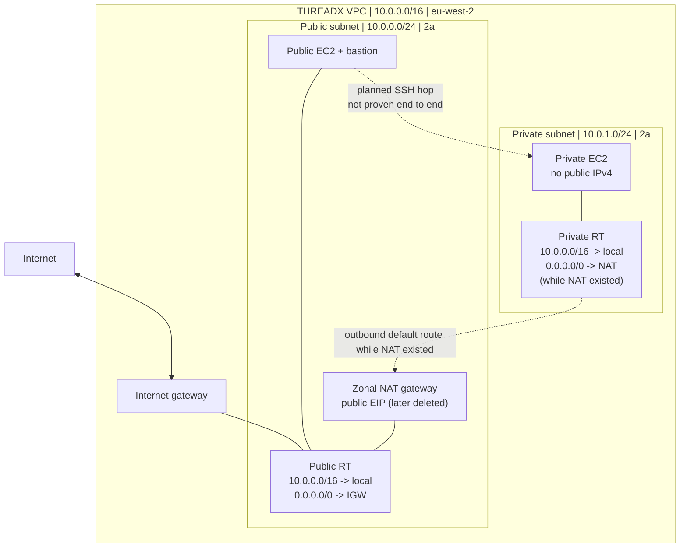

# Assignment 1 — VPC, subnet routing and EC2 networking

## 1) Project overview

CoderCo asked for a custom VPC with a public and private subnet, an Internet Gateway, a NAT Gateway in the public subnet, route tables for each subnet, and EC2 instances to demonstrate public/private placement. I used the THREADX naming scheme in `eu-west-2` and built the networking by hand to understand each dependency.

**What I set out to prove:** a subnet's name does not make it public; **route tables** determine the path, while a host's public IP, security group, service and credentials determine whether a specific connection can work.

## 2) Architecture



The dashed lines distinguish a configured route or planned bastion connection from a successful recorded end-to-end test. **A route table is not a server in an Availability Zone.**

## 3) Main configuration

| Resource | Lab value / decision |
|---|---|
| VPC | `THREADX_VPC` — `10.0.0.0/16` |
| Public subnet | `pub-threadx` — `10.0.0.0/24`, `eu-west-2a` |
| Private subnet | `piv-threadX` — `10.0.1.0/24`, `eu-west-2a` |
| Internet Gateway | `ig-threadX`, attached to the THREADX VPC |
| Public route table | `RouteT-Pub-threadX`: local route plus `0.0.0.0/0` → IGW |
| Private route table | `RouteT-priv-threadX`: local route plus `0.0.0.0/0` → NAT while NAT existed |
| NAT Gateway | `ng-threadX`, **public / zonal**, hosted in the public subnet; later deleted |
| Elastic IP | Allocated to NAT, then **released** |
| EC2 | Public EC2, private EC2 without public IP, and a public bastion instance |
| Storage | EC2 root volumes used EBS gp3 (not a separate EFS service) |

Each `/24` contains 256 total IPv4 addresses, **251 available within AWS** after AWS reserves five. The two `/24` subnets are nonoverlapping parts of the parent `/16`.

## 4) Build steps and the decisions behind them

### 4.1) VPC and subnets

**Console:** VPC → Your VPCs → Create VPC → *VPC only*. The manual option mattered because I wanted to create and connect the other resources individually, not let the wizard build everything for me. After creation, I checked the VPC ID instead of assuming a resource name was sufficient.

**Console:** VPC → Subnets → Create subnet. I chose the THREADX VPC, the AZ, and two nonoverlapping CIDR blocks. My old default VPC used `172.31.x.x`; seeing those ranges in a list did **not** mean THREADX's subnets were missing. I filtered by the selected VPC.

### 4.2) Internet Gateway and routing

**Console:** Internet gateways → Create internet gateway → Actions → Attach to VPC. **Creating** the IGW and **attaching** it are separate operations; neither by itself adds `0.0.0.0/0` to a subnet's route table.

**Console:** Route tables → Create route table (choose VPC) → Routes → Edit routes → Add route. Then **Subnet associations → Edit subnet associations**. I learned to distinguish these questions:

- **Routes:** Which next hop should packets use for a destination prefix?
- **Associations:** Which subnets follow this particular set of routes?
- **Local route:** `10.0.0.0/16 → local` matches traffic destined for addresses inside the VPC, including another subnet; it is not the IP of one instance.

The public subnet was explicitly associated with the public route table, and the private subnet with the private route table.

### 4.3) NAT and EIP

**Console:** EC2 → Elastic IPs → Allocate; VPC → NAT gateways → Create NAT gateway. I chose **Zonal**, selected the public subnet and the allocated EIP, and observed the NAT move to **Available**. A private EC2 can use a NAT path only when its associated route table points to that gateway and other relevant conditions permit egress.

**Cost note:** I deliberately deleted the NAT Gateway and released the EIP after the lab. The previously saved private default route is therefore not a functioning internet route today.

### 4.4) EC2 and bastion security

**Console:** EC2 → Instances → Launch instances → Network settings → choose **THREADX VPC and the correct subnet**. The private instance had an internal address but no public IPv4. For administration I set up a bastion path:

```text
Mac SSH client -> bastion public IPv4:22
bastion SSH client -> private EC2 private IPv4:22
```

Security groups allowed the intended SSH flows. They did **not** automatically forward a connection; SSH from the bastion must initiate the second connection. **That second hop was not actually verified as a completed SSH session.** No private-instance internet egress `curl` result was retained either.

## 5) Verification and evidence

| Check | Observation | Confidence |
|---|---|---|
| VPC/subnet CIDRs | Confirmed in AWS Console | Configured/observed |
| Public vs private routes | Public IGW and private NAT default routes present before cleanup | Configured/observed |
| NAT | Status `Available` before deletion | Observed |
| Private EC2 | No public IPv4 shown | Observed |
| Bastion-to-private SSH | Security groups and path designed | **Not end-to-end tested** |
| Private outbound internet | NAT/routing configured | **Not end-to-end tested** |

**Curated visual proof (3 screenshots, not every screen):** [evidence plan](screenshots/README.md). The final screenshot set is curated separately from console navigation logs.

## 6) Challenges and corrections

**Wrong VPC selected when launching EC2.** An earlier instance landed in the pre-existing/default VPC. I recognised the `172.31.x.x` private address and checked the VPC ID. The correction was to explicitly select THREADX in the launch wizard.

**Subnet CIDR confusion.** A subnet must fit within the parent `10.0.0.0/16` and not overlap another subnet. `10.0.0.0/24` and `10.0.1.0/24` satisfy that. AWS's usable addresses are not the same as the mathematical total.

**Route table vs subnet association.** Seeing “subnets without explicit associations” meant they still used the main route table. The fix was to associate each subnet deliberately with its intended table, not assume routes apply based on names.

**Assuming public subnet means public EC2 address.** Public routing via IGW is necessary, but an EC2 instance also needs a public IPv4/EIP for direct IPv4 internet reachability; appropriate inbound rules and a listening service also matter. Private `10.x.x.x` remains the interface's internal identity.

**Bastion vs reverse proxy.** Allowing SSH on security groups does not make an EC2 automatically relay web or SSH traffic. A second SSH connection must be actively established to the private IP.

## 7) What I learned / what I would retest

- **Strongest:** VPC/subnet address containment, IGW attachment, and the importance of checking the selected VPC; repeated subnet/routing work improved confidence.
- **Needs more independent practice:** CIDR maths, `local` vs default route matching, and choosing route-table associations without prompts.
- **Still to prove hands-on:** complete SSH via bastion to private host and a confirmed private-instance outbound connection with a temporary NAT gateway.

## 8) Cleanup and reproduction

NAT and EIP were deleted to reduce charges. Practice EC2 instances were stopped, not all terminated; EBS volumes remain relevant to costs. There is no Terraform script here. Reproduction requires recreating or checking the NAT before claiming that private egress works.

[← AWS overview](../README.md)
