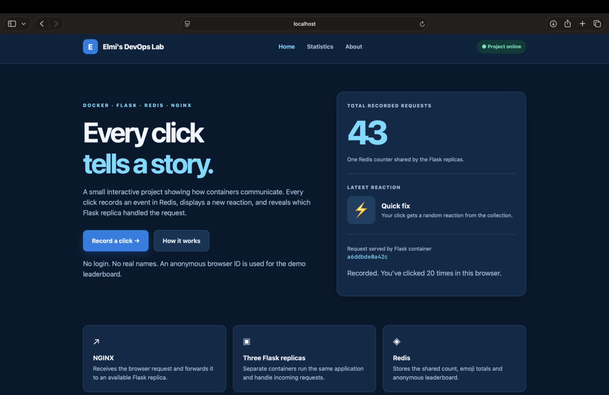
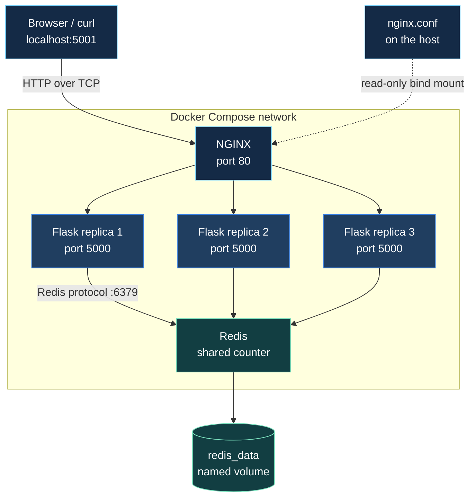

# Docker Visit Counter — An Engineering Build Log

> **One shared counter. Three Flask replicas. Five running containers.**  
> A CoderCo Docker challenge extended with NGINX load balancing, Redis persistence and a personalised click dashboard.

**Stack:** Docker · Docker Compose · Python/Flask · Redis · NGINX · HTML/CSS/JavaScript  
**Author:** Muhyadin Elmi

## The application

I started with CoderCo's challenge: run a Flask application and Redis as separate containers, then make a visit counter work across them. I extended the setup to run three Flask replicas behind NGINX and later added a dashboard with emoji reactions, statistics and an anonymous leaderboard.

The counter and reaction data live in **one Redis service**, so requests handled by different Flask containers share the same state. Docker Compose defines the services, builds the custom images and creates the network connecting them.

### Demo — video coming soon



*Temporary still from an earlier working version of the counter (count: 20). I will replace it with a 30–45-second recording of the finished dashboard and project walkthrough. The current UI has evolved since this screenshot.*

The completed application is intended to run locally at **`http://localhost:5001`**. The GitHub repository contains the source code; it does not itself host the running application.

### What the application exposes

| Route | Purpose |
| --- | --- |
| `GET /` | Interactive dashboard with the shared counter and last reaction |
| `POST /api/click` | Records a click in Redis, chooses an emoji and returns the responding Flask container ID |
| `GET /stats` | Statistics page: reaction collection and anonymous activity leaderboard |
| `GET /api/stats` | JSON totals, reaction counts and leaderboard entries |
| `GET /about` | Explains the components and request flow |
| `GET /count` | Original CoderCo-style route: increments and displays the Redis counter |

The displayed total counts recorded **interactions**, not verified unique visitors. The anonymous leaderboard identifies browsers using locally stored random IDs, not real people. The emoji total counts only clicks made through the personalised button; it may differ from the older `/count` total.

## Follow one request



1. A browser connects to **host port 5001**, published to **port 80** in the NGINX container.
2. NGINX acts as a reverse proxy. Its upstream uses Docker's internal DNS to reach the `web` service, whose three containers listen internally on port 5000.
3. One Flask replica handles the HTTP request. A counter request or dashboard click makes that application talk to Redis on port 6379.
4. Redis maintains the shared data. Its `/data` directory is backed by a Docker-managed named volume for persistence files.
5. The Flask response returns through NGINX to the browser. The response can identify which Flask replica served it.

NGINX uses its default round-robin upstream balancing method; that does **not** guarantee perfectly equal workload or application health. Redis is accessed internally and has no published host port.

## The files and the decisions behind them

This project sits in the `docker/` directory of my wider DevOps learning repository.

```text
docker/
├── README.md
├── assets/
│   └── counter-preview.png       # Temporary demo still
├── applications/
│   ├── app.py                    # Flask routes and Redis operations
│   ├── requirements.txt          # Python application dependencies
│   ├── templates/
│   │   ├── index.html
│   │   ├── stats.html
│   │   └── about.html
│   └── static/
│       └── style.css
└── containers/
    ├── Dockerfile.flask
    ├── Dockerfile.redis
    ├── docker-compose.yml
    └── nginx.conf
```

### Packaging two different services

I created separate Dockerfiles because the applications need different software.

- **[Flask Dockerfile](containers/Dockerfile.flask):** `python:3.12-slim` supplies Python, but not Flask or the Redis Python client. The image copies the application files from its build context and installs the packages in [`requirements.txt`](applications/requirements.txt) with `RUN pip install`. Its default `CMD` starts `app.py` when the container runs.
- **[Redis Dockerfile](containers/Dockerfile.redis):** `redis:7-alpine` already contains the Redis server. I didn't need another installation step. This Dockerfile uses the base image and documents port 6379 with `EXPOSE`.

**What clicked for me:** there isn't one fixed Dockerfile recipe. The instructions depend on what's already in the base image and what the application still needs. `RUN` performs a build-time step; `CMD` provides a default startup command. `EXPOSE` documents a port—it does not publish it on my Mac.

### The Compose configuration changed as the project grew

My earlier two-service setup published Flask directly to my Mac:

```yaml
# Reconstructed excerpt from the earlier Flask + Redis stage.
web:
  ports:
    - "5000:5000"
  depends_on:
    - redis_client

redis_client:
  volumes:
    - redis_data:/data
```

That was useful for learning how Flask and Redis communicate. It also exposed an important limitation: a fixed published host port cannot be claimed simultaneously by three Flask replicas.

The final [Compose configuration](containers/docker-compose.yml) removes Flask's host-port mapping and introduces NGINX as the public entry point:

```yaml
services:
  nginx:
    image: nginx:alpine
    ports:
      - "5001:80"
    depends_on:
      - web
    volumes:
      - ./nginx.conf:/etc/nginx/nginx.conf:ro

  web:
    build:
      context: ../applications
      dockerfile: ../containers/Dockerfile.flask
    image: flask:v1
    depends_on:
      - redis_client
    environment:
      REDIS_HOST: redis_client
      REDIS_PORT: "6379"

  redis_client:
    build:
      context: .
      dockerfile: Dockerfile.redis
    image: redis.v1
    volumes:
      - redis_data:/data

volumes:
  redis_data:
```

The older excerpt is reconstructed from my development work; it is **not** presented as an exact historical Git revision. The final YAML above reflects the current repository configuration.

Three details were especially important:

**Build paths.** `context` identifies the build input directory relative to the Compose file. The `dockerfile` location is resolved relative to that build context. The Flask build context is `../applications`, whereas the Redis build context is the `containers/` directory itself.

**Networking and configuration.** Compose creates an internal network and provides DNS resolution for service names. Flask connects to `redis_client:6379`, not `localhost:6379` (which would refer to the Flask container's own network environment). The `REDIS_HOST` and `REDIS_PORT` environment variables let me change the connection settings without editing Python. `depends_on` starts Redis before Flask, but doesn't by itself wait until Redis is healthy.

**Persistence.** The named volume `redis_data:/data` keeps Redis's persistence files separate from the container's writable filesystem. Recreating Redis with the same volume allows it to recover data that Redis has written to disk. The volume remains after a normal `docker compose down`, but `docker compose down -v` removes it.

### Putting NGINX in front of Flask

I integrated NGINX into Compose, mounted [nginx.conf](containers/nginx.conf) as a read-only file, and used it as the client-facing reverse proxy.

```nginx
events {}

http {
    resolver 127.0.0.11 valid=10s;

    upstream flask_backend {
        zone flask_backend 64k;
        server web:5000 resolve;
    }

    server {
        listen 80;

        location / {
            proxy_pass http://flask_backend;
        }
    }
}
```

The `resolver` points to Docker's internal DNS, the `upstream` names the Flask backend, and `proxy_pass` forwards HTTP requests to it. The `resolve` option allows NGINX to refresh the backend addresses. NGINX listens on port 80 **inside its container** while Docker publishes that endpoint on my Mac at `localhost:5001`.

I then ran three replicas of the `web` service. Each replica runs the same application image but has its own container identity; all three connect to the same Redis data store.

### Personalising the finished application

The original challenge used a welcome route and a simple Redis-backed counter. I kept the `/count` route and extended the application with a responsive dashboard, changing emoji reactions and statistics.

[`app.py`](applications/app.py) uses Redis keys and data structures for different jobs:

| Redis data | Used for |
| --- | --- |
| `visits` | Shared total incremented by `/count` and the dashboard click action |
| `emoji_counts` | Counts for each emoji reaction |
| `guest_scores` | Sorted scores for the anonymous leaderboard |
| `last_reaction` | Previous emoji, used to avoid immediate repeats during ordinary sequential clicks |

The browser holds a random anonymous ID in local storage for the demo leaderboard. This is **not an account or verified identity**, and resetting browser storage creates a new label. The project is a learning application, not an analytics system tracking unique people.

## Run the stack locally

**Prerequisites:** Docker Desktop or a working Docker Engine with Docker Compose.

The personalised version currently lives on the feature branch while its [pull request](https://github.com/muhayadindev-dev/DevOps_Learning-/pull/1) is under review:

```bash
git clone --branch feature/docker-personal-dashboard https://github.com/muhayadindev-dev/DevOps_Learning-.git
cd DevOps_Learning-/docker/containers
docker compose up -d --build --scale web=3
```

`up` creates and starts the services, `-d` runs them in the background, `--build` builds configured images before starting, and `--scale web=3` requests three Flask containers.

Open **http://localhost:5001** in a browser. The Statistics and About pages are at `/stats` and `/about`. The original CoderCo counter endpoint remains available at `/count`.

Useful checks from the same `docker/containers` directory:

```bash
docker compose ps
curl -i http://localhost:5001
curl -i http://localhost:5001/count
docker compose logs nginx
```

Stop the stack without deleting the named volume:

```bash
docker compose down
```

**Note for macOS:** Docker Desktop needs permission to share the project directory when a Compose service bind-mounts a local file such as `nginx.conf`.

## Evidence, not assumptions

These were the observations from my original working counter setup. The newer personalised dashboard still needs a full end-to-end check after rebuilding the updated Flask image.

| Check | What I observed | What that proves |
| --- | --- | --- |
| Container status | NGINX, Redis and three Flask replicas running | Compose started the intended five containers; not by itself proof of connectivity |
| HTTP access | `curl -i http://localhost:5001` returned `HTTP/1.1 200 OK` with the application response | NGINX reached a working Flask backend |
| Shared counter | The counter increased across requests | Flask could update and read shared Redis data |
| Load balancing | Counter values increased while at least two different Flask container IDs appeared | Requests reached different replicas, sharing the same counter |
| Persistence | Counter continuity was checked after Redis container recreation with its named volume | Saved Redis data was retained in that test |

**Checks to repeat before merging the PR:** Verify that the new dashboard records clicks, changes reactions, displays the responding Flask container, and populates `/stats` correctly. Also verify that `/about` and the original `/count` route still work. I will replace the temporary preview still with a short demonstration recording.

## When things broke — and what I learned

The working application is only half the story. These are actual problems I encountered during the build and the engineering lessons they exposed.

| Incident | What I investigated or changed | Key learning |
| --- | --- | --- |
| Docker daemon unavailable | Started Docker Desktop before retrying Docker commands | The Docker CLI needs a running Engine to build or manage containers |
| Dockerfile build paths | Checked `build.context`, the Dockerfile path and the directories used by Compose | Dockerfile paths and build contexts are related but not interchangeable |
| Compose YAML mistakes | Corrected field names such as `environment` and `image` | Small YAML errors can prevent a stack from being interpreted correctly |
| Port 5000 conflict | `localhost:5000` returned an AirTunes-related `403`; used an available host port for NGINX | A host address and port can be bound by only one listener at a time |
| Flask scaling | Removed the fixed `5000:5000` host mapping from `web` and routed requests through NGINX | Multiple replicas can use the same *internal* port while sharing one reverse-proxy entry point |
| NGINX configuration file | Found `nginx.config` instead of the expected `nginx.conf` | Bind-mount paths and filenames must match exactly |
| Docker Desktop bind mount | Investigated `operation not permitted` when NGINX tried to mount the configuration | Host file-sharing permissions affect bind mounts on Docker Desktop |
| Compose scaling syntax | Corrected `web=3` to `--scale web=3` | Without the flag, Compose interpreted `web=3` as a service name |

The port issue taught me two separate lessons: macOS already had a service listening on port 5000, **and** three Flask replicas could not all publish that same fixed host port even if it were otherwise available. Publishing NGINX as `5001:80` while leaving Flask internal solved both design problems.

My biggest conceptual challenge was **working out application dependencies before writing Dockerfiles**. The Python base image includes Python but still needs Flask and the Redis client installed; the Redis base image already contains its server. This made me realise that Dockerfile instructions depend on the application and what its base image provides.

## What I would improve next

- **Production serving:** Replace Flask's built-in development server with a production-suitable WSGI server.
- **Startup readiness:** Add health checks and retry behaviour rather than relying solely on `depends_on` startup ordering.
- **Testing:** Add repeatable integration checks for the counter, dashboard API and Redis reconnection.
- **Data durability:** Review Redis persistence settings; keeping `/data` on a volume does not by itself guarantee that every recent write has reached disk.
- **Delivery:** Add CI checks and publish versioned images when extending the project beyond this local learning exercise.

This project began as a small Flask/Redis exercise. The most valuable part for me was learning to connect the Dockerfiles, Compose configuration, networking, storage and reverse proxy—and then using terminal evidence to investigate when those pieces didn't work together.

---

**Challenge:** [CoderCo Containers Intro — multi-container application](https://github.com/codercohq/containers-intro/tree/main/challenge)  
**Current work:** [Review the personalised dashboard pull request](https://github.com/muhayadindev-dev/DevOps_Learning-/pull/1)
