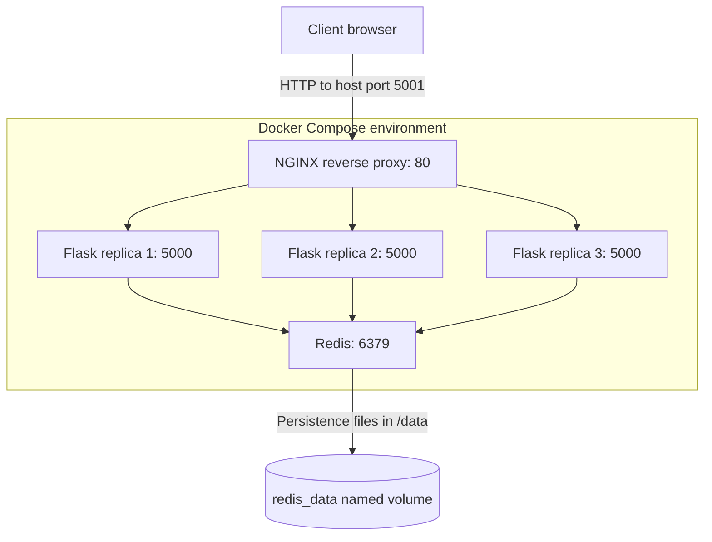

# Docker Visit Counter — Flask, Redis and NGINX

## 1) Project Overview

This project began with CoderCo's multi-container Docker assignment: running a Python Flask application and a Redis database in separate containers, then connecting them through Docker Compose. I extended the application to include an NGINX reverse proxy, three Flask replicas, persistent Redis storage and a web interface with a shared counter, changing emoji reactions and an anonymous activity leaderboard.

The aim was to understand how several containers work together as one application. That involved building different images, configuring service-to-service communication, separating internal and published ports, and investigating failures during deployment.

**Technologies:** Docker, Docker Compose, Python, Flask, Redis, NGINX, HTML, CSS and JavaScript.

### 1.1) Application Demo


### 1.2) Application Functionality

The web interface has three pages:

- **Dashboard (`/`):** Displays the shared interaction count. Clicking the counter sends a `POST` request to `/api/click`. Flask updates Redis and returns the new total, a randomly selected reaction, the anonymous browser label and the hostname of the Flask container that handled the request.
- **Statistics (`/stats`):** Displays the distribution of emoji reactions and a leaderboard ranked by recorded clicks. The page retrieves the figures from `GET /api/stats`; the information comes from Redis rather than an independent counter in each container.
- **About (`/about`):** Describes the technologies used and their responsibilities within the application.

I also retained the original `GET /count` endpoint from the assignment. It increments the same shared `visits` value and returns the responding container's hostname, which is useful when checking requests across replicas.

The counter records interactions, **not unique visitors**. The leaderboard uses a randomly generated identifier stored in each browser's local storage. It does not collect real names or establish a verified user identity. Reaction totals are recorded separately from the original `/count` requests, so they may differ from the overall counter.

## 2) Application Architecture



The request moves through the following components:

1. **Client and published port:** The browser connects to `http://localhost:5001`. Docker forwards traffic from port `5001` on my Mac to port `80` inside the NGINX container.
2. **NGINX reverse proxy:** NGINX receives the HTTP request and forwards it to a Flask backend. Three containers run the same Flask image; NGINX can distribute requests across their internal addresses.
3. **Flask application:** A replica processes the request. For an interaction that needs stored data, the Python application connects to Redis using its Compose service name and port `6379`.
4. **Redis and storage:** All Flask replicas use the same Redis service, so the count does not start again when another replica responds. Redis has a named volume mounted at `/data` for its persistence files.
5. **Response:** Flask sends the result back through NGINX to the browser. The application can also return the Flask container's hostname to help demonstrate which replica handled a request.

Only NGINX needs a published host port for browser access. Flask and Redis communicate on the internal Compose network. The `nginx.conf` file determines how NGINX forwards requests; it is configuration mounted into the container, **not an additional component in the network request path**.

## 3) Project Structure

The project is stored in the `docker/` directory of my DevOps learning repository:

```text
docker/
├── README.md
├── assets/
│   └── counter-preview.png
├── applications/
│   ├── app.py
│   ├── requirements.txt
│   ├── templates/
│   │   ├── index.html
│   │   ├── stats.html
│   │   └── about.html
│   └── static/
│       └── style.css
└── containers/
    ├── Dockerfile.flask
    ├── Dockerfile.redis
    ├── docker-compose.yml
    └── nginx.conf
```

- `applications/` contains the Flask application, its Python dependencies, HTML templates and styling.
- `containers/` contains the image definitions, Docker Compose services and NGINX routing configuration.
- `assets/` contains the application image used in this documentation.

## 4) Implementation and Configuration

### 4.1) Building the Flask and Redis Images

I used two Dockerfiles because Flask and Redis have different dependencies.

**[Dockerfile.flask](containers/Dockerfile.flask)**

```dockerfile
FROM python:3.12-slim
WORKDIR ./app
COPY . .
RUN pip install --no-cache-dir -r requirements.txt
EXPOSE 5000
CMD ["python", "app.py"]
```

The `python:3.12-slim` base image provides Python, but does not include Flask or the Python Redis client. Those are declared in [`requirements.txt`](applications/requirements.txt) and installed with `RUN` **during the image build**. `COPY` adds the application files from the build context, while `CMD` specifies the command used to start the Flask application **when the container runs**. `EXPOSE 5000` documents the application's listening port; it does not publish that port on the Mac.

**[Dockerfile.redis](containers/Dockerfile.redis)**

```dockerfile
FROM redis:7-alpine
EXPOSE 6379
```

The official Redis base image already provides the Redis server and its startup behaviour, so there was no additional package installation or startup command to define.

This was one of the main lessons from the assignment: a Dockerfile is determined by the software the application requires and what its selected base image already contains. The Flask image needed additional Python packages, whereas the Redis image did not.

### 4.2) Configuring Docker Compose

I initially connected Flask directly to the Mac using `5000:5000`, with Redis running as a separate service. The relevant part of that earlier configuration was:

```yaml
services:
  web:
    ports:
      - "5000:5000"
    depends_on:
      - redis_client

  redis_client:
    volumes:
      - redis_data:/data
```

This is a reconstructed excerpt of the original two-service arrangement, rather than an exact historical Git snapshot. It was sufficient for an initial Flask–Redis test, but the fixed host port later became a problem when I scaled Flask.

The current [`docker-compose.yml`](containers/docker-compose.yml) defines the NGINX, Flask and Redis services:

```yaml
services:
  nginx:
    image: nginx:alpine
    ports:
      - "5001:80"
    depends_on:
      - web
    volumes:
      - ./nginx.conf:/etc/nginx/nginx.conf:ro

  web:
    build:
      context: ../applications
      dockerfile: ../containers/Dockerfile.flask
    image: flask:v1
    depends_on:
      - redis_client
    environment:
      REDIS_HOST: redis_client
      REDIS_PORT: "6379"

  redis_client:
    build:
      context: .
      dockerfile: Dockerfile.redis
    image: redis.v1
    volumes:
      - redis_data:/data

volumes:
  redis_data:
```

**Build context and Dockerfile paths.** The Flask build context is `../applications`, which makes the application files available to `COPY`. Its Dockerfile is referenced relative to that context as `../containers/Dockerfile.flask`. Redis uses `.` as its build context because its Dockerfile is in the same directory as the Compose file. Understanding these relative paths was necessary when resolving build errors.

**Service discovery and environment variables.** Compose creates an internal network and provides DNS resolution for service names. The Flask container receives `REDIS_HOST=redis_client` and `REDIS_PORT=6379`, which tell the Python Redis client where to connect. Using `localhost` would point back to the Flask container's own network environment, not the Redis container. The environment variables let me change connection settings without editing the Python source. `depends_on` controls startup order; it does not create the network connection or guarantee that Redis is ready.

**Named volume.** The `redis_data:/data` mapping mounts a Docker-managed volume at Redis's data directory. This separates saved files from the container's writable layer, so a replacement Redis container can reuse data that Redis has written to disk. A normal `docker compose down` preserves named volumes, while `docker compose down -v` removes them. The volume alone is not a guarantee that every recent Redis update has been flushed to disk.

### 4.3) NGINX Reverse Proxy and Flask Replicas

NGINX became the single entry point for the application. Instead of publishing Flask directly to the Mac, Compose publishes `5001:80` for NGINX and leaves the Flask replicas accessible only through the internal Docker network.

I integrated the following [`nginx.conf`](containers/nginx.conf) into the Compose service using a read-only bind mount:

```nginx
events {}

http {
    resolver 127.0.0.11 valid=10s;

    upstream flask_backend {
        zone flask_backend 64k;
        server web:5000 resolve;
    }

    server {
        listen 80;

        location / {
            proxy_pass http://flask_backend;
        }
    }
}
```

In this configuration, `listen 80` identifies the port used by NGINX inside the container. The `upstream` block defines the Flask backend using the Compose service name `web`, and `proxy_pass` sends matching HTTP requests to that backend. The resolver uses Docker's internal DNS at `127.0.0.11`; the `resolve` setting supports changes to the resolved backend addresses.

Starting three `web` replicas creates three Flask containers from the same image. They each listen on port `5000` inside their own network environment, so they do not need three separate published host ports. NGINX can forward requests to these replicas, and they all use the same Redis store. NGINX's default round-robin selection distributes connections across available upstream addresses, but it does not guarantee exactly equal request counts or application health.

### 4.4) Flask Application — Initial and Final Versions

The Flask application changed significantly during this project. The initial version demonstrated communication with Redis and exposed a basic counter. The final version retained that counter and added the interactive dashboard, statistics API, emoji reactions and anonymous leaderboard.

NGINX is configured separately in `nginx.conf` and Docker Compose; it is not implemented inside the Flask Python file. It forwards requests to whichever Flask replica is selected.

#### 4.4.1) Initial Flask Application

This is the original [`app.py` from the first Docker project commit](https://github.com/muhayadindev-dev/DevOps_Learning-/blob/aecfa1926155b7ac93eede6eaf060c13c0677699/docker/applications/app.py):

```python
import os
import socket

from flask import Flask, render_template
import redis

app = Flask(__name__)

redis_client = redis.Redis(
    host=os.getenv("REDIS_HOST", "redis"),
    port=int(os.getenv("REDIS_PORT", "6379")),
    decode_responses=True
)

@app.route("/")
def home():
    return render_template("index.html")

@app.route("/count")
def count():
    visits = redis_client.incr("visits")
    hostname = socket.gethostname()

    return f"Visit count: {visits} | Container: {hostname}"

if __name__ == "__main__":
    app.run(host="0.0.0.0", port=5000)
```

The home route rendered a template, while `/count` incremented the `visits` key in Redis. The response also included `socket.gethostname()`, making it possible to see which Flask container handled the request. The Redis connection already used environment variables, so the hostname and port did not need to be hardcoded.

#### 4.4.2) Final Flask Application

The current [`app.py`](applications/app.py) contains the original counter route alongside the additional pages and API endpoints:

```python
import os
import random
import re
import socket

import redis
from flask import Flask, jsonify, render_template, request

app = Flask(__name__)

redis_client = redis.Redis(
    host=os.getenv("REDIS_HOST", "redis_client"),
    port=int(os.getenv("REDIS_PORT", "6379")),
    decode_responses=True,
)

REACTIONS = [
    {"emoji": "🚀", "label": "Shipped it"},
    {"emoji": "🐳", "label": "Container victory"},
    {"emoji": "🔥", "label": "On a roll"},
    {"emoji": "⚡", "label": "Quick fix"},
    {"emoji": "🧠", "label": "Eureka moment"},
    {"emoji": "🛠️", "label": "Debugging complete"},
    {"emoji": "🎯", "label": "Nailed it"},
    {"emoji": "💪", "label": "Kept going"},
]

@app.route("/")
def home():
    return render_template("index.html")

@app.route("/about")
def about():
    return render_template("about.html")

@app.route("/stats")
def stats_page():
    return render_template("stats.html")

@app.route("/count")
def count():
    visits = redis_client.incr("visits")
    return f"Visit count: {visits} | Container: {socket.gethostname()}"

@app.post("/api/click")
def click():
    payload = request.get_json(silent=True) or {}
    guest_id = payload.get("guest_id", "")
    if not isinstance(guest_id, str) or not re.fullmatch(r"[a-f0-9]{12}", guest_id):
        return jsonify({"error": "Invalid anonymous visitor ID"}), 400

    previous = redis_client.get("last_reaction")
    reaction = random.choice([item for item in REACTIONS if item["emoji"] != previous])
    guest = f"Guest-{guest_id[:6].upper()}"
    transaction = redis_client.pipeline(transaction=True)
    transaction.incr("visits")
    transaction.hincrby("emoji_counts", reaction["emoji"], 1)
    transaction.zincrby("guest_scores", 1, guest)
    transaction.set("last_reaction", reaction["emoji"])
    total, _, score, _ = transaction.execute()

    return jsonify({
        "total": total,
        "reaction": reaction,
        "your_clicks": int(score),
        "guest": guest,
        "container": socket.gethostname(),
    })

@app.get("/api/stats")
def stats_api():
    counts = redis_client.hgetall("emoji_counts")
    leaderboard = redis_client.zrevrange("guest_scores", 0, 9, withscores=True)
    return jsonify({
        "total": int(redis_client.get("visits") or 0),
        "emoji_total": sum(int(value) for value in counts.values()),
        "reactions": [
            {"emoji": item["emoji"], "label": item["label"], "count": int(counts.get(item["emoji"], 0))}
            for item in REACTIONS
        ],
        "leaderboard": [
            {"guest": guest, "clicks": int(score)}
            for guest, score in leaderboard
        ],
    })

if __name__ == "__main__":
    app.run(host="0.0.0.0", port=5000)
```

The main differences are the `/api/click` endpoint, which validates a browser-generated identifier and records an interaction, and `/api/stats`, which reads the stored reaction totals and leaderboard. The `/stats` and `/about` routes render their respective HTML pages. The original `/count` route remains available.

The application now uses several Redis data structures:

| Redis key | Purpose |
| --- | --- |
| `visits` | Shared count updated by both `/count` and dashboard clicks |
| `emoji_counts` | Hash storing the number of times each emoji was selected |
| `guest_scores` | Sorted set used to rank anonymous browser labels by clicks |
| `last_reaction` | Previous emoji, used to avoid an immediate repeat during ordinary sequential requests |

The interaction endpoint updates these values using a Redis transaction and returns the counter value, reaction, guest label and responding container hostname. Keeping this state in Redis allows different Flask replicas to display the same totals.

## 5) Running the Application Locally

Docker Desktop (or Docker Engine with the Compose plugin) is required. From a terminal, clone the repository and start the application using Docker Compose:

```bash
git clone https://github.com/muhayadindev-dev/DevOps_Learning-.git
cd DevOps_Learning-/docker/containers
docker compose up -d --build --scale web=3
```

The Compose command builds the application images and starts NGINX, Redis and three Flask replicas in the background. Once running, the dashboard is available at **http://localhost:5001**.

To check the running services or inspect the HTTP response:

```bash
docker compose ps
curl -i http://localhost:5001
```

To stop the containers without deleting the Redis named volume:

```bash
docker compose down
```

On macOS, Docker Desktop may need permission to access the project directory so NGINX can mount its configuration file.

## 6) Testing, Verification and Troubleshooting

I tested the services as I built the application, using Docker output, HTTP requests and the counter response to check each change. The main issues and their verification results are documented together below.

### 6.1) Docker Builds and Container Startup

My first build attempts exposed several setup errors: Docker Desktop was not running, some Dockerfile paths did not match their build contexts, and the Compose file contained incorrect YAML field names. I started Docker Desktop, corrected the paths and fixed fields such as `environment` and `image`.

```bash
docker compose up -d --build
```

**Verification:** The custom Flask and Redis images built, and Compose created the services. This confirmed that the Engine and build configuration were working, although container startup alone did not establish application connectivity.

### 6.2) NGINX Configuration and Host Port Conflict

The original Compose configuration attempted to publish Flask on port `5000`, but macOS ControlCenter/AirTunes was already using that port. Requests to it returned an unrelated `403` response. I introduced NGINX on `5001:80` and removed Flask's published host port.

While configuring NGINX, I also corrected a filename mismatch (`nginx.config` versus `nginx.conf`) and a Docker Desktop bind-mount permission error. Once the configuration file was accessible inside the NGINX container, I checked the HTTP response:

```bash
curl -i http://localhost:5001
```

**Verification:** The request returned HTTP `200 OK` and application content, confirming that NGINX was forwarding requests to Flask.

### 6.3) Flask Scaling and Load Balancing

An early scaling attempt used `web=3` without the `--scale` flag, so Compose interpreted it as a service name. I corrected the command and ran three Flask replicas behind NGINX:

```bash
docker compose up -d --build --scale web=3
docker compose ps
```

**Verification:** Compose reported three Flask containers, NGINX and Redis. Repeated counter requests returned different Flask container identifiers while the shared total continued increasing. This demonstrated that more than one replica handled requests using the same Redis counter, without implying perfectly equal traffic distribution.

### 6.4) Redis Connectivity and Persistence

All three Flask replicas used the Compose hostname `redis_client` to connect to the same Redis service. I mounted `redis_data:/data` so Redis persistence files could outlive an individual container, then checked the counter after recreating Redis with the same named volume.

**Verification:** The original counter continued from its stored value. The updated homepage also displays the global count, emoji reaction, responding Flask container and anonymous browser click count, as shown in the demo screenshot. The Statistics and About pages have not yet been independently documented with test results. A volume preserves saved files but does not guarantee every recent Redis write has been flushed to disk.

## 7) Key Learning

The hardest part was understanding which dependencies each application needed before writing its Dockerfile. The Python base image supplied the Python runtime, but Flask and the Redis client still had to be installed. The Redis base image already contained the Redis server. This changed how I approached image construction: first identify the application's requirements, then decide what the Dockerfile needs to add.

The networking and scaling work also connected several concepts I had previously studied separately:

- A **published port** exposes a container service through the host; containers can still communicate over a Docker network without publishing their ports.
- A **Compose service name** is resolvable on the internal network, so Flask can reach `redis_client` without using the Mac's `localhost` address.
- **Environment variables** provide application connection settings; `depends_on` only controls startup ordering.
- **Replicas** run separate containers from the same image, while a **shared Redis service** allows them to work with the same counter.
- A **named volume** preserves stored files across container replacement, subject to the application's persistence behaviour.

## 8) Further Improvements

- Replace Flask's development server with a production-suitable WSGI server.
- Add health checks and retry handling for dependencies during startup.
- Introduce integration tests for counter updates, API responses, statistics and Redis reconnection.
- Review Redis persistence settings and recovery behaviour.
- Add automated build and validation checks to the Git workflow.

**Assignment reference:** [CoderCo — Containers Intro Challenge](https://github.com/codercohq/containers-intro/tree/main/challenge)
