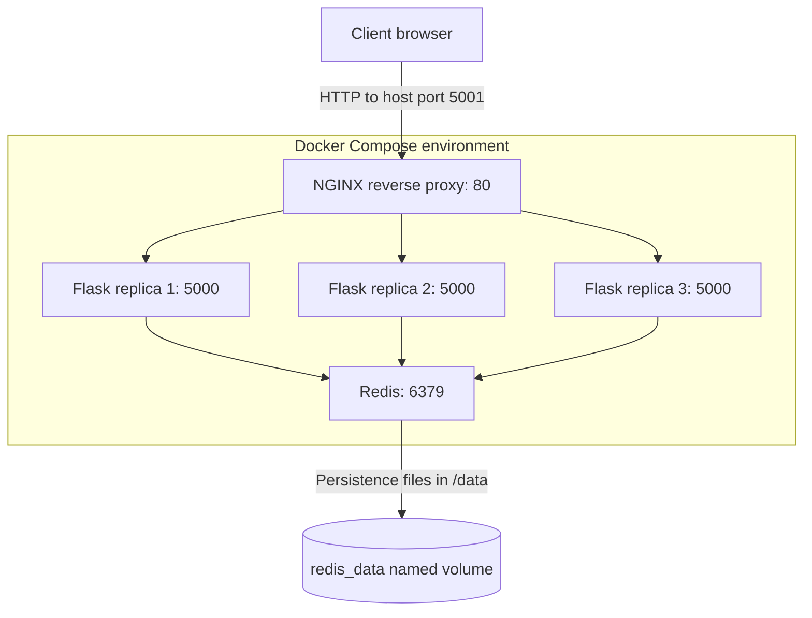

# Docker Visit Counter — Flask, Redis and NGINX

## Project overview

This project began with CoderCo's multi-container Docker assignment: running a Python Flask application and a Redis database in separate containers, then connecting them through Docker Compose. I extended the application to include an NGINX reverse proxy, three Flask replicas, persistent Redis storage and a web interface with a shared counter, changing emoji reactions and an anonymous activity leaderboard.

The aim was to understand how several containers work together as one application. That involved building different images, configuring service-to-service communication, separating internal and published ports, and investigating failures during deployment.

**Technologies:** Docker, Docker Compose, Python, Flask, Redis, NGINX, HTML, CSS and JavaScript.

### Application demo


### Application functionality

The web interface has three pages:

- **Dashboard (`/`):** Displays the shared interaction count. Clicking the counter sends a `POST` request to `/api/click`. Flask updates Redis and returns the new total, a randomly selected reaction, the anonymous browser label and the hostname of the Flask container that handled the request.
- **Statistics (`/stats`):** Displays the distribution of emoji reactions and a leaderboard ranked by recorded clicks. The page retrieves the figures from `GET /api/stats`; the information comes from Redis rather than an independent counter in each container.
- **About (`/about`):** Describes the technologies used and their responsibilities within the application.

I also retained the original `GET /count` endpoint from the assignment. It increments the same shared `visits` value and returns the responding container's hostname, which is useful when checking requests across replicas.

The counter records interactions, **not unique visitors**. The leaderboard uses a randomly generated identifier stored in each browser's local storage. It does not collect real names or establish a verified user identity. Reaction totals are recorded separately from the original `/count` requests, so they may differ from the overall counter.

## Application architecture



The request moves through the following components:

1. **Client and published port:** The browser connects to `http://localhost:5001`. Docker forwards traffic from port `5001` on my Mac to port `80` inside the NGINX container.
2. **NGINX reverse proxy:** NGINX receives the HTTP request and forwards it to a Flask backend. Three containers run the same Flask image; NGINX can distribute requests across their internal addresses.
3. **Flask application:** A replica processes the request. For an interaction that needs stored data, the Python application connects to Redis using its Compose service name and port `6379`.
4. **Redis and storage:** All Flask replicas use the same Redis service, so the count does not start again when another replica responds. Redis has a named volume mounted at `/data` for its persistence files.
5. **Response:** Flask sends the result back through NGINX to the browser. The application can also return the Flask container's hostname to help demonstrate which replica handled a request.

Only NGINX needs a published host port for browser access. Flask and Redis communicate on the internal Compose network. The `nginx.conf` file determines how NGINX forwards requests; it is configuration mounted into the container, **not an additional component in the network request path**.

## Project files

The project is stored in the `docker/` directory of my DevOps learning repository:

```text
docker/
├── README.md
├── assets/
│   └── counter-preview.png
├── applications/
│   ├── app.py
│   ├── requirements.txt
│   ├── templates/
│   │   ├── index.html
│   │   ├── stats.html
│   │   └── about.html
│   └── static/
│       └── style.css
└── containers/
    ├── Dockerfile.flask
    ├── Dockerfile.redis
    ├── docker-compose.yml
    └── nginx.conf
```

- `applications/` contains the Flask application, its Python dependencies, HTML templates and styling.
- `containers/` contains the image definitions, Docker Compose services and NGINX routing configuration.
- `assets/` contains the application image used in this documentation.

## Building and configuring the application

### 1. Creating the Flask and Redis images

I used two Dockerfiles because Flask and Redis have different dependencies.

**[Dockerfile.flask](containers/Dockerfile.flask)**

```dockerfile
FROM python:3.12-slim
WORKDIR ./app
COPY . .
RUN pip install --no-cache-dir -r requirements.txt
EXPOSE 5000
CMD ["python", "app.py"]
```

The `python:3.12-slim` base image provides Python, but does not include Flask or the Python Redis client. Those are declared in [`requirements.txt`](applications/requirements.txt) and installed with `RUN` **during the image build**. `COPY` adds the application files from the build context, while `CMD` specifies the command used to start the Flask application **when the container runs**. `EXPOSE 5000` documents the application's listening port; it does not publish that port on the Mac.

**[Dockerfile.redis](containers/Dockerfile.redis)**

```dockerfile
FROM redis:7-alpine
EXPOSE 6379
```

The official Redis base image already provides the Redis server and its startup behaviour, so there was no additional package installation or startup command to define.

This was one of the main lessons from the assignment: a Dockerfile is determined by the software the application requires and what its selected base image already contains. The Flask image needed additional Python packages, whereas the Redis image did not.

### 2. Configuring Docker Compose

I initially connected Flask directly to the Mac using `5000:5000`, with Redis running as a separate service. The relevant part of that earlier configuration was:

```yaml
services:
  web:
    ports:
      - "5000:5000"
    depends_on:
      - redis_client

  redis_client:
    volumes:
      - redis_data:/data
```

This is a reconstructed excerpt of the original two-service arrangement, rather than an exact historical Git snapshot. It was sufficient for an initial Flask–Redis test, but the fixed host port later became a problem when I scaled Flask.

The current [`docker-compose.yml`](containers/docker-compose.yml) defines the NGINX, Flask and Redis services:

```yaml
services:
  nginx:
    image: nginx:alpine
    ports:
      - "5001:80"
    depends_on:
      - web
    volumes:
      - ./nginx.conf:/etc/nginx/nginx.conf:ro

  web:
    build:
      context: ../applications
      dockerfile: ../containers/Dockerfile.flask
    image: flask:v1
    depends_on:
      - redis_client
    environment:
      REDIS_HOST: redis_client
      REDIS_PORT: "6379"

  redis_client:
    build:
      context: .
      dockerfile: Dockerfile.redis
    image: redis.v1
    volumes:
      - redis_data:/data

volumes:
  redis_data:
```

**Build context and Dockerfile paths.** The Flask build context is `../applications`, which makes the application files available to `COPY`. Its Dockerfile is referenced relative to that context as `../containers/Dockerfile.flask`. Redis uses `.` as its build context because its Dockerfile is in the same directory as the Compose file. Understanding these relative paths was necessary when resolving build errors.

**Service discovery and environment variables.** Compose creates an internal network and provides DNS resolution for service names. The Flask container receives `REDIS_HOST=redis_client` and `REDIS_PORT=6379`, which tell the Python Redis client where to connect. Using `localhost` would point back to the Flask container's own network environment, not the Redis container. The environment variables let me change connection settings without editing the Python source. `depends_on` controls startup order; it does not create the network connection or guarantee that Redis is ready.

**Named volume.** The `redis_data:/data` mapping mounts a Docker-managed volume at Redis's data directory. This separates saved files from the container's writable layer, so a replacement Redis container can reuse data that Redis has written to disk. A normal `docker compose down` preserves named volumes, while `docker compose down -v` removes them. The volume alone is not a guarantee that every recent Redis update has been flushed to disk.

### 3. Introducing NGINX and three Flask replicas

NGINX became the single entry point for the application. Instead of publishing Flask directly to the Mac, Compose publishes `5001:80` for NGINX and leaves the Flask replicas accessible only through the internal Docker network.

I integrated the following [`nginx.conf`](containers/nginx.conf) into the Compose service using a read-only bind mount:

```nginx
events {}

http {
    resolver 127.0.0.11 valid=10s;

    upstream flask_backend {
        zone flask_backend 64k;
        server web:5000 resolve;
    }

    server {
        listen 80;

        location / {
            proxy_pass http://flask_backend;
        }
    }
}
```

In this configuration, `listen 80` identifies the port used by NGINX inside the container. The `upstream` block defines the Flask backend using the Compose service name `web`, and `proxy_pass` sends matching HTTP requests to that backend. The resolver uses Docker's internal DNS at `127.0.0.11`; the `resolve` setting supports changes to the resolved backend addresses.

Starting three `web` replicas creates three Flask containers from the same image. They each listen on port `5000` inside their own network environment, so they do not need three separate published host ports. NGINX can forward requests to these replicas, and they all use the same Redis store. NGINX's default round-robin selection distributes connections across available upstream addresses, but it does not guarantee exactly equal request counts or application health.

### 4. Extending the counter application

I retained the Redis-backed visit counter and added a dashboard interaction that selects a reaction and records activity against an anonymous browser ID.

The [Flask application](applications/app.py) uses several Redis data structures:

| Redis key | Purpose |
| --- | --- |
| `visits` | Shared count updated by both `/count` and dashboard clicks |
| `emoji_counts` | Hash storing the number of times each emoji was selected |
| `guest_scores` | Sorted set used to rank anonymous browser labels by clicks |
| `last_reaction` | Previous emoji, used to avoid an immediate repeat during ordinary sequential requests |

The interaction endpoint updates these values using a Redis transaction and returns the counter value, reaction, guest label and responding container hostname. Keeping this state in Redis allows different Flask replicas to display the same totals.

## Running the project

**Requirements:** Docker Desktop, or Docker Engine with the Docker Compose plugin.

The application source and this documentation are available on the project's feature branch:

```bash
git clone --branch feature/docker-personal-dashboard https://github.com/muhayadindev-dev/DevOps_Learning-.git
cd DevOps_Learning-/docker/containers
docker compose up -d --build --scale web=3
```

This command builds the custom images, starts the services in the background and requests three Flask replicas. Open `http://localhost:5001` in a browser to access the application.

To inspect the containers and test HTTP access:

```bash
docker compose ps
curl -i http://localhost:5001
curl -i http://localhost:5001/count
docker compose logs nginx
```

Stop the application while retaining the Redis named volume:

```bash
docker compose down
```

On macOS, Docker Desktop must be permitted to access the project directory when mounting `nginx.conf` from the host into the NGINX container.

## Testing and verification

The initial Flask–Redis counter and NGINX setup were checked through Docker's container status output, terminal requests and the counter response.

| Verification | Observed result | Significance |
| --- | --- | --- |
| `docker compose ps` | NGINX, Redis and three Flask containers running | The Compose services and requested replica count started |
| `curl -i http://localhost:5001` | HTTP `200 OK` and an application response | NGINX received the request and reached a Flask backend |
| Counter requests | The count increased across successive requests | Flask communicated with the shared Redis service |
| Flask container hostname | Different replica identifiers appeared in responses | Requests were handled by more than one Flask container |
| Redis volume test | Counter continuity after Redis container recreation | Previously written Redis data was recovered using the named volume |

These observations relate to the working counter configuration. They are not a substitute for independently testing every route and interaction added to the personalised dashboard.

## Problems encountered and resolutions

### Docker Engine was not running

Some initial Docker commands failed because the Docker daemon was unavailable. After opening Docker Desktop, the CLI could communicate with the Engine and the builds could proceed. This distinguished a Docker Engine connectivity problem from an error in the Dockerfile.

### Incorrect build paths and Compose fields

I encountered errors when specifying Dockerfile paths and build contexts. I checked where `docker-compose.yml` was located and how each service resolved its `context` and `dockerfile` settings. I also corrected YAML field names, including `environment` instead of `environments` and `image` instead of `images`. These errors showed how much the configuration depends on exact paths, spelling and indentation.

### Port 5000 was occupied on macOS

The initial Compose file published Flask at `5000:5000`. On my Mac, port `5000` was already being used by a macOS service associated with AirTunes/ControlCenter, and accessing that address returned a `403` response unrelated to my Flask application.

I investigated the listener on port `5000` and changed the architecture so NGINX published an available host port, `5001`. I also removed Flask's host-port mapping. This resolved the local port conflict and allowed multiple Flask replicas to use their own internal port `5000` without competing for a single host port.

### NGINX bind-mount and configuration errors

NGINX initially failed because the local configuration filename did not match the file referenced in Compose: `nginx.config` versus `nginx.conf`. A separate `operation not permitted` error involved Docker Desktop's access to the directory used for the bind mount. Checking the file path and host-sharing permissions resolved these problems.

### Incorrect scaling command

An attempt to specify `web=3` without the `--scale` flag caused Compose to treat it as a service name. The correct command was `docker compose up -d --build --scale web=3`. This started the three Flask replicas alongside NGINX and Redis.

## Key learning

The hardest part was understanding which dependencies each application needed before writing its Dockerfile. The Python base image supplied the Python runtime, but Flask and the Redis client still had to be installed. The Redis base image already contained the Redis server. This changed how I approached image construction: first identify the application's requirements, then decide what the Dockerfile needs to add.

The networking and scaling work also connected several concepts I had previously studied separately:

- A **published port** exposes a container service through the host; containers can still communicate over a Docker network without publishing their ports.
- A **Compose service name** is resolvable on the internal network, so Flask can reach `redis_client` without using the Mac's `localhost` address.
- **Environment variables** provide application connection settings; `depends_on` only controls startup ordering.
- **Replicas** run separate containers from the same image, while a **shared Redis service** allows them to work with the same counter.
- A **named volume** preserves stored files across container replacement, subject to the application's persistence behaviour.

## Further improvements

- Replace Flask's development server with a production-suitable WSGI server.
- Add health checks and retry handling for dependencies during startup.
- Introduce integration tests for counter updates, API responses, statistics and Redis reconnection.
- Review Redis persistence settings and recovery behaviour.
- Add automated build and validation checks to the Git workflow.

**Assignment reference:** [CoderCo — Containers Intro Challenge](https://github.com/codercohq/containers-intro/tree/main/challenge)
