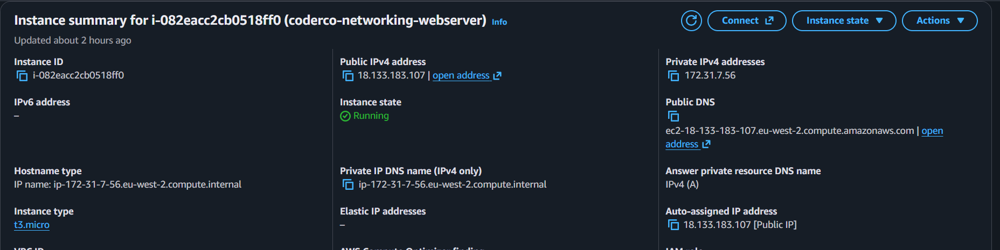
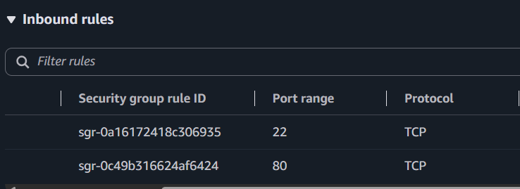
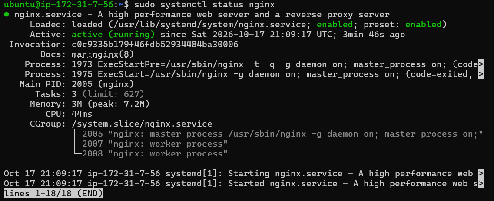
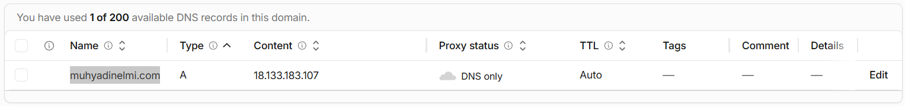
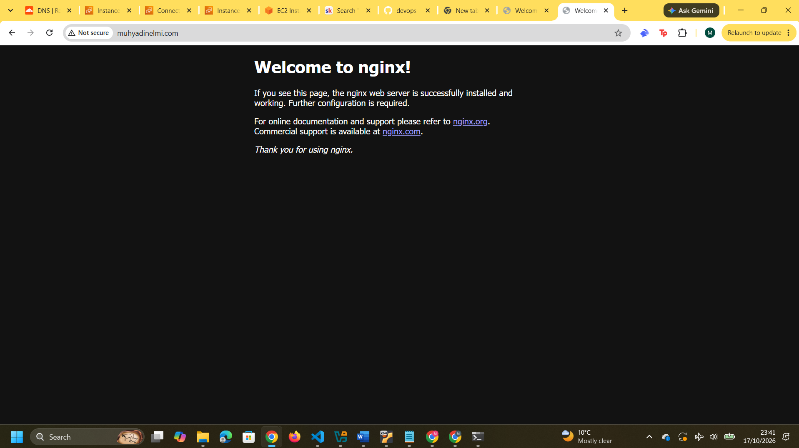

# Networking — AWS EC2, NGINX and DNS Deployment

**Section:** Networking · [Repository Home](../README.md)

A practical networking project that brings together DNS, public/private IP addressing, security groups, SSH, HTTP and NGINX in one AWS deployment.

## 1) Project Overview

For this CoderCo networking project, I deployed NGINX on an Ubuntu EC2 instance, controlled inbound access with an AWS security group, and connected the server to my own domain using Cloudflare DNS.

The goal was to understand the full request path end to end: how a domain resolves to an IP address, how traffic reaches the EC2 instance, how access is filtered, and how NGINX responds to the HTTP request.

**Domain:** `muhyadinelmi.com`  
**AWS region:** London (`eu-west-2`)  
**Server:** Ubuntu on Amazon EC2 (`t3.micro`)  
**Web server:** NGINX  
**DNS provider:** Cloudflare  
**Protocol:** HTTP (TCP port 80)

> **Project status:** The deployment was tested successfully and the evidence is captured below. The EC2 instance was later terminated to avoid unnecessary infrastructure costs, so the domain is no longer expected to serve this project.

## 2) Architecture

The project has two separate stages: DNS resolution first, then the HTTP request to the server.

```text
1. DNS resolution

muhyadinelmi.com
        |
        v
Cloudflare authoritative DNS
(A record, DNS only)
        |
        v
18.133.183.107
EC2 public IPv4 returned to the client


2. HTTP request

Browser
   |
   | HTTP TCP 80
   v
18.133.183.107
EC2 public IPv4
   |
   v
AWS VPC routing
   |
   v
Security Group
HTTP TCP 80 allowed
   |
   v
Ubuntu EC2 instance
Private IPv4: 172.31.7.56
   |
   v
NGINX
   |
   v
Welcome to nginx!
```

The important distinction is that **DNS resolves the domain name to an IP address; it does not deliver the web page**. Once the browser has the IP address, it makes a separate HTTP request to the server.

## 3) Project Structure

```text
networking/
├── README.md
└── screenshots/
    ├── 01-ec2-instance.png
    ├── 02-security-group.png
    ├── 03-nginx-status.png
    ├── 04-cloudflare-dns.png
    └── 05-nginx-domain.png
```

The screenshots capture the EC2 configuration, security group rules, NGINX service status, Cloudflare DNS record and final browser test.

## 4) Implementation

### 4.1) Launching the EC2 Instance

I launched an Ubuntu `t3.micro` instance in the London region using the default VPC and an AWS-selected subnet.

The instance had two IPv4 addresses with different roles:

| Address | Purpose |
|---|---|
| Private IPv4: `172.31.7.56` | Communication inside the VPC |
| Public IPv4: `18.133.183.107` | Internet reachability during the deployment |

The public IPv4 address did not make every service automatically accessible. Traffic still depended on the VPC routing, security group rules and the application listening on the requested port.



I connected to the server over SSH using a private key:

```bash
ssh -i PATH_TO_PRIVATE_KEY.pem ubuntu@18.133.183.107
```

The private key is **not** stored in this repository.

### 4.2) Controlling Network Access

The EC2 security group acted as a stateful virtual firewall for the instance.

I configured these inbound rules:

| Purpose | Protocol | Port | Source |
|---|---|---|---|
| SSH administration | TCP | 22 | My public IP only (`/32`) |
| Public web traffic | TCP | 80 | Anywhere IPv4 (`0.0.0.0/0`) |

SSH was restricted to my public IP because administrative access did not need to be open to the internet.

HTTP was open on port 80 because the web server needed to accept public browser requests.



### 4.3) Installing and Testing NGINX

After connecting to the EC2 instance, I installed NGINX and checked that the service was running:

```bash
sudo apt update
sudo apt install nginx
sudo systemctl status nginx
```

The service returned `active (running)`, confirming that NGINX was running on the instance.



Before touching DNS, I opened the EC2 public IPv4 address directly over HTTP.

The default **Welcome to nginx!** page loaded successfully.

That test mattered because it proved the server, NGINX and inbound HTTP access were working independently of the domain. If the IP worked but the domain did not, DNS became the next place to investigate.

### 4.4) Connecting the Domain with Cloudflare DNS

I configured the root domain `muhyadinelmi.com` with an **A record** pointing to the EC2 public IPv4 address.

| DNS setting | Value |
|---|---|
| Record type | `A` |
| Name | `@` |
| IPv4 address | `18.133.183.107` |
| Proxy status | **DNS only** |
| TTL | Auto |

An A record maps a hostname to an IPv4 address.

I used Cloudflare's **DNS only** mode so the domain resolved directly to the EC2 public IP rather than sending HTTP traffic through Cloudflare's reverse proxy.



## 5) Verification

The final test was opening:

```text
http://muhyadinelmi.com
```

The browser displayed the **Welcome to nginx!** page.

That confirmed the full path was working:

```text
Domain
  -> DNS A record
  -> EC2 public IPv4
  -> VPC routing
  -> Security Group
  -> NGINX
  -> HTTP response
```



This deployment used **HTTP**, not HTTPS. TLS/HTTPS configuration was outside the scope of this project.

## 6) Troubleshooting

### 6.1) SSH Key Permissions

**Problem:** My initial SSH connection failed because the `.pem` private key file permissions were too broad.

**Fix:** I placed a copy in my Windows `.ssh` directory and restricted the local file permissions before reconnecting.

**What it showed me:** Having the correct key is only part of SSH access. The SSH client can also reject a private key if its local permissions are too open.

### 6.2) EC2 Instance Connect vs Direct SSH

**Problem:** AWS EC2 Instance Connect could not connect while port 22 was restricted to my home public IP.

**Fix:** I connected from my own machine using the SSH client, where the source IP matched the security group rule.

**What it showed me:** Security group source rules apply to where the connection actually comes from. A valid key and a running SSH service are not enough if the source IP is not allowed.

### 6.3) APT Package Error

**Problem:** My initial NGINX installation returned a `404 Not Found` package-download error.

**Fix:**

```bash
sudo apt update
sudo apt install nginx
```

Updating the package index before retrying resolved the issue.

**What it showed me:** The problem was package metadata, not the EC2 networking or security group configuration.

### 6.4) Cloudflare DNS Configuration

**Problem:** I initially entered the wrong DNS name/value and briefly used Cloudflare's **Proxied** mode.

**Fix:** I corrected the root record to `@`, verified the complete EC2 public IPv4 address and switched the record to **DNS only**.

Because NGINX already worked through the public IP, I knew the server side was healthy. That let me isolate the remaining issue to DNS instead of changing unrelated parts of the setup.

## 7) Key Learnings

- **DNS and HTTP are separate stages.** DNS resolves the name; HTTP carries the web request and response.
- **Public and private IPs have different jobs.** The private address belongs to the instance inside the VPC, while the public address provided internet reachability during this deployment.
- **A public IP is not the same as open access.** Routing, security group rules and the listening application all affect whether traffic can reach a service.
- **Security groups are stateful.** I could control inbound access by protocol, port and source while return traffic for an allowed connection was handled automatically.
- **Testing in layers makes troubleshooting easier.** Confirming NGINX through the public IP before configuring DNS gave me a clear boundary between server problems and DNS problems.
- **NGINX runs independently of the SSH session.** Closing my terminal did not stop the web server.
- **Auto-assigned EC2 public IPv4 addresses are not permanent.** A stop/start can change the address, which would require the DNS A record to be updated.

## 8) Infrastructure Cleanup

After capturing the working deployment and screenshots, I terminated the EC2 instance because I did not need to keep the practice infrastructure running.

The Cloudflare domain remains registered separately from the instance. Any DNS record still pointing to the released EC2 public IP should be removed, and leftover billable AWS resources should be checked after cleanup.

---

## Result

The deployment successfully served NGINX through my own domain and gave me a practical end-to-end example of how DNS, IP addressing, ports, security groups, Linux and HTTP work together in a real network path.
